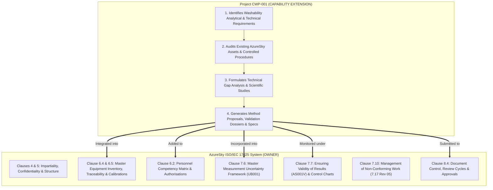

# CWP-001: ARCHITECTURE RECONCILIATION & FREEZE PROTOCOL
## Formal System Governance, QMS Ownership Boundaries & Directory Consolidation

```
Document ID:     CWP-001-GOV-001
Project ID:      CWP-001
Project Name:    Coal Washability Testing & Characterisation Laboratory Capability
Parent QMS:      AzureSky (Pty) Ltd — ISO/IEC 17025:2017 Accredited Quality Management System
Authoritative:   Z:\AZURESKY SYSTEM\AZURESKY QMS\17025
Workspace:       C:\Projects\AzureSky\CWP-001
Effective Date:  October 2026
Status:          FROZEN & AUTHORITATIVE
```

---

## 1. Executive Declaration of Architecture Freeze

This document formalizes the **Architecture Reconciliation and Freeze** for Project **CWP-001**. 

Following a comprehensive archaeological audit of AzureSky's live operating system at `Z:\AZURESKY SYSTEM\AZURESKY QMS\17025`, all duplicate, competing, and unverified repository folders have been eliminated. The project architecture is locked under a single, non-negotiable principle:

> **CWP-001 is an analytical capability extension project engineered to plug into AzureSky's existing ISO/IEC 17025:2017 accredited quality system. CWP-001 does NOT invent a parallel laboratory management system.**

All development, technical drafting, equipment evaluation, and procedural amendments must strictly adhere to the boundaries, document lifecycles, and source hierarchies established in this protocol.

---

## 2. Fundamental Governance: Existing QMS Ownership Boundaries

AzureSky (Pty) Ltd already holds formal SANAS accreditation for **Sample Preparation of Hard Coal**, **Proximate Analysis (Ash, Moisture, Volatile Matter)**, and **Gross Calorific Value (CV)**. The existing QMS owns laboratory governance, resource management, and process control.

CWP-001 operates strictly within the following functional boundaries:



### Specific Operational Ownership Rules:
1. **Equipment Management**: CWP-001 will **never** create a shadow equipment register or independent maintenance log. CWP-001 identifies apparatus requirements, checks [`6.3 EQUIPMENT REGISTER.xlsx`](file:///Z:/AZURESKY%20SYSTEM/AZURESKY%20QMS/17025/CLAUSE%206/EQUIPMENT/6.3%20EQUIPMENT%20REGISTER.xlsx), defines the engineering gap, and submits the technical specification for ingestion into AzureSky's Clause 6.4 equipment system.
2. **Personnel Competency**: CWP-001 defines the competency criteria for float-and-sink operators (AZCA-007) and submits the training/assessment record for authorisation inside [`COMPETENCY MATRIX 01.xlsx`](file:///Z:/AZURESKY%20SYSTEM/AZURESKY%20QMS/17025/CLAUSE%206/PERSONNEL%20COMPETENCY/6.2%20COMPETENCY%20MATRIX/COMPETENCY%20MATRIX%2001.xlsx).
3. **Measurement Uncertainty**: CWP-001 establishes the mathematical measurement model for washability measurands (Yield %, Cut-point $\text{d}_{50}$, Cumulative Ash %) and integrates them directly into [`UB001 UNCERTAINTY BUDGET rev 01.docx`](file:///Z:/AZURESKY%20SYSTEM/AZURESKY%20QMS/17025/CLAUSE%207/7.6.%20MEASUREMENT%20UNCERTAINTY/UB001%20UNCERTAINTY%20BUDGET%20rev%2001.docx).
4. **Quality Control & Validity**: CWP-001 defines mass recovery gates and duplicate criteria, which integrate into [`AS001V ENSURING VALIDITY OF RESULTS PROCEDURE.docx`](file:///Z:/AZURESKY%20SYSTEM/AZURESKY%20QMS/17025/CLAUSE%207/7.7%20ENSURING%20VALIDATION%20OF%20RESULTS/AS001V%20ENSURING%20VALIDITY%20OF%20RESULTS%20PROCEDURE.docx).

---

## 3. Four-Tier Document Classification System

Every document generated or handled within CWP-001 must be formally classified into one of four distinct categories:

| Document Type | Description | Handling Rule | Example |
| :---: | :--- | :--- | :--- |
| **Type A** | **Existing AzureSky Controlled Document** | **Use as authoritative.** Do not recreate, duplicate, or alter outside official QMS change control. | [AS001IW Rev 05](file:///Z:/AZURESKY%20SYSTEM/AZURESKY%20QMS/17025/CLAUSE%207/7.2.%20SELECTION,%20VERIFICATION%20AND%20VALIDATION%20OF%20METHODS/7.2.1.%20SELECTION%20AND%20VERIFICATION%20OF%20METHODS/PROCEDURES/AS001IW%20PROCEDURE%20ON%20SAMPLE%20PREPARATION%20OF%20HARD%20COAL%20Rev%2005.docx)<br/>[AS003IW Rev 01 (Ash)](file:///Z:/AZURESKY%20SYSTEM/AZURESKY%20QMS/17025/CLAUSE%207/7.2.%20SELECTION,%20VERIFICATION%20AND%20VALIDATION%20OF%20METHODS/7.2.1.%20SELECTION%20AND%20VERIFICATION%20OF%20METHODS/PROCEDURES/AS003IW%20PROCEDURE%20ON%20THE%20DETERMINATION%20OF%20ASH%20CONTENT%20rev%2001.docx) |
| **Type B** | **Existing Document Requiring Modification** | Identify exact controlled document, clause, and **propose specific amendment**. Do not build parallel SOPs. | Proposed washability branch in `AS001IW`<br/>Amendment to `AS014IW` mass loss rule |
| **Type C** | **New Washability-Specific Procedure** | Develop proposal for a new controlled procedure and **specify exact destination in AzureSky QMS**. | Proposed upgraded `AS013IW Rev 02`<br/>New `AS030TF Float & Sink Benchsheet` |
| **Type D** | **Project Study & Engineering Evidence** | Research, scientific trade-off, or verification study supporting decisions. **Remains in CWP-001 workspace**. | [`CWP-001-DM-001 Density Medium Study`](file:///c:/Projects/AzureSky/CWP-001/07_DENSITY_MEDIA/)<br/>[`CWP-001-AUDIT-001 Verification Matrix`](file:///c:/Projects/AzureSky/CWP-001/03_GAP_ANALYSIS/CWP-001_STANDARDS_VERIFICATION_MATRIX.md) |

---

## 4. Mandatory Document Lifecycle & Control Gate

```
┌─────────────┐     ┌───────────┐     ┌───────────┐     ┌──────────────────┐
│  DISCOVERY  │ ──► │   STUDY   │ ──► │   DRAFT   │ ──► │ TECHNICAL REVIEW │
└─────────────┘     └───────────┘     └───────────┘     └──────────────────┘
                                                                  │
                                                                  ▼
┌───────────────────────┐     ┌────────────┐     ┌──────────────────┐
│  CONTROLLED DOCUMENT  │ ◄── │  APPROVED  │ ◄── │    QMS REVIEW    │
└───────────────────────┘     └────────────┘     └──────────────────┘
```

> [!CRITICAL]
> **A CWP-001 project artifact does NOT become an AzureSky controlled laboratory procedure merely because it was authored.** It only becomes controlled when formally reviewed by the Technical Signatory (T. Maponya), approved by the Laboratory Manager (S. Nyambi), and issued under AzureSky Document Control ([`8.4 DOCUMENT CONTROL Rev 01`](file:///Z:/AZURESKY%20SYSTEM/AZURESKY%20QMS/17025/CLAUSE%208/8.4%20DOCUMENT%20CONTROL%20Rev%2001.docx)).

---

## 5. Strict Source & Decision Hierarchy

Every technical decision, calculation method, equipment tolerance, or operational gate must be justified in strict descending order of precedence:

1. **Current AzureSky Controlled QMS Document** (`Z:\AZURESKY SYSTEM\AZURESKY QMS\17025`)
2. **Current AzureSky Actual Practice & Historical Verification Records**
3. **Applicable Current International & National Standards** (ISO 7936:2022, ISO 1953:2025, ISO 13909:2025, ISO 18283:2022)
4. **SANAS Accreditation Requirements** (SANAS R 47, TR 01, TR 26, TG 01, F49)
5. **South African Statutory & Labour Regulations** (OHSA Act 85, HCA Regs 2021, NEMWA Act 59, MHSA Act 29)
6. **Validated Scientific & Mineral Processing Evidence** (Peer-reviewed literature, SACPS benchmarks)
7. **Proposed Engineering Optimization**

*Under no circumstances may an ungrounded assumption or tool hallucination override any level of this hierarchy.*

---

## 6. Role of Archaeology: Read-Only Evidence

The folder [`00_EXISTING_SYSTEM_ARCHEOLOGY/`](file:///c:/Projects/AzureSky/CWP-001/00_EXISTING_SYSTEM_ARCHEOLOGY/) is formally designated as:
* **A READ-ONLY REPOSITORY OF FORENSIC STUDY TEXTS** extracted from `Z:\` during the October 2026 baseline audit.
* It serves as an analytical reference for audits, gap analyses, and textual comparisons.
* **It is NOT the authoritative source of live procedures.** The sole authoritative home of controlled documents remains `Z:\AZURESKY SYSTEM\AZURESKY QMS\17025`.

---

## 7. Consolidated Directory Mapping to AzureSky QMS Clauses

The CWP-001 repository is now consolidated into 22 dedicated modules. Each module maps directly to an AzureSky QMS clause:

| CWP-001 Folder | Functional Scope | Primary AzureSky QMS Link (`Z:\`) | Primary Activity & Deliverables |
| :--- | :--- | :--- | :--- |
| **`00_ARCHIVE_HISTORICAL/`** | Repository Archive | None (Project internal) | Superseded project notes and archived structures. |
| **`00_EXISTING_SYSTEM_ARCHEOLOGY/`** | Forensic Extraction | Read-only mirror of `Z:\` SOPs | Forensic text files for audit and comparison. |
| **`00_GOVERNANCE/`** | Project Management | Clauses 4 & 5 (`CLAUSE 4/`, `CLAUSE 5/`) | Project charters, authorization matrices, freeze protocol. |
| **`01_EXISTING_AZURESKY_SYSTEM/`** | Current-State Mapping | All Clauses 4 through 8 | Master archaeological map, evidence register, organogram link. |
| **`02_STANDARDS/`** | Normative Baseline | Clause 7.2.1 (`ISO STANDARDS/`) | Authoritative Standards Register (ISO, SANS, ASTM, OIML). |
| **`03_GAP_ANALYSIS/`** | Audit & Verification | Clause 7.2.1 & 7.2.2 | Line-by-line standards verification matrix, method gap analysis. |
| **`04_METHOD_ARCHITECTURE/`** | Analytical Flowsheets | Clause 7.2.1 (`AS013IW`, `AS014IW`) | Overall size fractions, density cuts, flowsheet logic. |
| **`05_SAMPLE_AND_PREPARATION/`** | Lump Integrity & Sizing | Clause 7.2.1 (`AS001IW Rev 05`, `AS008IW`) | Proposed washability sub-stream preserving lump coal. |
| **`06_PARTICLE_SIZE/`** | Test Sieve Metrology | Clause 7.2.1 (`AS014IW`, `PSD014.xlsx`) | ISO 1953:2025 screening protocol, sieve verification rules. |
| **`07_DENSITY_MEDIA/`** | Chemical Solutions | Clause 7.2.1 (`AS013IW`, `ASMF 02`) | Selection study (`CWP-001-DM-001`), temp correction tables. |
| **`08_FLOAT_AND_SINK/`** | Bath Separation | Clause 7.2.1 (`AS013IW`, `WASHABILITY SOP`) | Coarse bath design, perforated baskets, handling protocols. |
| **`09_FRACTION_RECOVERY/`** | Washing & Drying | Clause 7.2.1 (`AS013IW`, `AS004IW`) | Conductivity wash verification, standardized thermal drying. |
| **`10_FRACTION_ANALYSIS/`** | Analytical Routing | Clause 7.2.1 (`AS003IW`, `AS004IW`, `AS007IW`) | Reusing accredited Ash, IM, VM, and CV analytical lines. |
| **`11_CALCULATIONS/`** | Data Reduction | Clause 7.11 (`AS002LV`) & Clause 7.8 | Yield, Ash balance, M-curves, spline fitting, NGM index. |
| **`12_QA_QC/`** | Validity Control | Clause 7.7 (`AS001V`, `7.7.ASMF Rules.xlsx`) | Washability QC gates, recovery thresholds, blind duplicates. |
| **`13_METHOD_VALIDATION/`** | Accreditation Evidence | Clause 7.2.2 (`7.2.2 METHOD VALIDATION/`) | Formal SANAS TR-26 Method Validation dossier for F&S. |
| **`14_MEASUREMENT_UNCERTAINTY/`** | Uncertainty Budgets | Clause 7.6 (`UB001 rev 01.docx`) | Washability measurement uncertainty budget (`UB001-FS-01`). |
| **`15_EQUIPMENT_AND_METROLOGY/`** | Equipment Gaps & Specs | Clause 6.4 & 6.5 (`6.3 ER.xlsx`, `6.5 Memo`) | Disciplined Equipment Gap Register and technical specs. |
| **`16_COMPETENCY/`** | Personnel Qualification | Clause 6.2 (`COMPETENCY MATRIX 01.xlsx`) | Technical assessment module (`AZCA-007`) for F&S operators. |
| **`17_SOPS_AND_FORMS/`** | Controlled QMS Output | Clause 7.2.1 & Clause 7.5 (Technical Forms) | Proposed `AS013IW Rev 02` and new controlled benchsheets. |
| **`18_LIMS_AND_DATA_INTEGRITY/`** | Electronic Records | Clause 7.11 (`ASMF 7.11`, `AS002LV.xlsx`) | Validated calculation spreadsheets, access controls, audit trail. |
| **`19_REPORTING/`** | Test Reports & Certificates | Clause 7.8 (`7.8 REPORTING OF RESULTS.docx`) | ISO/IEC 17025 client report template and conformity rules. |
| **`20_ACCREDITATION_READINESS/`** | SANAS Submission | Clause 5 & 8 (Management Review) | Scope extension application dossier, audit checklists. |
| **`21_PROCUREMENT/`** | Capital Acquisition | Clause 6.6 (`6.6.3 Approved Suppliers`) | Phased Capex Bill of Quantities (Level 1 to 4). |

---

## 8. Directory Audit & Consolidation Summary

### Redundant Directories Safely Removed
The following 16 empty or duplicate folders were audited, verified free of unmigrated data, and removed:
* `01_STANDARDS` *(Content consolidated into `02_STANDARDS/`)*
* `03_WASHABILITY_GAP_ANALYSIS` *(Content consolidated into `03_GAP_ANALYSIS/`)*
* `02_RISK_AND_SAFETY`, `03_FACILITY_DESIGN`, `04_SAMPLING`, `05_SAMPLE_PREPARATION`, `06_SIZE_ANALYSIS`, `09_DRYING_AND_WEIGHING`, `10_COAL_QUALITY`, `13_CALIBRATION`, `14_SOPS`, `15_FORMS_AND_RECORDS`, `16_EQUIPMENT`, `17_PPE`, `18_PROCUREMENT`, `20_ISO_17025_READINESS` *(All empty legacy duplicates)*

### Authoritative Master Artifacts at Root
The root of `C:\Projects\AzureSky\CWP-001` now contains only the verified master artifacts:
1. [`README.md`](file:///c:/Projects/AzureSky/CWP-001/README.md) — Master repository overview and navigation
2. [`AZURESKY_WASHABILITY_CURRENT_STATE_MAP.md`](file:///c:/Projects/AzureSky/CWP-001/AZURESKY_WASHABILITY_CURRENT_STATE_MAP.md) — Baseline archaeological audit
3. [`CWP-001_STANDARDS_REGISTER.md`](file:///c:/Projects/AzureSky/CWP-001/CWP-001_STANDARDS_REGISTER.md) — Master normative standards register
4. [`CWP-001_STANDARDS_VERIFICATION_MATRIX.md`](file:///c:/Projects/AzureSky/CWP-001/CWP-001_STANDARDS_VERIFICATION_MATRIX.md) — Line-by-line verification matrix
5. [`CWP-001_DOCUMENT_LINK_AND_EVIDENCE_REGISTER.md`](file:///c:/Projects/AzureSky/CWP-001/CWP-001_DOCUMENT_LINK_AND_EVIDENCE_REGISTER.md) — Exact document path and status register
6. [`CWP-001_ARCHITECTURE_FREEZE.md`](file:///c:/Projects/AzureSky/CWP-001/CWP-001_ARCHITECTURE_FREEZE.md) — This formal freeze protocol

---

## 9. Architecture Freeze Protocol Sign-off

With this protocol enacted:
* The directory structure is **frozen**.
* The QMS ownership boundaries are **locked**.
* The 4 document types and 7-tier source hierarchy are **binding**.
* No new procedures, procurement specifications, or equipment orders shall be initiated until the user reviews and confirms this freeze.

---
*End of Document CWP-001-GOV-001 — Architecture Reconciliation & Freeze Protocol.*
