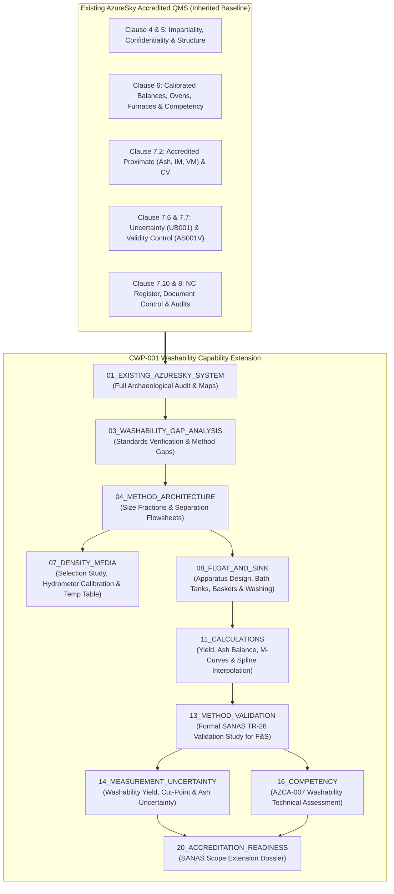

# AZURESKY WASHABILITY CURRENT-STATE LABORATORY MAP
## Archaeological Baseline & ISO/IEC 17025 System Integration for Project CWP-001

```
Document ID:     CWP-001-ARCH-001
Project:         Coal Washability Testing Laboratory — Integration & Extension Project (CWP-001)
Source System:   AzureSky QMS (Z:\AZURESKY SYSTEM\AZURESKY QMS\17025 & PROCEDURES)
Current Status:  SANAS Accredited for Proximate Analysis, Calorific Value & Sample Preparation
Baseline Date:   October 2026
Author:          Engineering & Metrology Pair-Programming Team
Classification:  Controlled Laboratory Technical Investigation & Audit Baseline
```

---

## 1. Executive Summary & Paradigm Shift

The original concept for **CWP-001** envisioned designing a coal washability testing facility from scratch. An in-depth archaeological investigation of the live filesystem at `Z:\AZURESKY SYSTEM\AZURESKY QMS` reveals that **AzureSky (Pty) Ltd** already operates a mature, structured, and active **ISO/IEC 17025:2017 management system**.

Crucially:
1. **Accredited Analytical Engine**: AzureSky holds active technical accreditation (traceable through SANAS to NMISA) for **Sample Preparation of Hard Coal**, **Proximate Analysis (Moisture, Ash, Volatiles)**, and **Gross Calorific Value (CV)**.
2. **Pre-Existing Washability Foundations**: An internal Float-and-Sink operating procedure (`AS013IW` / `WASHABILITY STANDARD OPERATING PROCEDURE.docx`) and validation record form (`ASMF 02- FLOAT AND SINK VALIDATION FORM.docx`) already exist in the QMS.
3. **Core Laboratory Assets in Place**: Calibrated precision balances, platform scales, muffle furnaces, drying ovens, sample splitters, heavy-duty jaw crushers (25 mm and 10 mm), pulverisers, sieve verification systems (`PSD014`), and LIMS integration are already operational.
4. **Accreditation Scope Boundary**: While Proximate, CV, and Sample Prep are validated under Clause 7.2.2 and accredited, **Float & Sink (Washability) and Particle Size Distribution (PSD) are currently outside the accredited scope**.

Therefore, the mission of **CWP-001** is **not to invent a greenfield laboratory**, but to **engineer a technically rigorous, standards-aligned extension of AzureSky's existing accredited facility**. We inherit what is controlled, identify the technical and normative gaps, and build the washability capability to meet SANAS accreditation standards.

---

## 2. Archaeological Architecture of the AzureSky QMS

The physical and technical layout of AzureSky's QMS directly mirrors the clauses of **ISO/IEC 17025:2017**:

```
Z:\AZURESKY SYSTEM\AZURESKY QMS\17025/
├── CLAUSE 4: GENERAL REQUIREMENTS
│   ├── 4.2 IMPARTIALITY (Policy Rev 02, Risk Assessment ASRI 4.2-001 Rev 02, DOI declarations)
│   └── CONFIDENTIALITY (Non-disclosure agreements, Quality Policy Statement 8.2)
├── CLAUSE 5: STRUCTURAL REQUIREMENTS
│   ├── Organogram Rev 02 (Director, Operations Mgr, Lab Mgr S. Nyambi, Lab Supervisor T. Maponya)
│   └── ASMF 5.3 Statement of Conformity (Defining Scope of Work Rev 02)
├── CLAUSE 6: RESOURCE REQUIREMENTS
│   ├── EQUIPMENT
│   │   ├── 6.3 EQUIPMENT REGISTER.xlsx (Active instrument inventory AS025PA to AS8809)
│   │   ├── 6.4 EQUIPMENT Rev 02 & 6.5 METROLOGICAL TRACEABILITY MEMORANDUM
│   │   └── CALIBRATION CERTIFICATES (SANAS certificates from Micron Lab & Montech)
│   ├── FACILITY (7.2.3 Environmental Control for RMP Laboratory)
│   └── PERSONNEL COMPETENCY (COMPETENCY MATRIX 01.xlsx, assessments, technical signatory files)
├── CLAUSE 7: PROCESS REQUIREMENTS
│   ├── 7.1 TENDERS AND CONTRACTS (Contract review checklists)
│   ├── 7.2 SELECTION, VERIFICATION AND VALIDATION OF METHODS
│   │   ├── 7.2.1 PROCEDURES (AS001IW Rev 05, AS003IW, AS004IW, AS006IW, AS007IW, AS008IW, AS013IW, AS014IW)
│   │   └── 7.2.2 METHOD VALIDATION (Ash AS003MV, Moisture AS004MV, CV AS002MV, Volatiles AS001MV)
│   ├── 7.3 SAMPLING (SAMPLING PLAN.docx, AS008IW Sampling Procedure)
│   ├── 7.4 HANDLING OF TEST ITEMS (7.4 BALANCE PROTOCOLS.docx)
│   ├── 7.5 TECHNICAL RECORDS (AS002TF to AS028TF: Crusher efficiency, balance check, furnace logs)
│   ├── 7.6 MEASUREMENT UNCERTAINTY (UB001 Uncertainty Budget Rev 01, SANAS F49 decision rules)
│   ├── 7.7 ENSURING VALIDITY OF RESULTS (AS001V, Control chart rules, PT Plan 2025–2029)
│   ├── 7.8 REPORTING (7.8 REPORTING OF RESULTS.docx)
│   ├── 7.10 NON-CONFORMING WORK (7.17 Rev 05, 7.10 NC REGISTER.xlsx, NC01–NC07, AB01–AB23)
│   └── 7.11 MANAGEMENT OF RECORDS & LIMS (AS002LV LIMS Validation, ASMF 7.11 Data Integrity)
└── CLAUSE 8: MANAGEMENT SYSTEM REQUIREMENTS
    ├── 8.4 Document Control Rev 01, 8.5 Risks & Opportunities Register
    ├── 8.6 Management Review Procedure Rev 03 & Minutes (May 2026)
    └── 8.7 Internal Audits Procedure Rev 03 & Audit Plan 2026–2027
```

---

## 3. AzureSky Washability Master Current-State & Gap Matrix

| Domain | Existing AzureSky System Element | Primary Controlled Evidence | Standard Cited in QMS | Current Control & Performance Level | Washability Gap / Missing Link | Required Action for Project CWP-001 |
| :--- | :--- | :--- | :--- | :--- | :--- | :--- |
| **Primary Test Method** | Float and Sink Washability | `AS013IW` / `WASHABILITY SOP.docx` / `ASMF 02` | ISO 7936:2022 | Semi-controlled; prescribes 6 kg charges, -25 mm +0.5 mm, ZnCl₂ (RD 1.30–1.90), drift $\le 0.002\text{ g/cm}^3$, mass balance $\le 2\%$. | Test is unvalidated under Clause 7.2.2; drying specifies "until visibly dry"; no multi-size fractions; manual bucket/scoop limits throughput; not SANAS accredited. | Validate method per 7.2.2; standardize thermal drying; optimize tanks/baskets; develop full multi-size fraction scheme; prepare for SANAS extension. |
| **Sampling** | Sampling Procedure for Coal | `AS008IW` / `SAMPLING PLAN.docx` | ISO 18283:2006 | Manual sampling for CRM/PT bulk lots; 35 increments for $> 100\text{ t}$; increment mass $\ge 3\times$ NTS; scoop/shovel. | Standard is outdated (ISO 18283:2006 vs 2022); focused on CRM production, not customer washability lots; mechanical sampling (ISO 13909:2025) absent. | Update standard citations to ISO 18283:2022 and ISO 13909:2025; define washability-specific increment mass protocol based on coal top size. |
| **Sample Preparation** | Sample Prep of Hard Coal | `AS001IW Rev 05` (dated 21/09/2026) | ISO 13909-4:2025 | Crusher efficiencies weekly ($\ge 90\%$, dust $< 10\%$); stage crushing 25 mm $\to$ 10 mm $\to$ 3 mm; 210 L mixing drum; pulverising to $-212\text{ }\mu\text{m}$. | Tailored to bulk homogenisation for CRMs/PT; washability requires coarse fractions preserved *without* premature crushing. | Create a Washability Sub-Preparation Stream ensuring $+50\text{ mm}$, $25\text{ mm}$, $13.2\text{ mm}$ fractions are separated *before* destructive comminution. |
| **Particle Size Analysis (PSD)** | Determination of Particle Size Distribution | `AS014IW` / `PSD 01` / `PSD014 Sieve Verification.xlsx` | ISO 1953 (undated) | Scalping at 22.4 mm; manual 2-person rocking agitation (8 cycles); fines sieving (2 min); sieve verification every 6 mos per ISO 3310-1/2. | Manual sieving causes operator fatigue and variability; mass loss rule artificially forces all lost mass into receiver fines; ISO 1953:2025 wet sieving absent. | Upgrade to certified sieve shaker; align mass balance with ISO 1953:2025; introduce wet-sieving protocol for sticky/clayey coals. |
| **Density Media** | Zinc Chloride Preparation & Verification | `AS013IW` (Sec 8.3.1) / `ASMF 02- Form` | ISO 7936:2022 | $\text{ZnCl}_2$ aqueous solution adjusted with water; checked with hydrometer; tolerance $\pm 0.002\text{ g/cm}^3$; temperature recorded. | Density medium selection study (`CWP-001-DM-001`) missing; no certified hydrometer rack inventory in `6.3 ER`; temperature compensation unformalized. | Formalize hydrometer metrology set; implement temperature-density correction equations; conduct formal Hazchem risk assessment on $\text{ZnCl}_2$. |
| **Drying & Moisture** | Inherent Moisture / Total Moisture / Oven Drying | `AS004IW Rev 02` / `AS015IW` / `AS010TF` / `AS023TF` | SANS 5925 / ISO 589:2008 | IM oven 105–110°C (Darvan Brenco 50L); Prep drying ovens (Mokopoledi); thermal validation completed (`AS004MV`, `AS005MV`). | In `AS013IW`, washability floats are "air-dried until visibly dry" on trays—causes variable residual moisture skewing fraction weights. | Replace subjective air drying with controlled thermal equilibration oven ($< 40^\circ\text{C}$ or $105^\circ\text{C}$) to establish standard dry mass. |
| **Weighing & Mass Metrology** | Balances & Mass Calibration | `6.3 ER` / `6.5 Memo` / `AS019.1TF` / `AS019.2TF` / `AS019.3TF` | ISO/IEC 17025 / SANAS TR 01 | BEL M124Ai (0.1 mg), Adam CKT8H (0.1 g), Darvan Brenco 150 kg; Class E2 & F1 weights; Micron Lab SANAS certificates. | Mass balance threshold in `AS013IW` is set at $\le 2\%$, which is coarse; weighing vessels for wet/draining coal fractions unstandardized. | Formalize washability mass balance calculation protocol; define tared stainless drying pans; integrate scale data into LIMS. |
| **Ash Analysis** | Determination of Ash Content | `AS003IW Rev 01` / `AS022TF` / `AS024TF` / `AS003MV` | ISO 1171:2024 / SANS 131 | ISO ramping (ambient to 500°C, then 815°C); porcelain crucibles; ATS muffle furnace; validated (`AS003MV`); spacebar LIMS entry. | Capacity bottleneck: washability yields 10–14 density fractions per size fraction. Ash furnace loading and turnaround must scale up. | Fully reuse accredited `AS003IW` method; establish high-throughput crucible racking; validate batch processing for multi-fraction ash. |
| **Volatile Matter & CV** | Volatile Matter & Calorific Value | `AS006IW Rev 02` / `AS007IW` / `AS001MV` / `AS002MV` | ISO 562:2010 / ISO 1928:2020 | Volatile furnace at 900°C (7 min); Drycal bomb calorimeter with benzoic acid CRM; fully accredited and validated. | Not all clients require VM/CV on every density fraction, but composites (e.g. cumulative float product) require them. | Establish protocol for recombining or selecting density fractions for composite proximate and energy analysis. |
| **Quality Control & Validity** | Validity of Results & Quality Rules | `AS001V` / `7.7.ASMF Rules.xlsx` / `PT Plan 2025–2029` | ISO/IEC 17025 (Cl 7.7) / ILAC G8 | Duplicates on every run; CRM every 10 runs; Shewhart control charts; PT participation (SABS/interlab); repeatability gates. | Washability has no internal blind duplicate rules, no float-and-sink reference sample, and no interlaboratory round-robin scheme. | Extend `AS001V` to incorporate Float & Sink QC gates: mass recovery validation, density check logs, and duplicate washability splits. |
| **Measurement Uncertainty** | Master Uncertainty Budget | `UB001 Uncertainty Budget Rev 01` | ISO/IEC 17025 (Cl 7.6) / SANAS F49 | Complete budgets for Ash ($U$), Moisture ($U$), Volatiles ($U$), CV ($U$); coverage factor $k=2$; Type A & B evaluations. | No uncertainty budget exists for Float-and-Sink measurands: Yield %, Cut-Point Density ($\text{d}_{50}$), or Cumulative Ash %. | Develop washability measurement uncertainty budget covering balance uncertainty, hydrometer resolution, and yield curve interpolation. |
| **Method Validation** | Validation of Methods | `7.2.2 METHOD VALIDATION` / `AS001MMV` | ISO/IEC 17025 (Cl 7.2.2) / SANAS TR-26 | Validation reports exist for Ash, Moisture, CV, VM, TM, Prep; signed fitness-for-use statements; statistical datasets. | **CRITICAL GAP**: No validation file exists in 7.2.2 for Float & Sink! Only `ASMF 02` exists under 7.2.1. | Execute formal method validation study for Float-and-Sink per SANAS TR-26; generate repeatability, recovery, and robustness data. |
| **Personnel Competency** | Personnel Training & Authorisation | `COMPETENCY MATRIX 01.xlsx` / `6.2 Assessments` | ISO/IEC 17025 (Cl 6.2) | Structured assessments (AZCA-001 to 006); technical signatory competency files for S. Nyambi & T. Maponya. | Competency matrix tracks Prep, Moisture, Ash, VM, CV, QC, NCs, but **Float & Sink is not listed as a competency line item**. | Develop AZCA-007 Assessment for Float & Sink Washability; update Competency Matrix to declare authorized F&S operators. |
| **Data Integrity & LIMS** | LIMS Validation & Data Governance | `AS002LV- LIMS VALIDATION.xlsx` / `ASMF 7.11` | ISO/IEC 17025 (Cl 7.11) | Spacebar auto-transfer from balances; LIMS functionality validated; Data Integrity Risk Management Procedure active. | Washability yield-ash calculations, cumulative curves, and M-curve plotting are currently performed manually or outside LIMS. | Validate a dedicated Washability Calculation Spreadsheet or LIMS module; secure cell formulas under `ASMF 7.11`. |
| **Reporting & Conformity** | Reporting & Statements of Conformity | `7.8 REPORTING OF RESULTS.docx` / `AS010IW` | ISO/IEC 17025 (Cl 7.8) / ILAC-G8:09/2019 | Guard-band decision rules ($x \pm U$); default to reporting measured values only unless client requests conformity statement. | Washability requires engineering presentation: primary float/sink tables, cumulative curves, NGM ($\pm 0.1$) separation difficulty. | Design ISO/IEC 17025-compliant Washability Test Report template incorporating required curves, cut-point yields, and disclaimers. |
| **Waste & Environment** | Waste Management Procedure | `AS009IW` | OHSA Act 85 / NEMWA Act 59 | Labelled drums: Drum 1 (Coal Residues), Drum 2 (Plastics), Drum 3 (Cardboard); licensed waste recycling. | `AS009IW` covers solid coal and packaging, but **completely omits liquid chemical waste ($\text{ZnCl}_2$ effluent and rinse water)**! | Author Hazchem & Effluent Management Procedure; design closed-circuit rinse water settling, filtration, and recycling system. |

---

## 4. Deep Technical Audit of the Existing Methods (The 13-Point Forensic Model)

### 4.1. Float-and-Sink Procedure: `AS013IW` / `WASHABILITY SOP`
* **A. What AzureSky does**: Crushes bulk coal to $-25\text{ mm}$, screens at $0.5\text{ mm}$, floats the $+0.5\text{ mm}$ fraction in $6\text{ kg}$ portions through aqueous $\text{ZnCl}_2$ baths (RD 1.30 to 1.90), scoops floats with wire mesh, rinses with water, air-dries until visibly dry, weighs fractions, pulverises to $-212\text{ }\mu\text{m}$, and runs chemical analysis.
* **B. Why they do it**: To assess coal washability, density distribution, and beneficiation cut-point performance.
* **C. Which standard they cite**: ISO 7936:2022, ISO 1171, and ISO 13909-3 (Note: cited as "Preparation", which is a typo for ISO 13909-4).
* **D. Which edition they cite**: ISO 7936:2022.
* **E. What equipment they use**: Jaw crusher ($-25\text{ mm}$), $0.5\text{ mm}$ sieve, rotary splitter, $\text{ZnCl}_2$ buckets/drums, mixing rod, wire mesh scoop, water supply, drying trays, analytical balance ($\pm 1\text{ g}$ accuracy for coarse fractions), calibrated hydrometer, and form `ASMF F&S-01`.
* **F. What measurements they make**: Media relative density and temperature; initial coal mass ($6\text{ kg}$); float mass at each RD; sink mass; dry basis ash per fraction.
* **G. What acceptance criteria they use**: Density drift $\le 0.002\text{ g/cm}^3$ (triggers re-preparation); mass balance recovery deviation $\le 2\%$; sequential ash increase with increasing RD.
* **H. What records they create**: Sample Receiving Book, `ASMF F&S-01` Data Sheet, `ASMF 02-` Density Validation Form, calibration logs, and final report.
* **I. What QC they perform**: Pre-test density confirmation with hydrometer; mass balance check ($\le 2\%$); supervisor review and sign-off.
* **J. What accreditation scope covers**: **Not currently accredited under SANAS**.
* **K. What is outside accreditation scope**: The entire float-and-sink separation process.
* **L. What appears undocumented**:
  * Exact bath temperature equilibration protocol ($20^\circ\text{C}$ compensation).
  * Objective drying end-point (currently "air-dry until visibly dry" on trays, causing uncontrolled moisture retention).
  * Fine coal separation protocol (no centrifuge or fine coal separation instruction for the $-0.5\text{ mm}$ material).
  * Effluent containment and zinc chloride washing recovery loop.
* **M. What needs verification against current standards**:
  * ISO 7936:2022 Section 6 permitted apparatus (perforated drainage baskets vs manual wire scooping).
  * The $\le 2\%$ mass balance threshold (ISO 7936 requirements vs actual repeatability).
  * Pre-screening multi-fraction washability (e.g., $+50\text{ mm}$, $50\text{--}25\text{ mm}$, $25\text{--}13.2\text{ mm}$, $13.2\text{--}0.5\text{ mm}$) instead of arbitrarily crushing everything to $-25\text{ mm}$.

---

### 4.2. Sample Preparation: `AS001IW Rev 05`
* **A. What AzureSky does**: Receives $\pm 200\text{ kg}$ bulk coal, air-dries until visibly dry, cones and quarters to obtain workable portion, stage crushes through 25 mm $\to$ 10 mm $\to$ 3 mm crushers, oven-dries $\le 40^\circ\text{C}$ ($\le 4\text{ h}$), pulverises, homogenises in a 210 L rotating drum for 4 hours, and bottles into 100 g CRM/PT containers.
* **B. Why they do it**: Primarily designed to produce ultra-homogenous Certified Reference Materials (CRMs) and Proficiency Testing (PT) scheme samples with verified stability and homogeneity.
* **C. Which standard they cite**: ISO 13909-4, ISO 589, Eskom Method, ISO 17034 (Clause 7.14).
* **D. Which edition they cite**: ISO 13909-4 (active QMS folder contains `SAMPLE PREP-ISO_13909-4_2025(en).pdf`).
* **E. What equipment they use**: Mega Size 25 mm crusher (AS8284), Mega Size 10 mm crusher (AS8809), 4.75/3 mm crusher, pulveriser, 210 L mixing drum, Darvan Brenco platform scale, top-pan balance, drying oven.
* **F. What measurements they make**: Crusher efficiencies weekly (25 mm with 15 kg, 10 mm with 10 kg, 3 mm with 5 kg); pulveriser efficiency (1 kg, 212 µm); indicative ash (grouping samples in 4% ash increments); sample masses; CRM room temperature/humidity (16–20°C).
* **G. What acceptance criteria they use**: Crusher dust loss $< 10\%$, efficiency $\ge 90\%$; Pulveriser dust loss $< 5\%$, efficiency $\ge 95\%$; Discard any bulk samples with ash $> 40\%$.
* **H. What records they create**: Sample receiving book, `AS012TF` (crusher efficiency), `AS002TF` (pulveriser efficiency), `AS028TF` (packaging checklist), CRM storage logs.
* **I. What QC they perform**: Weekly and before-use crusher efficiencies; 10 random homogeneity bottles evaluated by duplicate ash analysis; stability monitoring.
* **J. What accreditation scope covers**: **Fully Accredited** under SANAS for Hard Coal Sample Preparation.
* **K. What is outside accreditation scope**: Coarse fraction preparation specifically for washability (where crushing must be strictly avoided prior to density separation).
* **L. What appears undocumented**: Dedicated branch procedure for customer ROM washability samples where top size ($+50\text{ mm}$ or $+25\text{ mm}$) must be preserved for float-and-sink rather than crushed to 3 mm.
* **M. What needs verification against current standards**: Alignment of sample division with ISO 13909-4:2025 minimum mass tables for washability sizing.

---

### 4.3. Particle Size Distribution: `AS014IW` & `PSD014`
* **A. What AzureSky does**: Splits bulk sample by coning and quartering (min 65 kg); air-dries until visibly dry; scalps at 22.4 mm; coarse fraction ($+22.4\text{ mm}$) screened manually by two operators rotating the screen 360° across 4 segments with 8 back-and-forth strokes; fine fraction screened with lid/receiver for 2 minutes with 45–60 s dust settling time; calculates mass percentage; corrects mass loss by adding all loss to the receiver fines.
* **B. Why they do it**: Determine particle size distribution of coal samples.
* **C. Which standard they cite**: ISO 1953 (undated); `PSD014` cites ISO 3310-1 and ISO 3310-2.
* **D. Which edition they cite**: Cites ISO 1953 without edition; sieve verification references ISO 3310.
* **E. What equipment they use**: 22.4 mm scalping screen, test sieves, digital vernier caliper, receiver pans, lids, top pan balance.
* **F. What measurements they make**: Mass retained on each sieve; initial mass; total recovered mass; aperture X and Y dimensions (10 apertures, 20 measurements along 45° diagonal every 6 months).
* **G. What acceptance criteria they use**: Total sieving recovery between $99.9\%$ and $100.1\%$; Sieve loading $\le 75\%$ of screen surface; Vernier caliper aperture check within ISO 3310-1 tolerances; plate bridge wear $< 25\%$.
* **H. What records they create**: `PSD 01` Particle Size Distribution form, `PSD014` Sieve Verification logsheet.
* **I. What QC they perform**: Six-monthly sieve aperture measurement; rejection/puncturing of failed meshes; mass balance sanity check.
* **J. What accreditation scope covers**: **Not currently accredited under SANAS**.
* **K. What is outside accreditation scope**: The entire PSD testing method.
* **L. What appears undocumented**: Wet-sieving procedure (critical for high-clay Witbank/Waterberg fines); mechanical sieve shaker settings (amplitude and time).
* **M. What needs verification against current standards**:
  * ISO 1953:2025 end-point sieving criteria ($< 0.1\%$ per min).
  * The mathematical rule in Section 5.2 that forces all mass loss into the fines fraction—this introduces systematic bias and is technically questionable under ISO 1953.

---

### 4.4. Proximate Analysis (Ash, Inherent Moisture, Volatiles): `AS003IW`, `AS004IW`, `AS006IW`
* **A. What AzureSky does**:
  * **Ash (`AS003IW`)**: Weighed ($1.0000 \pm 0.05\text{ g}$) into porcelain crucibles, automated transfer to LIMS via spacebar; slow ramping in ATS furnace to 500°C (60 min), hold 30 min, ramp to $815 \pm 5^\circ\text{C}$ (60 min), hold 60 min; cooled on bench (10 min) then desiccator (10 min); weighed back.
  * **Inherent Moisture (`AS004IW`)**: Weighed ($1.0000 \pm 0.05\text{ g}$) into glass weighing bottles; dried in Darvan Brenco 50L oven at 105–110°C for 2.5 hours; cooled on metal plate (10 min) then desiccator (10 min); weighed back.
  * **Volatiles (`AS006IW`)**: Weighed ($1.0000 \pm 0.05\text{ g}$) into glazed silica crucibles with ground lids (clearance $\le 0.5\text{ mm}$, mass 10–14 g); inserted into ATS furnace at $900 \pm 5^\circ\text{C}$ for precisely 7 minutes; 4-minute temperature recovery verified; cooled on metal plate (5 min) then desiccator (10 min); weighed back.
* **B. Why they do it**: Determine proximate parameters for coal commercial valuation and characterisation.
* **C. Which standard they cite**: Ash: ISO 1171:2024 / SANS 131; Moisture: SANS 5925 / ISO 589; Volatiles: ISO 562:2010.
* **D. Which edition they cite**: 1171:2024 (active PDF in 7.2.1); ISO 562:2010 (PDF in 7.2.1 is `VOLATILE MATTER-ISO_562_2024(en).pdf`).
* **E. What equipment they use**: BEL M124Ai analytical balance, ATS ashing furnace (AS02217), ATS volatile furnace (AS01338), Darvan Brenco oven (AS3800), Sinometer digital thermometers and probes, silica/porcelain crucibles, desiccators.
* **F. What measurements they make**: Crucible tare, sample mass, residue mass, furnace temperatures, recovery times, room temperature and humidity.
* **G. What acceptance criteria they use**: Strict repeatability limits from `AS001V`: Ash $\le 0.2\%$ abs (for $\le 10\%$) or $\le 2\%$ of mean (for $> 10\%$); IM $\le 0.1\%$ abs (for $\le 5\%$) or $\le 0.15\%$ abs (for $> 5\%$); VM $\le 0.3\%$ abs (for $\le 10\%$) or $\le 3\%$ of mean (for $> 10\%$).
* **H. What records they create**: `AS022TF` (ash), `AS008TF` (moisture), `AS013TF` (volatile), `AS024TF` (furnace check), `AS027TF` (ash/vol verification).
* **I. What QC they perform**: Duplicates in every batch; CRM every 10 samples; Shewhart control charts; weekly furnace temperature verification with external calibrated probe.
* **J. What accreditation scope covers**: **Fully Accredited** under SANAS for Moisture, Ash, and Volatile Matter.
* **K. What is outside accreditation scope**: None—core proximate is fully accredited.
* **L. What appears undocumented**: High-throughput sample batching for washability (where 100+ density fractions arrive simultaneously).
* **M. What needs verification against current standards**: Volatile Matter cited standard in SOP is ISO 562:2010, while the ISO standard folder already contains ISO 562:2024. Routine SOP revision needed.

---

### 4.5. Calorific Value: `AS007IW`
* **A. What AzureSky does**: Weighed ($0.5000\text{--}0.5099\text{ g}$) into stainless steel crucible, ignition thread connected; loaded into stainless steel bomb vessel; pressurized to 2500 kPa with pure oxygen ($\ge 99.5\%$); fired in Energy Instrumentation bomb calorimeter (TPAD924644); automated data capture in Drycal software.
* **B. Why they do it**: Determine gross calorific value at constant volume.
* **C. Which standard they cite**: ISO 1928:2020 (Edition 3).
* **D. Which edition they cite**: ISO 1928:2020.
* **E. What equipment they use**: Energy Instrumentation bomb calorimeter, Bomb vessels 467/1 and 468/2, oxygen station, water chiller, BEL analytical balance, certified benzoic acid tablets (~0.50 g).
* **F. What measurements they make**: Sample mass, bomb pressure, initial/final temperature, heat capacity ($C$), gross CV.
* **G. What acceptance criteria they use**: Repeatability limit $\le 0.12\text{ MJ/kg}$; control sample within control limits on Shewhart chart.
* **H. What records they create**: `AS003TF` (CV calibration form), `AS004TF` (CV analysis form), Drycal export files.
* **I. What QC they perform**: Calibration using certified benzoic acid; daily control sample; control charting; duplicate repeatability checks.
* **J. What accreditation scope covers**: **Fully Accredited** under SANAS for Gross Calorific Value.
* **K. What is outside accreditation scope**: None.
* **L. What appears undocumented**: Composite reconstitution rules for washability products (how to combine individual density fractions to form representative clean coal for CV determination).
* **M. What needs verification against current standards**: Current method is fully aligned with ISO 1928:2020.

---

## 5. Re-Architecting CWP-001: The Extension Framework

With the existing system thoroughly mapped, the revised 22-module repository structure reflects an **integration and extension strategy**:



---

## 6. Action Plan & Next Immediate Milestones

Rather than rushing to write equipment procurement lists or inventing procedures, we execute the project in strict technical order:

1. **Milestone 1 (Complete)**: Full QMS Archaeological Investigation & Current-State Map (`CWP-001-ARCH-001`).
2. **Milestone 2 (Next)**: **`CWP-001_STANDARDS_VERIFICATION_MATRIX.md`** (in `03_WASHABILITY_GAP_ANALYSIS/`):
   * Line-by-line verification comparing `AS013IW` (Float & Sink), `AS014IW` (PSD), and `AS008IW` (Sampling) against current standards (ISO 7936:2022, ISO 1953:2025, ISO 18283:2022, ISO 13909:2025).
3. **Milestone 3**: **`CWP-001-DM-001: Density Medium Selection & Environmental Study`** (in `07_DENSITY_MEDIA/`):
   * Comprehensive comparison of aqueous $\text{ZnCl}_2$ vs. organic liquids (perchloroethylene/bromoform) vs. non-toxic dense inorganic salts (sodium polytungstate / LST / $\text{CsCl}$), evaluating viscosity, achievable density, coal leaching, occupational exposure limits, and waste effluent treatment.
4. **Milestone 4**: **`CWP-002: Equipment Performance & Gap Specification`** (in `15_EQUIPMENT_AND_METROLOGY/`):
   * Built on the principle: *Analytical Requirement $\to$ Standard Requirement $\to$ Performance Specification $\to$ Existing Laboratory Assets $\to$ Equipment Gap $\to$ Procurement*.

---
*Authored for Project CWP-001 — AzureSky Laboratory Extension.*
