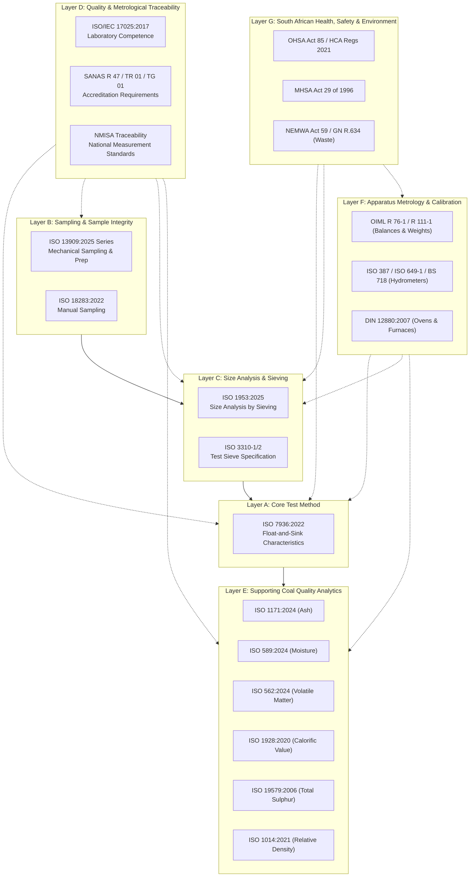
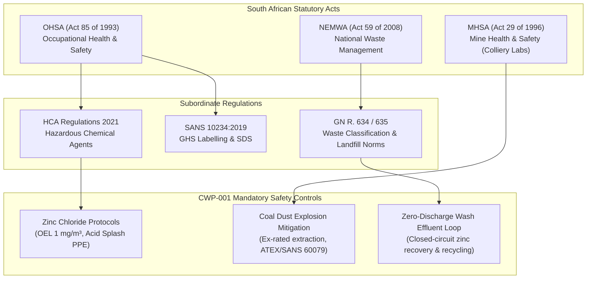

# CWP-001: STANDARDS & COMPLIANCE REGISTER
## Master Standards Framework for Coal Washability Testing & Characterisation Laboratory

```
Document ID:     CWP-001-REG-001
Project:         Coal Washability Testing Laboratory — Float-and-Sink Characterisation Project
Version:         1.0 (2026 Baseline)
Effective Date:  October 2026
Standard Base:   ISO 7936:2022 | ISO 1953:2025 | ISO 13909:2025 | ISO 18283:2022 | ISO/IEC 17025:2017
Jurisdiction:    Republic of South Africa (SANS Alignment & SANAS Metrological Framework)
Classification:  Controlled Laboratory Technical Specification
```

---

## 1. Executive Summary & Purpose

The purpose of this **Standards & Compliance Register** is to establish the authoritative normative and informative standard reference architecture for the **CWP-001 Coal Washability Testing Laboratory**. 

In the South African minerals testing landscape, commercial coal laboratories historically relied on **SANS 7936:2010**, which was an identical endorsement of the obsolete **ISO 7936:1992** standard. Since the publication of **ISO 7936:2022** (*Coal — Determination and presentation of float and sink characteristics — General directions for apparatus and procedures*), the global technical baseline has moved forward significantly. Concurrently, **ISO 1953:2025** has superseded ISO 1953:2015 for size analysis by sieving, and the **ISO 13909:2025 series** (Parts 1 to 4) has updated mechanical sampling and sample preparation principles, complementing **ISO 18283:2022** for manual sampling.

To ensure technical defensibility, global acceptance of technical reports, client confidence (mining houses, export traders through Richards Bay Coal Terminal [RBCT], and domestic utilities such as Eskom), and seamless progression toward **ISO/IEC 17025:2017 accreditation via SANAS** (South African National Accreditation System), the CWP-001 Laboratory operates on a **dual-layer standards architecture**:
1. **Primary Analytical Execution Layer**: The latest international standard editions (ISO 7936:2022, ISO 1953:2025, ISO 13909:2025, ISO 18283:2022).
2. **South African Regulatory & National Evidence Layer**: Current SANS endorsements, South African Statutory Regulations (OHSA Act 85 of 1993, MHSA Act 29 of 1996, NEMWA Act 59 of 2008), and SANAS mandatory requirements (TR 01, R 47, TG 01).

---

## 2. Standards Architecture: The Seven-Layer Framework

The laboratory's compliance register is organized into seven distinct, interrelated layers:



---

## 3. Comprehensive Master Standards Register

The following master register identifies every normative and informative standard applicable to the CWP-001 laboratory design, operation, quality management, and reporting.

| Ref # | Standard Number | Full Title | Current Edition | Superceded Edition | SANS Adoption / South African Equivalent | Scope in CWP-001 | Status | Mandatory Clause / Critical Parameter | Required Laboratory Audit Evidence |
| :--- | :--- | :--- | :--- | :--- | :--- | :--- | :--- | :--- | :--- |
| **A-01** | **ISO 7936** | Coal — Determination and presentation of float and sink characteristics — General directions for apparatus and procedures | **2022** | 1992 | SANS 7936:2010 *(equivalent to ISO 7936:1992; transition register active)* | Core analytical method for relative density separation of coarse and fine coal | **MANDATORY** | Apparatus design, bath sequence, rinsing protocols, mass balance criterion ($\pm 0.5\%$ target, $\pm 1.0\%$ threshold), temperature standardisation ($20.0 \pm 0.5^\circ\text{C}$), reporting | CWP-SOP-007, CWP-SOP-008, separation benchsheets, mass balance verification records, curve plotting logbooks |
| **B-01** | **ISO 13909-1** | Hard coal and coke — Mechanical sampling — Part 1: General introduction | **2025** | 2016 | SANS 13909-1:2018 | Primary sampling theory, precision requirements, bias avoidance | **MANDATORY (Mechanical)** | Error variance calculation, increment frequency, overall precision targets | Sampling plan, lot assessment record, precision verification calculations |
| **B-02** | **ISO 13909-2** | Hard coal and coke — Mechanical sampling — Part 2: Coal — Sampling from moving streams | **2025** | 2016 | SANS 13909-2:2018 | Cross-belt, falling-stream mechanical sampling from conveyors | **MANDATORY (Mechanical)** | Primary cutter speed ($< 1.5\text{ m/s}$), cutter aperture ($\ge 3 \times$ nominal top size), no spillage/overflow | Mechanical sampler inspection sheets, cutter speed calibration certificates |
| **B-03** | **ISO 13909-3** | Hard coal and coke — Mechanical sampling — Part 3: Coal — Sampling from stationary lots | **2025** | 2016 | SANS 13909-3:2018 | Mechanical auger sampling from rail wagons, trucks, stockpiles | **CONDITIONAL** | Auger diameter, penetration depth, increment extraction rules | Auger operation log, sampling pattern grid map |
| **B-04** | **ISO 13909-4** | Hard coal and coke — Mechanical sampling — Part 4: Coal — Preparation of test samples | **2025** | 2016 | SANS 13909-4:2018 | Sample reduction, crushing, division without bias or moisture loss | **MANDATORY** | Minimum mass of sample after division vs nominal top size; riffle/rotary division rules | CWP-SOP-002, sample division log, top-size vs division mass check sheets |
| **B-05** | **ISO 13909-7** | Hard coal and coke — Mechanical sampling — Part 7: Methods for determining the precision of sampling, sample preparation and testing | **2025** | 2016 | SANS 13909-7:2018 | Statistical validation of mechanical sampling precision | **MANDATORY (Validation)** | Dual-increment variance analysis, ANOVA precision modeling | Replicate increment statistical reports, annual sampling bias audits |
| **B-06** | **ISO 13909-8** | Hard coal and coke — Mechanical sampling — Part 8: Methods of testing for bias | **2025** | 2016 | SANS 13909-8:2018 | Experimental validation against stopped-belt reference sampling | **MANDATORY (Validation)** | Paired Student's t-test, Wilcoxon signed-rank test, bias limits | Sampler bias audit certificates, stopped-belt reference comparative datasets |
| **B-07** | **ISO 18283** | Coal and coke — Manual sampling | **2022** | 2006 | SANS 18283:2008 | Manual sampling from moving streams (stopped belt), stockpiles, heaps, trucks | **MANDATORY (Manual)** | Scoop/shovel dimensions ($\ge 3 \times$ nominal top size), minimum increment mass table, stratified systematic increments | CWP-SOP-001, manual sampling records, increment mass verification log, stopped-belt frame calibration |
| **C-01** | **ISO 1953** | Coal — Size analysis by sieving | **2025** | 2015 | SANS 1953:2016 *(withdrawn ISO 1953:2015 adoption)* | Particle size analysis, screen fractions from 90 mm down to 45 µm | **MANDATORY** | Dry sieving vs wet sieving endpoints ($< 0.1\%$ mass change per minute), blinding limits, screening mass limits | CWP-SOP-003, CWP-SOP-004, sieving data sheets, sieve overloading validation sheets |
| **C-02** | **ISO 3310-1** | Test sieves — Technical requirements and testing — Part 1: Test sieves of metal wire cloth | **2016 (R2022)** | 2000 | SANS 3310-1:2017 | Metrological criteria for woven wire test sieves (< 4 mm) | **MANDATORY** | Aperture tolerance, standard deviation of wire pitch, sieve frame integrity | Calibration/inspection certificates, master sieve registry, optical aperture check log |
| **C-03** | **ISO 3310-2** | Test sieves — Technical requirements and testing — Part 2: Test sieves of perforated metal plate | **2013 (R2023)** | 1999 | SANS 3310-2:2015 | Metrological criteria for perforated plate sieves ($\ge 4\text{ mm}$, round/square) | **MANDATORY** | Hole aperture tolerance, pitch spacing, plate flatness, non-corrosive stainless construction | Calibration certificates, periodic micrometer/vernier inspection sheets |
| **C-04** | **ISO 2591-1** | Test sieving — Part 1: Methods using test sieves of woven wire cloth and perforated metal plate | **1988 (R2021)** | - | SANS 2591-1:1999 | General engineering principles for laboratory test screening | **INFORMATIVE** | Mechanical vs hand sieving agitation, end-point determination | Method validation reports for sieve shakers |
| **D-01** | **ISO/IEC 17025** | General requirements for the competence of testing and calibration laboratories | **2017** | 2005 | SANS 17025:2018 | Overarching quality management, metrological traceability, competence | **MANDATORY (QMS)** | Clauses 4–8: Impartiality, Confidentiality, Structural, Resource (personnel, facility, equipment, metrological traceability), Process (validation, uncertainty, reporting), QMS | Laboratory Quality Manual, SOPs, training records, uncertainty budgets, management reviews |
| **D-02** | **SANAS R 47** | Requirements for the Accreditation of Calibration and Testing Laboratories | **Current Issue** | - | South African National Accreditation System Document R 47 | National compliance requirements for ISO/IEC 17025 accreditation | **MANDATORY (SANAS)** | Traceability to national standards (NMISA), authorized signatory approvals, facility security | SANAS Quality System documents, approved signatory competency files |
| **D-03** | **SANAS TR 01** | Technical Requirements: Calibration and Measurement Traceability | **Current Issue** | - | South African National Accreditation System Document TR 01 | Traceability hierarchy for balances, weights, thermometers, hydrometers | **MANDATORY (SANAS)** | Unbroken calibration chains to NMISA / ILAC MRA accredited calibration laboratories | External calibration certificates bearing SANAS accreditation logo |
| **D-04** | **SANAS TG 01** | Technical Guidance: Evaluation of Measurement Uncertainty in Testing | **Current Issue** | - | South African National Accreditation System Document TG 01 | Uncertainty estimation methodology for coal physical and chemical tests | **MANDATORY (SANAS)** | GUM compliance, coverage factor $k=2$, expanded uncertainty reporting | Uncertainty budget spreadsheets for yield, ash, moisture, and density cut points |
| **E-01** | **ISO 589** | Hard coal — Determination of total moisture | **2024** | 2008 | SANS 589:2010 | As-received total moisture determination on coarse and fine samples | **MANDATORY** | Method A (two-stage nitrogen oven), Method B (single-stage air-drying at $105\text{--}110^\circ\text{C}$ for non-oxidising coals) | CWP-SOP-010, moisture worksheets, oven temperature calibration charts |
| **E-02** | **ISO 11722** | Solid mineral fuels — Hard coal — Determination of moisture in the general analysis test sample by drying in nitrogen | **2013 (R2023)** | 1999 | SANS 5925:2007 | Air-dried analytical sample moisture ($M_{\text{ad}}$) for basis conversions | **MANDATORY** | Oven temperature $105\text{--}110^\circ\text{C}$, nitrogen purge ($\ge 15\times$ enclosure volume/hour), oxygen content $< 30\text{ ppm}$ | Moisture balance log, nitrogen purity certificates, daily check standards |
| **E-03** | **ISO 1171** | Solid mineral fuels — Determination of ash | **2024** | 2010 | SANS 131:2010 | Ash content determination on all float-and-sink density fractions | **MANDATORY** | Heating profile: room temp to $500^\circ\text{C}$ over 60 min, hold 30 min, ramp to $815 \pm 10^\circ\text{C}$, hold $\ge 60\text{ min}$; air exchange rate | CWP-SOP-012, muffle furnace thermal profile logs, crucible blank records, CRM ash control charts |
| **E-04** | **ISO 562** | Hard coal and coke — Determination of volatile matter | **2024** | 2010 | SANS 562:2011 | Volatile matter ($VM$) of composite products and raw feed | **RECOMMENDED (Phase 2/3)** | Muffle furnace at $900 \pm 10^\circ\text{C}$, cylindrical silica crucibles with ground-in lid, heating duration exactly 7 minutes | Furnace calibration certificates, crucible mass control log, volatile matter control charts |
| **E-05** | **ISO 1928** | Solid mineral fuels — Determination of gross calorific value by the bomb calorimetric method and calculation of net calorific value | **2020** | 2009 | SANS 1928:2012 | Energy content of clean coal products and raw coal | **RECOMMENDED (Phase 2/3)** | Isoperibol or adiabatic bomb calorimeter, benzoic acid CRM calibration, thermochemical corrections (nitric, sulfuric acid) | Calorimeter calibration log, heat capacity ($C$) drift charts, oxygen vessel pressure test certificates |
| **E-06** | **ISO 19579** | Solid mineral fuels — Determination of sulfur by IR spectrometry | **2006 (R2022)** | - | SANS 19579:2010 | Rapid total sulfur in coal products | **RECOMMENDED (Phase 2/3)** | Combustion at $> 1350^\circ\text{C}$, combustion gas drying, dual-range IR detection cell | Certified coal standards calibration curve, daily sulfur check sample log |
| **E-07** | **ISO 1014** | Coke — Determination of true relative density, apparent relative density and porosity | **2021** | 1985 | SANS 1014 | True and apparent relative density measurements | **INFORMATIVE** | Pycnometer and hydrostatic displacement techniques | Pycnometer calibration records |
| **E-08** | **ISO 1170** | Coal and coke — Calculation of analyses to different bases | **2020** | 2013 | SANS 1170:2014 | Conversion of analytical results: as-received (ar), air-dried (ad), dry (d), dry ash-free (daf) | **MANDATORY** | Exact mathematical formulae for analytical base conversions | Software validation spreadsheets, calculation QA checks |
| **E-09** | **ISO 5074** | Hard coal — Determination of Hardgrove Grindability Index | **2015 (R2025)** | 1994 | SANS 5074:2015 | Hardgrove Grindability Index (HGI) determination | **OPTIONAL (Phase 3)** | Standard Hardgrove machine, standard grinding bowl and 8 balls ($22.2\text{ mm}$), 60 revolutions, calibration against 4 US reference coals | HGI machine calibration curve, primary calibration coal certificates |
| **F-01** | **ISO 387** | Hydrometers — Principles of construction and adjustment | **2019** | 1977 | SANS 387 | Design, scale divisions, reference temperature ($20^\circ\text{C}$) for liquid density measurement | **MANDATORY** | Scale marking, surface tension basis (medium surface tension category for aqueous salt solutions), ballast safety | Hydrometer supplier data sheets, inspection log |
| **F-02** | **ISO 649-1** | Laboratory glassware — Density hydrometers for general purposes — Part 1: Specification | **1981 (R2021)** | - | BS 718:1991 / SANS aligned | Technical construction and accuracy of precision laboratory hydrometers | **MANDATORY** | Divisions ($0.001\text{ g/cm}^3$ or $0.0005\text{ g/cm}^3$), stem diameter, meniscus reading (bottom of meniscus for transparent solutions) | Calibration certificates from SANAS accredited calibration laboratory |
| **F-03** | **OIML R 76-1** | Non-automatic weighing instruments — Part 1: Metrological and technical requirements | **2006** | 1992 | SANS 1649 / SANS 1037 | Balances and platform scales accuracy class I, II, III | **MANDATORY** | Maximum permissible errors (MPE), repeatability, eccentricity, linearity | SANAS calibration certificates, daily balance verification logs (Class E2/F1 weights) |
| **F-04** | **OIML R 111-1** | Weights of classes $E_1, E_2, F_1, F_2, M_1, M_1\text{-}2, M_2, M_2\text{-}3$ and $M_3$ | **2004** | 1994 | SANS 111 | Working and reference standard weights for balance daily verification | **MANDATORY** | Class E2 (analytical balances), Class F1 (precision balances), Class M1 (platform scales) | SANAS calibration certificates for master weights, handling forceps protocols |
| **F-05** | **DIN 12880** | Electrical laboratory devices — Heating ovens and incubators | **2007** | 1978 | SANS equivalent | Temperature uniformity, stability, and ventilation rates in drying ovens | **MANDATORY** | Spatial temperature variation ($\pm 2.0^\circ\text{C}$ in drying oven, $\pm 5.0^\circ\text{C}$ in furnace) | 9-point thermal mapping test reports, annual calibration logs |
| **F-06** | **ASTM E100 / E126** | Standard Specification for ASTM Hydrometers / Standard Test Method for Inspection, Calibration, and Verification of ASTM Hydrometers | **2023 / 2021** | - | ASTM standards used as informative metrology benchmark | Hydrometer calibration and temperature correction coefficients | **INFORMATIVE** | Thermal expansion correction tables, meniscus correction rules | Hydrometer temperature correction algorithms in calculation system |
| **G-01** | **OHSA Act 85** | Occupational Health and Safety Act, 1993 (Act No. 85 of 1993) | **Statutory** | - | South African National Statute | Overarching occupational health and safety mandate for commercial test laboratories | **MANDATORY (Statutory)** | Section 8: General duties of employers; Risk Assessments; Written Safe Operating Procedures | CWP-003 Safety Manual, Hazard Identification and Risk Assessments (HIRA) |
| **G-02** | **GNR 280** | Regulations for Hazardous Chemical Agents (HCA Regulations, 2021) | **2021** | 1995 (HCS) | Department of Employment and Labour (South Africa) | Management of hazardous heavy liquid media (Zinc Chloride, organic alternatives) | **MANDATORY (Statutory)** | Mandatory GHS compliant SDS, exposure monitoring, airborne OEL ($1\text{ mg/m}^3$ fume, $2\text{ mg/m}^3$ STEL for $\text{ZnCl}_2$), medical surveillance | HCA Risk Assessment, annual air monitoring reports, staff medical surveillance records |
| **G-03** | **MHSA Act 29** | Mine Health and Safety Act, 1996 (Act No. 29 of 1996) | **Statutory** | - | Department of Mineral Resources and Energy (DMRE) | Mandatory where the laboratory is located on a mine property/colliery | **CONDITIONAL (Colliery Site)** | Code of Practice (COP) on coal dust explosions, machinery safety, mandatory appointments | Baseline Risk Assessment, Section 7/12 appointments, DMRE approved COP |
| **G-04** | **NEMWA Act 59** | National Environmental Management: Waste Act (Act No. 59 of 2008) & GN R. 634 / 635 | **Statutory** | - | Department of Forestry, Fisheries and the Environment (DFFE) | Classification and disposal of toxic chemical wastes (Zinc Chloride sludges, wash effluent) | **MANDATORY (Statutory)** | Waste classification according to SANS 10234; Leachable Concentration Thresholds (LCT); disposal at registered hazardous waste facilities (Class A/B) | Hazardous waste manifest documents, licensed waste collector disposal certificates, closed-loop effluent recycling log |
| **G-05** | **SANS 10234** | Globally Harmonized System of classification and labelling of chemicals (GHS) | **2019** | 2008 | South African National Standard | Chemical labelling, pictograms, safety data sheet (SDS) compliance | **MANDATORY** | 16-section SDS format, tank and container labelling, primary/secondary container markings | Up-to-date SDS master file (< 3 years old), chemical vessel hazard labels |
| **G-06** | **SANS 10400** | The application of the National Building Regulations | **Current** | - | South African National Standard | Laboratory ventilation, emergency exits, chemical drainage bunding | **MANDATORY** | Part O: Lightning and Ventilation; Part T: Fire Protection; Bunding capacity ($110\%$ of largest vessel) | Facility design blueprints, local fire department occupancy certificates |

---

## 4. Deep-Dive Standards Analysis & Transition Strategy

### 4.1. Float-and-Sink Primary Standard: ISO 7936:2022 vs. SANS 7936:2010

```
┌────────────────────────────────────────────────────────────────────────────────────────┐
│ CRITICAL JURISDICTIONAL FINDING:                                                       │
│ SANS 7936:2010 was an endorsement of ISO 7936:1992.                                    │
│ In 2022, ISO released ISO 7936:2022, introducing major technical improvements.         │
│ South African laboratories relying solely on "SANS 7936:2010" operate on 30-year-old   │
│ international criteria. CWP-001 bridges this gap via an explicit compliance matrix.     │
└────────────────────────────────────────────────────────────────────────────────────────┘
```

#### Key Technical Advancements in ISO 7936:2022
1. **Apparatus Modularity by Size Fraction**:
   * Explicitly bifurcates apparatus design between **coarse coal** (typically $> 1.0\text{ mm}$ or $> 0.5\text{ mm}$) and **fine coal** ($< 1.0\text{ mm}$ or $< 0.5\text{ mm}$).
   * Standardizes perforated basket construction, drainage rim geometries, and recovery trays for coarse separation.
   * Formalizes **centrifuge-assisted float-and-sink** procedures for fine coal to overcome surface-tension-induced misplacement and slow settling rates governed by Stokes' Law.
2. **Density Media Specification & Safety Transition**:
   * Recognizes the operational reality of hazardous organic liquids (e.g., bromoform, perchloroethylene, 1,1,1-trichloroethane) being severely restricted or banned under international environmental and occupational protocols (REACH, Stockholm Convention, OHSA HCA Regs).
   * Elevated **aqueous Zinc Chloride ($\text{ZnCl}_2$)** solutions to the primary industry benchmark for densities up to $1.90\text{ g/cm}^3$ (and up to $2.00\text{ g/cm}^3$ under controlled temperature/acidity conditions), alongside non-toxic aqueous suspensions/salt alternatives (such as sodium polytungstate / lithium heteropolytungstates [LST] or Cesium Chloride [$\text{CsCl}$] for ultra-heavy ranges).
3. **Strict Temperature Normalisation**:
   * Mandates testing and density verification at $20.0 \pm 0.5^\circ\text{C}$ (or $25.0 \pm 0.5^\circ\text{C}$ in designated tropical regions, provided all hydrometers and calibration curves are referenced to the identical base temperature). CWP-001 standardizes on **$20.0^\circ\text{C}$**.
4. **Mass Balance & Recovery Limits**:
   * Codifies quantitative mass recovery gates:
     $$\text{Mass Recovery (\%)} = \frac{\sum M_{\text{fractions}}}{M_{\text{initial}}} \times 100$$
   * Target: $99.5\% \le \text{Recovery} \le 100.5\%$.
   * Rejection Threshold: Any run outside $99.0\% \le \text{Recovery} \le 101.0\%$ is invalid, triggering an internal nonconformance investigation (CWP-SOP-016).
5. **Presentation of Washability Data**:
   * Prescribes mathematical consistency in cumulative float (clean coal) and cumulative sink (discard) curves, elementary ash (M-curve / characteristic curve), and $\pm 0.1$ near-gravity material (NGM) separation difficulty curves.

---

### 4.2. Particle Size Analysis: ISO 1953:2025 vs. ISO 1953:2015

ISO 1953:2025 is the updated global standard for coal size analysis by sieving. 

#### Major Methodological Requirements in ISO 1953:2025
* **Sieve Series Selection**:
  * Formalizes primary aperture sizes based on the Renard R20/R40 series: $90\text{ mm}, 75\text{ mm}, 63\text{ mm}, 50\text{ mm}, 31.5\text{ mm}, 25\text{ mm}, 16\text{ mm}, 13.2\text{ mm}, 8\text{ mm}, 6.3\text{ mm}, 4\text{ mm}, 2\text{ mm}, 1\text{ mm}, 500\text{ }\mu\text{m}, 250\text{ }\mu\text{m}, 125\text{ }\mu\text{m}, 63\text{ }\mu\text{m}, 45\text{ }\mu\text{m}$.
* **Wet vs. Dry Sieving Decision Gate**:
  * Mandates **wet sieving** whenever the sample contains sticky clay materials or when the fines fraction ($-0.5\text{ mm}$) exceeds $5\%$ of the total sample mass and adheres to coarse lump surfaces.
  * Prescribes rinsing with dispersion wetting agents if ultra-fine clay agglomeration impedes screen passage.
* **Screen Overloading Criteria**:
  * Sets quantitative maximum mass limits per sieve screen area to prevent multi-layer blinding. For example, on a $400\text{ mm} \times 400\text{ mm}$ square sieve or $200\text{ mm}$ round sieve, maximum retained bed depth must not exceed $1.5\times$ the aperture size for particles $> 25\text{ mm}$, or single-particle monolayer depth for $< 4\text{ mm}$.
* **Sieving End-Point Rule**:
  * Sieving is deemed complete when less than $0.1\%$ of the total sample mass passes the sieve during an additional 1 minute of hand sieving.

---

### 4.3. Sampling Architecture: ISO 13909:2025 & ISO 18283:2022

A washability curve is only as accurate as the representative sample collected from the coal seam, ROM stockpile, or beneficiation stream.

```
┌────────────────────────────────────────────────────────────────────────────────────────┐
│ FUNDAMENTAL COAL SAMPLING THEOREM (Gy's Sampling Theory):                              │
│ Fundamental Sampling Error (FSE) is proportional to the cube of the top size:          │
│                                                                                        │
│                                   s_FSE² ∝ d³ / M_S                                    │
│                                                                                        │
│ where d is nominal top size and M_S is sample mass.                                    │
│ Sizing and division without prior crushing exponentially magnifies error if increment   │
│ masses are inadequate.                                                                 │
└────────────────────────────────────────────────────────────────────────────────────────┘
```

#### Mechanical Sampling (ISO 13909:2025 Series)
* **Moving Streams (Part 2)**: The preferred sampling method. Falling-stream cutters must cut the complete stream at uniform velocity ($v < 1.5\text{ m/s}$). Cross-belt cutters must sweep the entire belt surface clean without selective particle rejection.
* **Sample Preparation (Part 4)**: Governs mass reduction rules. Coarse fractions ($+50\text{ mm}$) destined for washability testing **must not be crushed prior to sizing and washability**, as crushing fundamentally alters particle liberation and density distribution.

#### Manual Sampling (ISO 18283:2022)
* Governs sampling when mechanical cutters are absent (e.g., stationary train wagons, stockpile exploration pits, stopped conveyor belts).
* **Stopped-Belt Sampling**: Recognized by ISO 18283 as the **reference standard (zero-bias baseline)** against which all mechanical samplers are audited. Uses a profiled sampling frame matching the conveyor belt trough curvature.
* **Minimum Increment Masses**: Mandated according to nominal top size:
  * Top size $125\text{ mm} \implies 4.0\text{ kg}$ per increment.
  * Top size $90\text{ mm} \implies 3.0\text{ kg}$ per increment.
  * Top size $50\text{ mm} \implies 1.5\text{ kg}$ per increment.
  * Top size $25\text{ mm} \implies 0.8\text{ kg}$ per increment.
  * Top size $10\text{ mm} \implies 0.25\text{ kg}$ per increment.

---

### 4.4. Laboratory Quality System: ISO/IEC 17025:2017 & SANAS

The CWP-001 laboratory is designed from Day 1 to achieve and maintain formal accreditation under **ISO/IEC 17025:2017** through **SANAS**.

```mermaid
flowchart LR
    subgraph SANAS_FRAMEWORK["SANAS Accreditation Structure"]
        R47["SANAS R 47<br/>General Regulations"]
        TR01["SANAS TR 01<br/>Metrological Traceability"]
        TG01["SANAS TG 01<br/>Measurement Uncertainty"]
    end
    subgraph CORE_ISO["Core Quality Standard"]
        ISO17025["ISO/IEC 17025:2017<br/>Sections 4 to 8"]
    end
    subgraph LAB_SYSTEM["CWP-001 Operational System"]
        QM["Laboratory Quality Manual"]
        SOP["Controlled Standard Operating Procedures (SOP-001 - 017)"]
        CAL["Calibration & Verification System"]
        UNC["Uncertainty Budgets (Yield, Ash, Cut-Point)"]
        PT["Proficiency Testing (Round-Robin Interlab)"]
    end

    SANAS_FRAMEWORK --> CORE_ISO
    CORE_ISO --> LAB_SYSTEM
```



#### Mandatory Accreditation Pillars for CWP-001:
1. **Metrological Traceability (Clause 6.5 & SANAS TR 01)**:
   * Balances must be calibrated annually by a SANAS-accredited calibration laboratory (accredited under ISO/IEC 17025).
   * Daily verification using certified stainless steel reference weights (OIML Class E2 for analytical, Class F1 for precision balances) with calibrated correction values.
   * Hydrometers must hold valid calibration certificates issued against national density standards at NMISA.
   * Pt100 temperature sensors and reference digital thermometers calibrated with unbroken traceability chains.
2. **Evaluation of Measurement Uncertainty (Clause 7.6 & SANAS TG 01)**:
   * Formal uncertainty budgets established for:
     * Yield at target relative density ($\pm \% \text{ yield}$ at $95\%$ confidence interval, $k=2$).
     * Ash content per density fraction ($\pm \% \text{ ash}$, derived from weighing, moisture compensation, furnace temperature stability).
     * Cut-point density ($\text{d}_{50}$ uncertainty based on hydrometer and temperature interpolation).
3. **Proficiency Testing & Interlaboratory Comparisons (Clause 7.7)**:
   * Mandatory annual participation in recognized coal round-robin testing schemes (e.g., SABS Coal Proficiency Scheme / international coal round-robins) for proximate analysis and washability fraction verification.
4. **Controlled Environment & Contamination Prevention (Clause 6.3)**:
   * Complete physical segregation between dusty sample preparation zones (crushing, screening) and clean analytical chemistry zones (analytical weighing, hydrometer preparation, muffle furnaces).

---

## 5. Supporting Coal Quality Analytical Standards

Float-and-sink testing yields physical masses per density increment; however, the data becomes actionable only when combined with coal quality parameters (chiefly ash, moisture, and calorific value).

```
┌────────────────────────────────────────────────────────────────────────────────────────┐
│ CRITICAL BASE CONVERSION NOTICE (ISO 1170:2020):                                       │
│ All float-and-sink fraction ash results MUST be reported on a uniform basis:           │
│                                                                                        │
│                                 A_d = A_ad × 100 / (100 - M_ad)                        │
│                                                                                        │
│ Failure to determine air-dried moisture (M_ad) on each individual density fraction    │
│ introduces severe skew into the calculated head ash and cumulative washability curves! │
└────────────────────────────────────────────────────────────────────────────────────────┘
```

### Analytical Matrix Summary

1. **Ash Determination (ISO 1171:2024 / SANS 131)**:
   * **Sample Mass**: Minimum $1.0000 \pm 0.0050\text{ g}$ of finely ground sample ($-212\text{ }\mu\text{m}$).
   * **Incineration Profile**: Room temperature $\to 500^\circ\text{C}$ over 60 min; hold 30 min (oxidizing sulfides/organics); ramp to $815 \pm 10^\circ\text{C}$ over 60 min; hold $\ge 60\text{ min}$ until constant mass ($\Delta M < 0.001\text{ g}$).
   * **Crucibles**: High-grade glazed porcelain or silica, flat-bottomed.
2. **Total Moisture (ISO 589:2024 / SANS 589)**:
   * Coarse coal samples dried at $105\text{--}110^\circ\text{C}$ in an air-circulating oven (for non-reactive coals) or nitrogen-purged oven to prevent oxidation weight gain.
3. **Moisture in Analysis Sample (ISO 11722:2013 / SANS 5925)**:
   * Conducted concurrently with ash analysis so that ash dry basis ($A_{\text{d}}$) can be accurately derived.
4. **Volatile Matter (ISO 562:2024 / SANS 562)**:
   * $900 \pm 10^\circ\text{C}$ for precisely $7\text{ minutes}$ in an inert muffle furnace using a specialized cylindrical silica crucible with a ground-in lid.
5. **Gross Calorific Value (ISO 1928:2020 / SANS 1928)**:
   * Bomb calorimetry under 3.0 MPa pure oxygen, calibrated with certified thermochemical-grade benzoic acid.

---

## 6. South African Legislative, Safety & Environmental Framework

Operation of a coal washability testing facility in South Africa triggers specific statutory requirements under national environmental and safety laws.



### 6.1. Hazardous Chemical Agent Management: Zinc Chloride ($\text{ZnCl}_2$)
* **Hazard Class**: Acute Toxicity Category 4 (Oral), Skin Corrosion Category 1B (Causes severe skin burns and eye damage), Aquatic Acute & Chronic Category 1 (Very toxic to aquatic life with long-lasting effects).
* **Occupational Exposure Limit (OEL)**: Department of Employment and Labour OEL-Eight-Hour TWA for Zinc Chloride fume is **$1\text{ mg/m}^3$**, with a Short-Term Exposure Limit (STEL) of **$2\text{ mg/m}^3$**.
* **Controls**:
  * Local exhaust ventilation (LEV) above all hot dissolution tanks and density testing baths.
  * Mandatory acid/chemical resistant gloves (Neoprene / Heavy Nitrile), full face shields, chemical splash goggles, and PVC chemical aprons.
  * Emergency deluge showers and eye-wash stations within 10 seconds of unhindered travel distance.

### 6.2. Waste Classification & Effluent Management (NEMWA GN R. 634 / 635)
* Unfiltered disposal of Zinc Chloride rinse water into municipal sewers or surface stormwater is illegal under the National Water Act (Act 36 of 1998) and NEMWA.
* CWP-001 incorporates a **closed-loop wash-water recovery system**:
  1. Wash water from coal rinsing is collected into settling tanks.
  2. Fine coal slimes are flocculated and filtered out.
  3. Dilute $\text{ZnCl}_2$ effluent is routed to an evaporator / concentration tank to regenerate stock heavy liquid.
  4. Non-recoverable residues are collected in certified intermediate bulk containers (IBCs) and disposed of via a licensed hazardous waste management contractor with manifest certification.

### 6.3. Coal Dust Explosion & Inhalation Mitigation
* Coal dust (particularly from high-volatile Witbank/Waterberg coals) presents an acute explosive hazard when suspended in air at concentrations between $30\text{--}1000\text{ g/m}^3$.
* Preparation rooms must feature:
  * Antistatic dust extraction hoods meeting SANS 60079 / ATEX standards.
  * Prohibition of compressed-air blowdown cleaning (mandatory industrial HEPA vacuum cleaning).
  * Intrinsically safe or dust-ignition-proof electrical enclosures in high-dust crushing areas.

---

## 7. Document Audit & Compliance Matrix

Every laboratory activity must generate traceable audit records linked directly to the standards framework.

```
Activity: Sample Ingestion
 └── Standard: ISO 18283 / ISO 13909
      └── Output: Sample Receipt Register, Chain of Custody (CWP-FORM-001)

Activity: Test Sizing
 └── Standard: ISO 1953:2025 / ISO 3310
      └── Output: Sizing Logsheet (CWP-FORM-003), Sieve Inspection Record (CWP-CAL-003)

Activity: Density Media Prep
 └── Standard: ISO 387 / ISO 649-1 / BS 718
      └── Output: Media Batch Certificate (CWP-FORM-005), Hydrometer Check Log (CWP-CAL-002)

Activity: Float-and-Sink
 └── Standard: ISO 7936:2022
      └── Output: Separation Benchsheet (CWP-FORM-007), Mass Balance Record (CWP-FORM-008)

Activity: Analytical Ash
 └── Standard: ISO 1171:2024 / ISO 1170:2020
      └── Output: Furnace Log (CWP-FORM-012), CRM Control Chart (CWP-QC-001)

Activity: Reporting
 └── Standard: ISO 7936:2022 / ISO/IEC 17025:2017
      └── Output: Comprehensive Washability Technical Report (CWP-REP-001)
```

---

## 8. Standards Maintenance, Review Cycle & Transition Protocol

1. **Annual Review**: The Standards Register shall be formally reviewed by the Laboratory Technical Signatory and Quality Manager annually in October.
2. **Monitoring of New Releases**: The Technical Manager shall maintain active monitoring subscriptions with ISO TC 27 (*Solid mineral fuels*) and SABS TC 027 (*Solid mineral fuels*) to track revisions, amendments, and withdrawals.
3. **Transition Gap Protocol**: When a standard is revised (e.g., as occurred with ISO 7936:2022 and ISO 1953:2025):
   * A formal Technical Gap Analysis shall be conducted within 60 days of publication.
   * Internal SOPs shall be amended, validated, and approved.
   * Method validation / verification datasets shall be generated comparing the former and updated methods.
   * Clients and SANAS accreditation bodies shall be formally notified in the Annual Management Review.

---

## 9. Formal Approval & Authorization

| Role | Name | Title / Qualification | Signature | Date |
| :--- | :--- | :--- | :--- | :--- |
| **Compiled By** | Engineering & Standards Team | Project Metrology Specialist | *Controlled Electronic Signature* | 2026-10-07 |
| **Reviewed By** | Technical Specialist | Coal Processing & Characterisation | *Controlled Electronic Signature* | 2026-10-07 |
| **Approved By** | Laboratory Director | Quality & Technical Signatory | *Controlled Electronic Signature* | 2026-10-07 |

---
*End of Document CWP-001-REG-001.*
