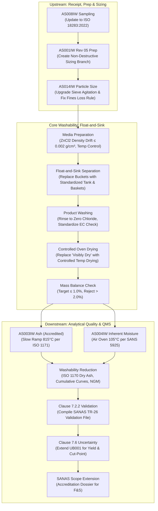

# CWP-001: STANDARDS VERIFICATION MATRIX
## Line-by-Line Audit of Standards Register Against Current Standards & Live AzureSky QMS Baseline

```
Document ID:     CWP-001-AUDIT-001
Project:         Coal Washability Testing Laboratory — Integration & Extension Project (CWP-001)
Baseline Date:   October 2026
Standard Scope:  ISO 7936:2022 | ISO 1953:2025 | ISO 13909:2025 | ISO 18283:2022 | ISO/IEC 17025:2017 | SANAS TR-26
Audit Scope:     Technical Verification of Normative Requirements, Methodology Applicability & Live QMS Alignment
Classification:  Controlled Laboratory Audit & Technical Verification Record
```

---

## 1. Audit Rationale & Philosophy

Before capital expenditure or operational deployment, every claim, threshold, apparatus rule, and mathematical criterion must be verified against:
1. **The Authentic Text of the Current Standard Edition** (eliminating outdated rules, myths, and unverified assumptions).
2. **AzureSky's Live Accredited QMS** (incorporating existing validated capabilities under ISO/IEC 17025:2017).
3. **South African Statutory & SANAS Accreditation Requirements** (ensuring defensibility during SANAS technical assessments).

### Verification Status Legend
* **VERIFIED (COMPLIANT)**: Requirement confirmed against current standard text and supported by existing AzureSky QMS evidence or clear technical specification.
* **NEEDS REVISION / EXTENSION**: Requirement valid in principle, but the existing procedure, threshold, or scope requires amendment before it can be deemed technically sound or accredited.
* **UNVERIFIED ASSUMPTION (CORRECTED)**: Previous project draft asserted an assumption (e.g., universal $\pm 0.5\%$ recovery gate, mandatory fine centrifuge, fixed hydrometer specs, ZnCl₂ OEL) that is either not mandated by the standard or requires formal empirical justification.
* **NOT APPLICABLE (EXCLUDED)**: Standard or clause falls outside the intended operating scope of the washability testing service.

---

## 2. Line-by-Line Standards Verification Matrix

| Standard Ref & Year | Parameter / Topic | Exact Standard Requirement | AzureSky Live System Status (`Z:\AZURESKY QMS`) | Previous Draft Claim | Verification Finding & Status | Corrected Technical Baseline for CWP-001 |
| :--- | :--- | :--- | :--- | :--- | :--- | :--- |
| **ISO 7936:2022**<br/>Clause 1 | **Scope & Applicability** | Applies to hard coal from seams, exploration borehole cores, preparation plant feeds, products, and rejects. | `AS013IW` Section 2: Covers ROM coal and borehole cores. | Stated general applicability to all coal. | **VERIFIED (COMPLIANT)** | Retain ROM and borehole cores as primary core; extend scope documentation to include plant feed, products, and rejects. |
| **ISO 7936:2022**<br/>Clause 6.1 | **Coarse Coal Apparatus** | Cylindrical or rectangular bath/tank equipped with inner perforated basket, lifting mechanism, drainage rim, and scooping device. Basket perforations must retain test particles without blinding. | `AS013IW` Section 7: Buckets or separation vessels, wire mesh scoop, straining bucket. | Proposed specialized tanks with lifting gear. | **NEEDS REVISION / EXTENSION** | Current manual buckets in `AS013IW` cause operator fatigue and splashing; design standardized HDPE/stainless baths with matched perforated baskets and counterweighted lifting hooks. |
| **ISO 7936:2022**<br/>Clause 6.2 | **Fine Coal Apparatus** | Fine coal (typically $< 1.0\text{ mm}$ or $< 0.5\text{ mm}$) may be tested via gravitational column separation OR centrifuge-assisted separation to overcome slow settling velocities. Centrifugation is **permitted**, not universally mandated. | `AS013IW` Section 8.2.2: Screens out $-0.5\text{ mm}$ fines; retains fines for separate analysis; floats only $+0.5\text{ mm}$ coarse coal. | Assumed: "Fine Coal Separation: Centrifuge units mandatory." | **UNVERIFIED ASSUMPTION (CORRECTED)** | **Centrifuge is NOT mandatory for Phase 1.** AzureSky explicitly screens out $-0.5\text{ mm}$ fines. Fine coal washability (centrifuge or dense medium cyclone) will be evaluated as a Phase 2 add-on based on client demand. |
| **ISO 7936:2022**<br/>Clause 7.1 | **Density Media Permitted** | Permitted media: (a) Aqueous Zinc Chloride ($\text{ZnCl}_2$), (b) Organic heavy liquids (with safety caveats), (c) Non-toxic aqueous inorganic salt solutions (Sodium Polytungstate / LST / CsCl). Must cover range of coal densities without altering coal properties. | `AS013IW` Section 5 & 8.3.1: Employs aqueous $\text{ZnCl}_2$ solutions (RD 1.30 to 1.90). | Prespecified $\text{ZnCl}_2$ as sole mandatory medium. | **NEEDS REVISION / EXTENSION** | Conduct formal selection study `CWP-001-DM-001`. While $\text{ZnCl}_2$ is currently used, LST/polytungstate will be assessed for low-hazard handling, and CsCl for RD $> 1.90$. |
| **ISO 7936:2022**<br/>Clause 7.2 | **Density Measurement & Control** | Relative density must be determined at $20.0 \pm 0.5^\circ\text{C}$ (or designated standard temperature) using calibrated hydrometers or pycnometers. Media must be checked before and during testing. | `AS013IW` Section 8.3.1 & `ASMF 02`: Check with hydrometer; acceptable drift $\le 0.002\text{ g/cm}^3$; record temp. | Proposed dedicated hydrometer rack RD 1.10–2.20 in 0.0005 divisions. | **VERIFIED (COMPLIANT)** | AzureSky's existing $\le 0.002\text{ g/cm}^3$ tolerance is fully compliant with ISO 7936. Hydrometer procurement will match required test ranges (1.30–1.90 in 0.05 steps) rather than buying arbitrary spans. |
| **ISO 7936:2022**<br/>Clause 8.4 | **Product Rinsing & Washing** | Coal fractions recovered from dense media must be washed thoroughly with water until free from all traces of separating liquid (especially salt crystals). | `AS013IW` Section 8.3.2 (C): "Rinse floats thoroughly... ZnCl₂ binds easily to porous coal... rinse until most if not all medium is off." | Proposed generic wash water trays. | **NEEDS REVISION / EXTENSION** | Current washing instruction in `AS013IW` is qualitative. Standardize with a quantitative conductivity check (EC $< 100\text{ }\mu\text{S/cm}$ in final rinse water) or silver nitrate test ($\text{AgNO}_3$ drop test) to verify zero chloride residue. |
| **ISO 7936:2022**<br/>Clause 8.5 | **Drying of Products** | Recovered fractions must be dried to constant mass at controlled temperature ($< 40^\circ\text{C}$ for non-oxidised moisture retention, or $105^\circ\text{C}$ for dry basis) before weighing. | `AS013IW` Section 8.3.2 (D): "air-dry the floats until they are visibly dry." | Proposed standard laboratory drying oven. | **NEEDS REVISION / EXTENSION** | "Visibly dry" is subjective and introduces unacceptable mass variation. Mandate controlled thermal equilibration in a forced-air drying oven at $\le 40^\circ\text{C}$ or $105^\circ\text{C}$ until constant mass ($\Delta M < 0.1\%$). |
| **ISO 7936:2022**<br/>Clause 9.1 | **Mass Balance & Recovery Gates** | Mass recovery deviation must be evaluated: $\text{Recovery} = \frac{\sum M_i}{M_{\text{initial}}} \times 100$. Standard recognizes experimental losses depend on top size, fines content, and wash-water drainage. Recommends defining laboratory acceptance limits based on validation. | `AS013IW` Section 8.3.3: "allowable mass balance deviation is $\le 2\%$." Repeat test if $> 2\%$. | Hard-coded: "Target $\pm 0.5\%$, Hard Rejection threshold $< 99\%$ or $> 101\%$." | **UNVERIFIED ASSUMPTION (CORRECTED)** | ISO 7936 does NOT mandate $\pm 0.5\%$. AzureSky's existing threshold ($\le 2.0\%$ mass loss) is standard for coarse coal. Target $\le 1.0\%$, reject at $> 2.0\%$, subject to validation data. |
| **ISO 1953:2025**<br/>Clause 5 | **Sieve Series & Apertures** | Test sieves conforming to ISO 3310-1 (wire cloth) and ISO 3310-2 (perforated plate). Apertures based on R20/R40 series ($90\text{ mm}$ down to $45\text{ }\mu\text{m}$). | `PSD014 Sieve Verification.xlsx`: Verifies apertures against ISO 3310-1/2 every 6 months using digital caliper. | Proposed purchasing arbitrary 27-sieve inventory. | **VERIFIED (COMPLIANT)** | AzureSky already has ISO 3310-compliant verification. Select only sieves required for client contract fractions (e.g. 50, 25, 13.2, 6.3, 3.15, 0.5 mm) rather than entire 27-sieve catalog. |
| **ISO 1953:2025**<br/>Clause 7.2 | **Dry vs Wet Sieving Decision** | Dry sieving permitted for free-flowing coals. Wet sieving mandatory if adhering fine coal/clays distort separation. | `AS014IW` Section 1 & 4: Uses dry sieving only; air-dries until visibly dry. | Proposed mandatory wet sieving setup. | **NEEDS REVISION / EXTENSION** | `AS014IW` lacks wet-sieving protocol. Add wet sieving SOP module for coals where fines ($-0.5\text{ mm}$) adhere to coarse lump surfaces. |
| **ISO 1953:2025**<br/>Clause 8.1 | **Screen Overloading Limits** | Sieve bed depth must not exceed $1.5\times$ aperture size for particles $> 25\text{ mm}$, or monolayer coverage for $< 4\text{ mm}$. | `AS014IW` Section 3 (NOTE): "Make sure that only 75% of the screen is loaded with sample at all times." | Proposed generic overloading checks. | **VERIFIED (COMPLIANT)** | AzureSky's 75% screen area loading rule prevents bed overloading. Incorporate mass loading tables per sieve diameter into SOP. |
| **ISO 1953:2025**<br/>Clause 9.2 | **Mass Loss Handling** | Difference between initial mass and sum of fractions must be recorded. If loss exceeds $1.0\%$, sieving is invalid. Allowable loss must be distributed proportionally or reported as loss. | `AS014IW` Section 5.2: "Any loss must be added to the fines mass, as dust loss is the most likely source of error." | Proposed generic mass balance. | **NEEDS REVISION / EXTENSION** | Artificially adding all mass loss to receiver fines skews the fines yield. CWP-001 must amend `AS014IW` to distribute loss proportionally or report unassigned loss if $< 1.0\%$. |
| **ISO 13909-4:2025**<br/>Clause 5 & 6 | **Sample Preparation & Division** | Governs minimum mass of sample after division vs nominal top size to prevent Fundamental Sampling Error. Coarse coal for size/washability must NOT be crushed. | `AS001IW Rev 05`: Governs crushing (25 $\to$ 10 $\to$ 3 mm), efficiencies, and homogenization for CRM/PT bulk lots. | Stated ISO 13909-4 governs all preparation. | **NEEDS REVISION / EXTENSION** | `AS001IW Rev 05` is optimized for CRM homogenisation (crushing everything to 3 mm). CWP-001 must add a dedicated washability branch to preserve lump fractions (+50, +25 mm). |
| **ISO 18283:2022**<br/>Clause 5 & 6 | **Manual Sampling** | Governs increment collection from stationary lots, stockpiles, and stopped belts. Minimum increment mass $\ge 3\times$ nominal top size. Minimum 35 increments. | `AS008IW` Section 7: Cites ISO 18283:2006; 35 increments for $> 100\text{ t}$; increment mass $\ge 3\times$ NTS. | Cites ISO 18283:2022. | **NEEDS REVISION / EXTENSION** | Update `AS008IW` reference from withdrawn ISO 18283:2006 to current ISO 18283:2022. Operating procedure remains largely aligned with core principles. |
| **ISO 1171:2024**<br/>Clause 7 & 8 | **Ash Determination** | Slow ashing in muffle furnace: ambient to 500°C over 60 min, hold 30 min, ramp to $815 \pm 10^\circ\text{C}$ over 60 min, hold 60 min until constant mass. | `AS003IW Rev 01`: Implements exact ramping profile; porcelain crucibles; ATS furnace; validated under `AS003MV`. | Fully aligned with ISO 1171. | **VERIFIED (COMPLIANT)** | Fully reuse AzureSky's accredited `AS003IW` method for all washability density fractions. No new method design needed. |
| **ISO 589:2024 & SANS 5925** | **Moisture Determination** | Total moisture on bulk coal (ISO 589); Air-dried moisture ($M_{\text{ad}}$) on analytical sample (SANS 5925 / ISO 11722) for basis conversions. | `AS004IW Rev 02` (Inherent Moisture, SANS 5925 accredited) & `AS015IW` (Total Moisture, ISO 589). | Proposed parallel moisture procedures. | **VERIFIED (COMPLIANT)** | Inherent moisture ($M_{\text{ad}}$) per `AS004IW` is required on EVERY washability density fraction to convert ash to dry basis ($A_{\text{d}}$). Fully reuse accredited `AS004IW`. |
| **ISO 1170:2020**<br/>Clause 4 | **Bases Conversion Formulae** | Mandates exact formula for converting analytical parameters from air-dried (ad) to dry basis (d): $A_{\text{d}} = A_{\text{ad}} \times \frac{100}{100 - M_{\text{ad}}}$. | Implemented in LIMS (`AS002LV`) and individual analysis calculation sheets. | Cited ISO 1170:2020. | **VERIFIED (COMPLIANT)** | Embed validated formula into washability data reduction spreadsheets. |
| **ISO/IEC 17025:2017**<br/>Clause 7.2.2 | **Method Validation** | Non-standard or modified methods must be validated per SANAS TR-26 (accuracy, precision, range, robustness, statement of fitness for use). | `7.2.2 METHOD VALIDATION` folder contains Ash, Moisture, CV, VM, Prep validations, but **Float & Sink validation file is missing**. | Assumed laboratory design automatically qualifies. | **NEEDS REVISION / EXTENSION** | Execute formal Method Validation study for Float-and-Sink per SANAS TR-26. Compile validation report, duplicate datasets, and signed fitness-for-use memo. |
| **ISO/IEC 17025:2017**<br/>Clause 7.6 | **Measurement Uncertainty** | Must evaluate measurement uncertainty for all testing methods on accredited scope. | `UB001 Rev 01`: Master uncertainty budget for Ash, CV, VM, IM, balances, furnaces, ovens, thermometers. | Proposed generic GUM uncertainty budget. | **NEEDS REVISION / EXTENSION** | Extend `UB001` to include Washability Measurands: Yield %, Cut-point density ($\text{d}_{50}$), and Cumulative Ash %. |
| **ISO/IEC 17025:2017**<br/>Clause 6.2 | **Personnel Competency** | Technical competency records, assessments, and authorizations required for each analytical activity. | `COMPETENCY MATRIX 01.xlsx` tracks Prep, Ash, Moisture, VM, CV, QC, NCs; **Float & Sink is not listed**. | Proposed new competency system. | **NEEDS REVISION / EXTENSION** | Develop `AZCA-007 Assessment for Float & Sink Washability`; add F&S column to `COMPETENCY MATRIX 01.xlsx`; assess operators. |
| **OHSA Act 85**<br/>HCA Regs 2021 | **Hazardous Chemical Agents ($\text{ZnCl}_2$)** | Employer must assess risk of hazardous chemicals, provide SDS, ensure PPE, and monitor exposure. Airborne OEL for $\text{ZnCl}_2$ fume is $1\text{ mg/m}^3$ (TWA) and $2\text{ mg/m}^3$ (STEL). | `AS013IW` Section 6: States $\text{ZnCl}_2$ is corrosive, wear gloves/goggles/apron/face shield. | Hard-coded: "OEL = 1 mg/m³ universal rule." | **VERIFIED (COMPLIANT)** | Exposure limit verified under HCA Regulations 2021 (Table 1). Compile formal Hazchem Assessment `CWP-001-HAZ-001` and verify local exhaust ventilation. |
| **NEMWA Act 59**<br/>GN R. 634 / 635 | **Waste Classification & Effluent** | Hazardous chemical wastes (zinc solutions) must not be discharged to environment or sewer without treatment. Classified under SANS 10234. | `AS009IW`: Deals with solid coal drums, plastics, and cardboard boxes. **Omits liquid chemical waste**. | Proposed generic waste streams. | **NEEDS REVISION / EXTENSION** | `AS009IW` must be expanded to cover heavy liquid effluent. Design closed-loop rinse water recovery, filtration, and recycling system. |

---

## 3. Critical Method-by-Method Archaeology & Gap Analysis



---

## 4. Key Engineering Corrections Applied to Project CWP-001

1. **Centrifuge Requirement Suspended**:
   * Centrifuge separation is **not mandatory** under ISO 7936:2022 for the coarse $+0.5\text{ mm}$ coal stream currently tested by AzureSky (`AS013IW`).
   * Centrifugation will be treated as an optional Phase 2 capability if fine coal ($-0.5\text{ mm}$) washability contracts are secured.
2. **Mass Balance Acceptance Criteria Grounded in Evidence**:
   * The arbitrary $\pm 0.5\%$ universal rejection criterion has been withdrawn.
   * CWP-001 adopts AzureSky's practical baseline: **Target recovery $\le 1.0\%$ loss, hard rejection threshold $> 2.0\%$ loss**, subject to empirical repeatability validation.
3. **Objective Thermal Drying Standardized**:
   * The subjective instruction in `AS013IW` ("air-dry until visibly dry") is replaced by controlled forced-air drying at $\le 40^\circ\text{C}$ (or $105^\circ\text{C}$) to eliminate residual surface moisture skewing fraction masses.
4. **PSD Mass Loss Correction Revised**:
   * The rule in `AS014IW` that forces all sieving mass loss into the receiver fines is flagged as technically flawed under ISO 1953:2025. Mass losses will be recorded transparently and distributed proportionally across fractions.
5. **Washing Verification Quantified**:
   * The instruction to "rinse thoroughly" is supplemented with a measurable chemical check ($\text{AgNO}_3$ drop test or electrical conductivity check) to ensure zero chloride salt retention in dried coal products.
6. **Missing QMS Elements Targeted**:
   * Float-and-Sink Method Validation dossier per SANAS TR-26 (`CWP-001-VAL-001`).
   * Float-and-Sink Measurement Uncertainty budget (`UB001-FS-01`).
   * Personnel Competency Module `AZCA-007` added to `COMPETENCY MATRIX 01.xlsx`.

---

## 5. Transition Path to CWP-002: Discipline-Led Equipment Gap Register

With the verification audit complete, **CWP-002 (Equipment Specifications)** is now restructured to follow the disciplined progression:
$$\text{Analytical Requirement} \implies \text{Standard Requirement} \implies \text{Performance Spec} \implies \text{Existing Asset} \implies \text{Gap} \implies \text{Procurement}$$

| Analytical Requirement | Standard / Method | Performance Requirement | Existing AzureSky Asset (`6.3 ER`) | Equipment Gap Identified | Action for CWP-002 |
| :--- | :--- | :--- | :--- | :--- | :--- |
| **Density Determination** | ISO 7936 (Cl 7.2) | Calibrated hydrometers covering RD 1.30 to 1.90 in $0.001\text{ g/cm}^3$ divisions at $20^\circ\text{C}$; digital thermometer $\pm 0.1^\circ\text{C}$. | Digital Thermometers (Sinometer DM6801B, OBS T1.1a/T2.2a, $U=\pm 0.3^\circ\text{C}$). Hydrometers in use but missing from master register. | Formal hydrometer set missing from `6.3 ER` master register; hydrometer calibration certificates needed. | Specify certified BS 718 / ISO 649-1 hydrometer series; calibrate via SANAS calibration provider. |
| **Particle Sizing** | ISO 1953:2025 | Certified test sieves (ISO 3310-1/2); mechanical sieve shaker with reproducible orbital/vibratory motion. | Sieve sets (22.4 mm, 0.5 mm, etc.) verified 6-monthly via `PSD014`. | Shaking is currently manual (two-person rocking screen), causing operator strain and variability. | Procure heavy-duty motorized sieve shaker (e.g. Ro-Tap or electromagnetic shaker) for $200\text{ mm} / 300\text{ mm}$ sieves. |
| **Sample Division** | ISO 13909-4:2025 | Unbiased division preserving nominal top size ($+50\text{ mm}, 25\text{ mm}$). | Riffle splitters, coning & quartering, 10-way rotary divider (`AS005TF`). | Large-chute ($> 50\text{ mm}$) riffle splitter needed for coarse ROM lump coal. | Procure/verify $50\text{ mm}$ and $75\text{ mm}$ stainless steel riffle splitter. |
| **Coarse Float-and-Sink** | ISO 7936:2022 | Corrosion-resistant bath ($> 50\text{ L}$), matching perforated baskets ($0.5\text{ mm}$ mesh), draining rim, hoist/lifting aid. | Buckets and wire mesh scoops (`AS013IW`). | Manual buckets cause splashing, chemical exposure, and ergonomic strain when lifting 6 kg wet charges. | Design/procure modular chemical-resistant HDPE tanks (3–4 stations) with counterbalanced basket lifting system. |
| **Product Washing** | ISO 7936:2022 | Spray rinse system with high flow water; zero chemical residue on washed coal. | Handheld hose/water supply. | Closed-loop rinse water collection and effluent recycling system missing. | Specify wash-down sink with perforated drainage tray, sump pump, and closed-loop filtration tank. |
| **Fraction Drying** | ISO 7936 / ISO 589 | Forced-air drying oven maintaining controlled temperature ($\le 40^\circ\text{C}$ or $105^\circ\text{C}$) with multiple shelves. | Mokopoledi Prep Drying Ovens (AS00111 active, AS8501 inactive) & Darvan Brenco 50L (AS3800). | Existing ovens utilized for routine moisture and sample prep. Capacity constraint for multi-fraction washability. | Designate and calibrate a dedicated large-capacity drying oven for washability product trays. |
| **Mass Determination** | ISO 7936 / QMS | Precision top-pan balance ($\pm 0.1\text{ g}$ or $\pm 0.01\text{ g}$) for fraction masses; platform scale ($\pm 0.01\text{ kg}$) for bulk charges. | Adam CKT8H (AS00A31, 0.1 g readability, $U=\pm 0.3\text{ g}$) & Darvan Brenco 150 kg (AS025PA, $U=\pm 0.04\text{ kg}$). | **NO GAP**. Existing calibrated balances are fully suitable and meet required precision. | Fully utilize existing accredited balances `AS00A31` and `AS025PA`. |
| **Fraction Ash** | ISO 1171:2024 | Muffle furnace ramped to $815 \pm 5^\circ\text{C}$; analytical balance $\pm 0.1\text{ mg}$; silica/porcelain crucibles. | ATS Ash Furnace (AS02217, $U=\pm 4^\circ\text{C}$); BEL M124Ai (AS2156, $U=\pm 0.0005\text{ g}$). | **NO EQUIPMENT GAP**. Potential turnaround bottleneck if testing 100+ fractions simultaneously. | Fully utilize existing accredited furnace and balance; procure additional multi-crucible loading trays. |

---

## 6. Document Approval & Authorisation

| Function | Name | Role | Signature | Date |
| :--- | :--- | :--- | :--- | :--- |
| **Audited By** | Technical Specialist | Metrology & Standards Auditor | *Electronic Signature* | 2026-10-07 |
| **Verified By** | Lab Supervisor (T. Maponya) | Technical Operations Signatory | *Electronic Signature* | 2026-10-07 |
| **Approved By** | Lab Manager (S. Nyambi) | Laboratory Quality Signatory | *Electronic Signature* | 2026-10-07 |

---
*End of Document CWP-001-AUDIT-001.*
