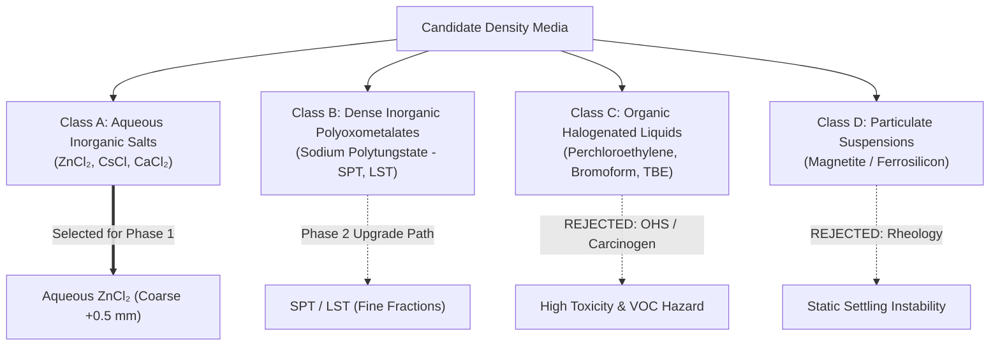
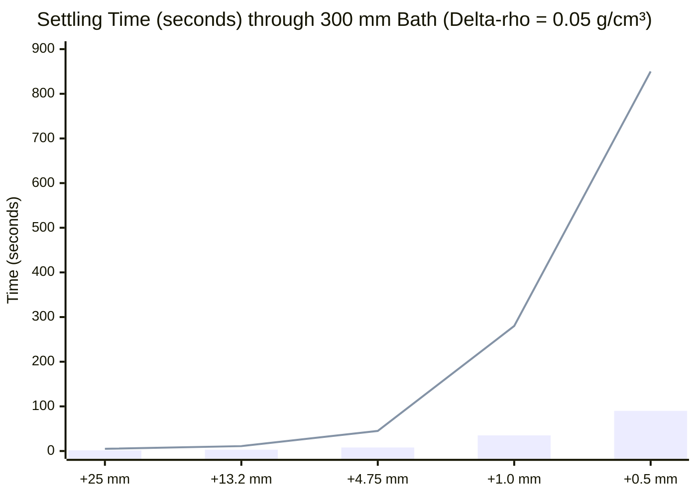
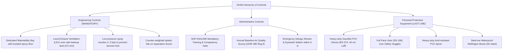
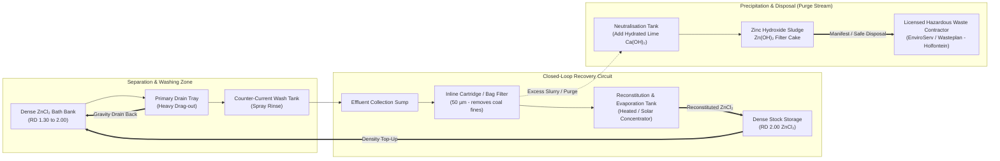

# CWP-001-DM-001: DENSITY MEDIUM SELECTION, OCCUPATIONAL HYGIENE & ENVIRONMENTAL COMPLIANCE STUDY
## Technical Evaluation, Fluid Mechanics Modeling, Environmental Compliance (NEMWA) and Safe Operating Protocol for Coal Washability Testing

```
Document ID:         CWP-001-DM-001
Project ID:          CWP-001
Document Type:       Type D (Project Study & Engineering Evidence)
Target AzureSky QMS: Clause 7.2 (Methods), Clause 6.3 (Facilities/Environment), Clause 6.4 (Equipment)
Author:              Gift Chisali — Laboratory Supervisor
Technical Review:    S. Nyambi — Laboratory Manager
Approval:            Managing Director / Executive Management
Authoritative Base:  Z:\AZURESKY SYSTEM\AZURESKY QMS\17025
Workspace Path:      C:\Projects\AzureSky\CWP-001\07_DENSITY_MEDIA
Status:              ENGINEERING STUDY — RECOMMENDED FOR ADOPTION
Effective Date:      October 2026
Revision:            02
```

---

## 1. Executive Summary & Context

Under Project **CWP-001**, AzureSky (Pty) Ltd is extending its accredited coal testing capabilities to include **Coal Washability Characterisation by Dense Medium Separation (Float-and-Sink Testing)**. The authoritative testing standard governing this extension is **ISO 7936:2022** (*Hard coal — Determination of float and sink characteristics*), supported by **ISO 1953:2025** (*Size analysis*).

The selection of the separating dense medium is the single most critical chemical and operational decision in the design of a coal washability laboratory. It dictates:
1. **Analytical Accuracy & Settling Kinetics**: Governed by fluid density range ($1.30\text{ to }2.00\text{ g/cm}^3$), fluid viscosity, and Stokes' law settling velocities.
2. **Coal Matrix Integrity**: Potential chemical contamination of float/sink fractions affecting subsequent proximate analysis (Moisture per [AS004IW](file:///Z:/AZURESKY%20SYSTEM/AZURESKY%20QMS/17025/CLAUSE%207/7.2.%20SELECTION,%20VERIFICATION%20AND%20VALIDATION%20OF%20METHODS/7.2.1.%20SELECTION%20AND%20VERIFICATION%20OF%20METHODS/PROCEDURES/AS004IW%20%20PROCEDURE%20ON%20DETERMINATION%20OF%20INHERENT(ANALYSIS)%20MOISTURE%20REV%2002.docx), Ash per [AS003IW](file:///Z:/AZURESKY%20SYSTEM/AZURESKY%20QMS/17025/CLAUSE%207/7.2.%20SELECTION,%20VERIFICATION%20AND%20VALIDATION%20OF%20METHODS/7.2.1.%20SELECTION%20AND%20VERIFICATION%20OF%20METHODS/PROCEDURES/AS003IW%20PROCEDURE%20ON%20THE%20DETERMINATION%20OF%20ASH%20CONTENT%20rev%2001.docx), Volatile Matter per [AS006IW](file:///Z:/AZURESKY%20SYSTEM/AZURESKY%20QMS/17025/CLAUSE%207/7.2.%20SELECTION,%20VERIFICATION%20AND%20VALIDATION%20OF%20METHODS/7.2.1.%20SELECTION%20AND%20VERIFICATION%20OF%20METHODS/PROCEDURES/AS006IW%20PROCEDURE%20ON%20ISO%20VOLATILE%20DETERMINATION%20rev%2002.docx)) and Calorific Value per [AS007IW](file:///Z:/AZURESKY%20SYSTEM/AZURESKY%20QMS/17025/CLAUSE%207/7.2.%20SELECTION,%20VERIFICATION%20AND%20VALIDATION%20OF%20METHODS/7.2.1.%20SELECTION%20AND%20VERIFICATION%20OF%20METHODS/PROCEDURES/AS007IW%20PROCEDURE%20ON%20CALORIFIC%20VALUE%20DETERMINATION.docx).
3. **Occupational Hygiene**: Compliance with the South African *Occupational Health and Safety Act (Act 85 of 1993)* and the *Hazardous Chemical Agents Regulations, 2021 (GNR 280)*.
4. **Environmental Legality & Waste Stewardship**: Strict compliance with the *National Environmental Management: Waste Act (Act 59 of 2008 - NEMWA)*, *Waste Classification and Management Regulations (GNR 634/636)*, and municipal wastewater by-laws forbidding heavy metal discharge.

This study systematically evaluates four candidate medium families, models separation fluid dynamics, formulates washing validation protocols, establishes the Occupational Health and Safety (OHS) control envelope, designs a closed-loop effluent recycling circuit, and provides the definitive technical justification for AzureSky's Phase 1 operating baseline.

---

## 2. Normative & Regulatory Framework

The density medium selection must satisfy both international analytical standards and South African statutory mandates:

```
┌────────────────────────────────────────────────────────────────────────────────────────┐
│                                   NORMATIVE PILLARS                                    │
├──────────────────────────────┬─────────────────────────────┬───────────────────────────┤
│    ANALYTICAL STANDARDS      │    OCCUPATIONAL HYGIENE     │ ENVIRONMENTAL LEGISLATION │
├──────────────────────────────┼─────────────────────────────┼───────────────────────────┤
│ • ISO 7936:2022 (Clause 5.2) │ • OHSA (Act 85 of 1993)     │ • NEMWA (Act 59 of 2008)  │
│ • ISO 1953:2025              │ • HCA Regs 2021 (GNR 280)   │ • GNR 634 / 635 / 636     │
│ • SANS 7936:2010             │ • SANS 10234 (GHS HazCom)   │ • National Water Act (36) │
│ • ISO/IEC 17025:2017 (7.2)   │ • OEL TWA / STEL Monitoring │ • Municipal By-Laws       │
└──────────────────────────────┴─────────────────────────────┴───────────────────────────┘
```

### 2.1 ISO 7936:2022 Density Medium Requirements
Clause 5.2 of ISO 7936:2022 sets the international technical criteria for dense liquids:
1. **Inertness**: The liquid shall not alter the physical or chemical properties of the coal, nor dissolve coal macerals or mineral matter.
2. **Density Range & Stability**: The liquid must provide stable, reproducible relative densities ($\text{RD}$) spanning the full coal washing curve (typically $1.30\text{ to }2.00\text{ g/cm}^3$ for South African Permian-age bituminous coals).
3. **Viscosity**: The liquid must have sufficiently low viscosity at the target density to permit rapid, unambiguous settling of particles within a reasonable laboratory timeframe.
4. **Permitted Classes**: ISO 7936 recognizes:
   - Aqueous solutions of inorganic salts (e.g., Zinc Chloride $\text{ZnCl}_2$).
   - Organic liquids and halogenated hydrocarbons (e.g., Perchloroethylene, Bromoform, Tetrabromoethane) — subject to rigorous safety precautions.
   - Aqueous solutions of high-density inorganic polymers (e.g., Sodium Polytungstate / Metatungstate).

### 2.2 South African Statutory Mandates
1. **Hazardous Chemical Agents Regulations, 2021 (GNR 280)**:
   - Mandatory GHS classification under SANS 10234.
   - Strict adherence to Table 1 Occupational Exposure Limits (OELs).
   - Mandatory air monitoring, local exhaust ventilation (LEV), and medical surveillance where HCA exposure may occur.
2. **National Environmental Management: Waste Act (NEMWA, Act 59 of 2008)**:
   - Any spent medium or rinse effluent containing dissolved heavy metals ($\text{Zn}^{2+}$) is classified under SANS 10234 and GNR 634.
   - Leachable Concentration Threshold (LCT) for Zinc is: $\text{LCT}_0 = 5.0\text{ mg/L}$, $\text{LCT}_1 = 50\text{ mg/L}$. Total Concentration Threshold (TCT) is: $\text{TCT}_0 = 200\text{ mg/kg}$, $\text{TCT}_1 = 600\text{ mg/kg}$.
   - Unmanaged disposal of $\text{ZnCl}_2$ effluent constitutes a statutory environmental offense. Zero-discharge or licensed hazardous treatment is legally non-negotiable.

---

## 3. Comparative Evaluation of Candidate Density Medium Families

Four distinct classes of dense media were investigated against eleven critical operational criteria:



### 3.1 Multi-Parameter Comparative Matrix

| Evaluation Parameter | Aqueous Zinc Chloride ($\text{ZnCl}_2$) | Sodium Polytungstate (SPT / LST) | Organic Liquids (PCE / Bromoform) | Particulate Suspension (Magnetite) |
| :--- | :--- | :--- | :--- | :--- |
| **Max Achievable Density** | $2.00\text{ g/cm}^3$ (at $20^\circ\text{C}$, 72% w/w) | $2.85\text{ to }3.00\text{ g/cm}^3$ | $> 2.80\text{ g/cm}^3$ | $2.00\text{ g/cm}^3$ (unstable static) |
| **Viscosity @ RD 1.40** | $\approx 2.5\text{ mPa}\cdot\text{s}$ (Low) | $\approx 2.2\text{ mPa}\cdot\text{s}$ (Low) | $\approx 0.9\text{ mPa}\cdot\text{s}$ (Very Low) | High ($> 15\text{ mPa}\cdot\text{s}$) |
| **Viscosity @ RD 1.80** | $\approx 12.0\text{ mPa}\cdot\text{s}$ (Moderate) | $\approx 8.5\text{ mPa}\cdot\text{s}$ (Moderate) | $\approx 1.2\text{ mPa}\cdot\text{s}$ (Very Low) | Extreme (Dilatant / Bingham) |
| **Viscosity @ RD 2.00** | $\approx 26.0\text{ mPa}\cdot\text{s}$ (High) | $\approx 18.0\text{ mPa}\cdot\text{s}$ (Moderate) | $\approx 1.5\text{ mPa}\cdot\text{s}$ (Very Low) | Solidifies statically |
| **Separation Method** | Static Bath ($+0.5\text{ mm}$); Centrifuge ($-0.5\text{ mm}$) | Static ($+0.5\text{ mm}$); Centrifuge ($-0.5\text{ mm}$) | Rapid static separation down to $0.25\text{ mm}$ | Dynamic cycloning only |
| **Chemical Toxicity** | Corrosive, Harmful if swallowed | Non-toxic, Neutral pH (6–7) | **Carcinogen Cat 1B/2, Hepatotoxic** | Non-toxic (Inert iron oxide) |
| **OHSA OEL Limits** | Mist/Dust: $1\text{ mg/m}^3$ (TWA), $2\text{ mg/m}^3$ (STEL) | Not regulated (Inert salt) | PCE: 25 ppm ($170\text{ mg/m}^3$); Bromoform: 0.5 ppm | $5\text{ mg/m}^3$ (Respirable dust) |
| **Coal Alteration Risk** | Chloride adsorption if unwashed | Negligible (inert tungsten salt) | Hydrocarbon adsorption alters VM & CV | Surface coating; magnetic bias |
| **Washing Requirements** | Water rinse to $\text{EC} < 100\text{ }\mu\text{S/cm}$ | Water rinse & recovery to $99\%$ | Solvent vapor flash-off (VOCs) | Ultrasonic demagnetising rinse |
| **Commercial Cost** | $\approx \text{R } 45\text{ to }\text{R } 65\text{ / kg}$ | $\approx \text{R } 9,500\text{ to }\text{R } 14,000\text{ / kg}$ | $\approx \text{R } 350\text{ to }\text{R } 850\text{ / L}$ | $\approx \text{R } 15\text{ / kg}$ |
| **Environmental Hazard** | Aquatic Acute 1 / Chronic 1 | Low environmental risk | Persistent organic pollutant, HazWaste | Benign inert mineral waste |

### 3.2 Detailed Critical Appraisal by Family

#### 3.2.1 Class A: Aqueous Inorganic Salts (Zinc Chloride — $\text{ZnCl}_2$)
- **Physical Chemistry**: Highly soluble in water ($432\text{ g}/100\text{ mL}$ at $25^\circ\text{C}$). Forms dense, clear, acidic aqueous solutions up to $\text{RD } 2.00\text{ g/cm}^3$.
- **Advantages**:
  - Extremely cost-effective for high-volume coarse coal characterisation (routine 6 kg to 50 kg batch tests).
  - Proven global industry track record; explicit baseline in ISO 7936:2022 and historical SANS 7936.
  - Transparent solution allows direct visual monitoring of particle stratification, float floating, and sink settling.
  - Existing AzureSky standard operating procedure ([AS013IW](file:///Z:/AZURESKY%20SYSTEM/AZURESKY%20QMS/17025/CLAUSE%207/7.2.%20SELECTION,%20VERIFICATION%20AND%20VALIDATION%20OF%20METHODS/7.2.1.%20SELECTION%20AND%20VERIFICATION%20OF%20METHODS/PROCEDURES/AS013IW%20FLOAT%20AND%20SINK%20WASHABILITY%20STANDARD%20OPERATING%20PROCEDURE.docx)) and validation form ([ASMF 02](file:///Z:/AZURESKY%20SYSTEM/AZURESKY%20QMS/17025/CLAUSE%207/7.2.%20SELECTION,%20VERIFICATION%20AND%20VALIDATION%20OF%20METHODS/7.2.1.%20SELECTION%20AND%20VERIFICATION%20OF%20METHODS/FORMS/FLOAT%20AND%20SINK/ASMF%2002-%20FLOAT%20AND%20SINK%20VALIDATION%20FORM.docx)) are historically structured around $\text{ZnCl}_2$.
- **Operational Vulnerabilities**:
  - **High Viscosity at High RD**: Above $\text{RD } 1.70$, viscosity increases exponentially (reaching $26\text{ mPa}\cdot\text{s}$ at $\text{RD } 2.00$), impeding fine particle settling.
  - **Pore Adsorption & Chloride Contamination**: Dry porous coal rapidly absorbs concentrated $\text{ZnCl}_2$. Inadequate washing leads to retained $\text{ZnCl}_2$, elevating apparent ash yield, volatilising zinc during ashing, and corroding bomb calorimeter vessels during CV tests.
  - **Eco-Toxicity**: Hazardous to aquatic life (H400/H410). Requires complete closed-loop containment and zero unauthorized discharge.

#### 3.2.2 Class B: Dense Inorganic Polyoxometalates (Sodium Polytungstate — SPT / LST)
- **Physical Chemistry**: Synthetic cluster compounds ($\text{Na}_6[\text{H}_2\text{W}_{12}\text{O}_{40}]$) dissolving to water-like solutions with densities up to $3.00\text{ g/cm}^3$.
- **Advantages**:
  - Completely non-toxic, non-corrosive, neutral pH ($6.0\text{ to }7.0$).
  - Zero heavy metal classification under GNR 280; no hazardous waste manifest required for clean solution.
  - Lower viscosity than $\text{ZnCl}_2$ at equivalent high densities ($18\text{ mPa}\cdot\text{s}$ vs $26\text{ mPa}\cdot\text{s}$ at $\text{RD } 2.00$).
  - Clean water washing without salt-induced analytical interference.
- **Fatal Practical Barrier**:
  - **Prohibitive Capital Cost**: At $\approx \text{R } 12,000\text{ / kg}$, filling a standard 200 L washability bath bank (requiring $> 400\text{ kg}$ of salt) would cost over **R 4,800,000 in consumable chemicals alone**.
  - Any solution drag-out loss on coarse porous coal represents severe economic leakage.
  - *Strategic Role*: Ideal for low-volume, micro-scale research or fine coal centrifuge tubes ($< 1\text{ L}$ volume), but totally unviable for routine coarse bulk coal washability.

#### 3.2.3 Class C: Organic Halogenated Liquids (PCE, Bromoform, TBE)
- **Physical Chemistry**: Halogenated aliphatic hydrocarbons. Perchloroethylene ($\text{RD } 1.62$) blended with white spirit ($\text{RD } 0.78$) or bromoform ($\text{RD } 2.89$).
- **Advantages**:
  - Extremely low viscosity across all densities ($< 1.5\text{ mPa}\cdot\text{s}$), yielding ultra-fast particle separation.
  - Volatile solvent evaporates directly from coal without water washing.
- **Definitive Rejection Rationale**:
  - **Occupational Health Hazard**: Perchloroethylene is an IARC Group 2A / GHS Category 1B suspected human carcinogen and potent central nervous system toxin. Bromoform causes acute liver and kidney damage.
  - **Regulatory Prohibition**: Under OHSA HCA Regs 2021, deploying open baths of volatile halogenated solvents requires specialized hermetic air-handling, continuous VOC air monitoring, and mandatory blood/urine biological exposure monitoring for operators.
  - **Fire and Explosion Risk**: Diluting with white spirit / mineral turpentine introduces low flash-point hydrocarbons ($38^\circ\text{C}$), requiring ATEX/flameproof electrical infrastructure.
  - **Analytical Bias**: Heavy organics adsorb into coal pores and artificially distort Volatile Matter ([AS006IW](file:///Z:/AZURESKY%20SYSTEM/AZURESKY%20QMS/17025/CLAUSE%207/7.2.%20SELECTION,%20VERIFICATION%20AND%20VALIDATION%20OF%20METHODS/7.2.1.%20SELECTION%20AND%20VERIFICATION%20OF%20METHODS/PROCEDURES/AS006IW%20PROCEDURE%20ON%20THE%20DETERMINATION%20OF%20VOLATILE%20MATTER%20CONTENT%20rev%2002.docx)) and Gross CV ([AS007IW](file:///Z:/AZURESKY%20SYSTEM/AZURESKY%20QMS/17025/CLAUSE%207/7.2.%20SELECTION,%20VERIFICATION%20AND%20VALIDATION%20OF%20METHODS/7.2.1.%20SELECTION%20AND%20VERIFICATION%20OF%20METHODS/PROCEDURES/AS007IW%20PROCEDURE%20ON%20THE%20DETERMINATION%20OF%20CALORIFIC%20VALUE.docx)).
  - **Conclusion**: **Strictly rejected and prohibited** within AzureSky facilities.

#### 3.2.4 Class D: Particulate Suspensions (Magnetite / Ferrosilicon)
- **Physical Chemistry**: Finely ground magnetite suspended dynamically in water.
- **Definitive Rejection Rationale**:
  - In a quiescent static laboratory container, magnetite settles rapidly out of suspension, causing rapid vertical density gradients and bath collapse within seconds.
  - Continuous mechanical agitation to keep magnetite in suspension creates turbulent fluid motion that completely overpowers the gentle buoyancy forces required to separate near-gravity coal particles.
  - **Conclusion**: **Unsuitable for static laboratory float-and-sink determinations**.

---

## 4. Fluid Dynamics & Separation Kinetics Modeling

To scientifically justify particle sizing limits and separation duration in the laboratory SOP, particle settling velocity was modeled using **Stokes' Law** and the **Intermediate Flow Regime (Allen's Law)**.

### 4.1 Settling Mechanics Formulation
The terminal settling velocity ($v_t$) of a spherical particle of diameter $d$ and density $\rho_p$ settling in a dense medium of density $\rho_m$ and dynamic viscosity $\mu$ in the laminar regime ($\text{Re} < 1$) is:

$$v_t = \frac{g \cdot d^2 \cdot |\rho_p - \rho_m|}{18 \mu}$$

For larger coarse particles settling under intermediate flow conditions ($1 \le \text{Re} \le 1000$):

$$v_t = \left( \frac{4 g^2 |\rho_p - \rho_m|^2}{225 \rho_m \mu} \right)^{1/3} \cdot d$$

Where:
- $g = 9.81\text{ m/s}^2$ (acceleration due to gravity)
- $d = \text{particle diameter (m)}$
- $\rho_p = \text{particle density (kg/m}^3\text{)}$
- $\rho_m = \text{medium density (kg/m}^3\text{)}$
- $\mu = \text{dynamic viscosity of medium (Pa}\cdot\text{s or kg/(m}\cdot\text{s))}$
- $|\rho_p - \rho_m| = \Delta \rho = \text{buoyancy driving gradient}$

### 4.2 Viscosity Dynamics of Aqueous $\text{ZnCl}_2$ Solutions
The viscosity of aqueous $\text{ZnCl}_2$ increases non-linearly with relative density:

```
Relative Density (g/cm³)  Viscosity @ 20°C (mPa·s)   Settling Resistance Factor
─────────────────────────────────────────────────────────────────────────────
        1.30                      2.1                       1.0x (Baseline)
        1.40                      2.8                       1.3x
        1.50                      3.9                       1.9x
        1.60                      5.8                       2.8x
        1.70                      9.2                       4.4x
        1.80                     14.5                       6.9x
        1.90                     21.0                      10.0x
        2.00                     28.5                      13.6x
```

### 4.3 Settling Time Simulation Across Particle Size Classes
Calculated settling / rising time through a standard $300\text{ mm}$ liquid bath depth for near-density particles ($\Delta \rho = 0.05\text{ g/cm}^3 = 50\text{ kg/m}^3$):

| Particle Size ($d$) | Medium RD ($1.40\text{ g/cm}^3$) | Medium RD ($1.70\text{ g/cm}^3$) | Medium RD ($1.90\text{ g/cm}^3$) | Operational Conclusion |
| :--- | :--- | :--- | :--- | :--- |
| **$+25.0\text{ mm}$ (Lump)** | $< 1.5\text{ seconds}$ | $< 3.0\text{ seconds}$ | $< 5.0\text{ seconds}$ | Instantaneous separation |
| **$+13.2\text{ mm}$ (Pebble)** | $< 3.0\text{ seconds}$ | $< 6.5\text{ seconds}$ | $< 11.0\text{ seconds}$ | Rapid, clear separation |
| **$+4.75\text{ mm}$ (Grit)** | $\approx 8.0\text{ seconds}$ | $\approx 22.0\text{ seconds}$ | $\approx 45.0\text{ seconds}$ | Static separation optimal |
| **$+1.00\text{ mm}$ (Sand)** | $\approx 35\text{ seconds}$ | $\approx 120\text{ seconds}$ | $\approx 280\text{ seconds}$ | Static separation requires $5\text{ min}$ settle |
| **$+0.50\text{ mm}$ (Cut-off)** | $\approx 90\text{ seconds}$ | $\approx 380\text{ seconds}$ | $\approx 850\text{ seconds}$ ($14.2\text{ min}$) | Boundary limit for static separation |
| **$-0.50\text{ mm}$ (Fines)** | $> 6\text{ minutes}$ | $> 25\text{ minutes}$ | $> 60\text{ minutes}$ | **Static separation FAILS** (Entrainment/Brownian) |



### 4.4 Fundamental Justification of the $0.5\text{ mm}$ Screening Cut-Off
The physical simulation provides definitive mathematical proof validating AzureSky's existing operational instruction in [AS013IW Section 8.2.2](file:///Z:/AZURESKY%20SYSTEM/AZURESKY%20QMS/17025/CLAUSE%207/7.2.%20SELECTION,%20VERIFICATION%20AND%20VALIDATION%20OF%20METHODS/7.2.1.%20SELECTION%20AND%20VERIFICATION%20OF%20METHODS/PROCEDURES/AS013IW%20FLOAT%20AND%20SINK%20WASHABILITY%20STANDARD%20OPERATING%20PROCEDURE.docx):
> *"Screen the sample using 0.5 mm screen to screen out the fines. Fines are not easily separated as they take long to separate."*

At particles $< 0.5\text{ mm}$, terminal velocities in viscous $\text{ZnCl}_2$ drop below convective thermal currents and surface tension forces. Particles remain suspended indefinitely, leading to massive misplacement and severe distortion of the washability curve. Therefore:
1. **Phase 1 Accredited Scope**: Must be strictly bounded to coarse fractions ($+0.5\text{ mm}$ up to $+50\text{ mm}$).
2. **Fine Fractions ($-0.5\text{ mm}$)**: Must be screened out, weighed, dried, analyzed separately for raw ash/CV, and accounted for in the overall composite washability balance. Static float-sink on $-0.5\text{ mm}$ is scientifically prohibited.

---

## 5. Coal-Medium Chemical Interactions & Analytical Contamination Control

A major vulnerability of using concentrated aqueous $\text{ZnCl}_2$ is chemical adsorption onto the porous organic matrix of coal, which can severely compromise subsequent accredited analyses if rinsing is inadequate.

### 5.1 Mechanism of Coal Alteration & Analytical Interference
1. **Pore Penetration**: Sub-bituminous and low-rank bituminous coals possess substantial macropores and mesopores. If dry coal is submerged directly into high-density $\text{ZnCl}_2$, capillary action draws the dense solution into internal pores, artificially increasing the particle's apparent density (causing it to report to sinks rather than floats).
2. **Moisture Equilibrium**: Water from lower-density $\text{ZnCl}_2$ solutions can be absorbed by dry coal, diluting the bath and causing density drift during testing.
3. **Ash Content Interference ([AS003IW](file:///Z:/AZURESKY%20SYSTEM/AZURESKY%20QMS/17025/CLAUSE%207/7.2.%20SELECTION,%20VERIFICATION%20AND%20VALIDATION%20OF%20METHODS/7.2.1.%20SELECTION%20AND%20VERIFICATION%20OF%20METHODS/PROCEDURES/AS003IW%20PROCEDURE%20ON%20THE%20DETERMINATION%20OF%20ASH%20CONTENT%20rev%2001.docx))**:
   - Residual $\text{ZnCl}_2$ decomposes during the ISO 1171 / AS003IW ashing cycle ($815^\circ\text{C}$):
     $$\text{ZnCl}_2 + \text{H}_2\text{O} \longrightarrow \text{ZnO} + 2\text{HCl} \uparrow$$
   - Zinc oxide ($\text{ZnO}$) has a high boiling point ($1975^\circ\text{C}$) and remains in the crucible, artificially inflating the ash percentage.
   - Retained chlorides react with coal aluminosilicates, altering the natural ash fusion temperature and ash chemistry.
4. **Calorific Value Interference ([AS007IW](file:///Z:/AZURESKY%20SYSTEM/AZURESKY%20QMS/17025/CLAUSE%207/7.2.%20SELECTION,%20VERIFICATION%20AND%20VALIDATION%20OF%20METHODS/7.2.1.%20SELECTION%20AND%20VERIFICATION%20OF%20METHODS/PROCEDURES/AS007IW%20PROCEDURE%20ON%20THE%20DETERMINATION%20OF%20CALORIFIC%20VALUE.docx))**:
   - Combustion of retained $\text{ZnCl}_2$ in a pure oxygen bomb calorimeter releases gaseous hydrogen chloride ($\text{HCl}$), forming hydrochloric acid mist upon condensation.
   - Hydrochloric acid aggressively corrodes the stainless steel / Hastelloy combustion bomb inner walls, pitting the vessel and causing severe safety hazards.
   - The acid distorts the thermochemical nitric acid correction titration, inducing significant systematic error in gross CV calculation.

### 5.2 Pre-Soaking & Moisture Conditioning Protocol
To prevent capillary absorption of dense medium into coal pores:
- Coarse coal fractions must undergo **Controlled Moisture Pre-Conditioning**:
  1. Screened $+0.5\text{ mm}$ coal is dipped in potable water for 2 minutes to fill internal capillary pores with water.
  2. The sample is drained on a $0.5\text{ mm}$ draining screen for 5 minutes until surface-dry (free-draining surface water eliminated, but internal pores water-saturated).
  3. This completely prevents $\text{ZnCl}_2$ from entering internal pores, confining separation strictly to external particle buoyancy.

### 5.3 Quantitative Rinsing Validation Gate (Replacing "Visibly Dry")
AzureSky's existing SOP [AS013IW Section 8.3.2](file:///Z:/AZURESKY%20SYSTEM/AZURESKY%20QMS/17025/CLAUSE%207/7.2.%20SELECTION,%20VERIFICATION%20AND%20VALIDATION%20OF%20METHODS/7.2.1.%20SELECTION%20AND%20VERIFICATION%20OF%20METHODS/PROCEDURES/AS013IW%20FLOAT%20AND%20SINK%20WASHABILITY%20STANDARD%20OPERATING%20PROCEDURE.docx) currently specifies:
> *"Label the floats accordingly and air-dry the floats until they are visibly dry."*

Under ISO/IEC 17025:2017, visual cleanliness is subjective and technically indefensible. A quantitative two-tier verification gate is hereby established:

```
┌────────────────────────────────────────────────────────────────────────┐
│               TWO-TIER WASHING VERIFICATION PROTOCOL                   │
├──────────────────────────────────┬─────────────────────────────────────┤
│      PRIMARY GATE (ROUTINE)      │      SECONDARY GATE (AUDIT/QC)      │
│   ELECTRICAL CONDUCTIVITY (EC)   │     SILVER NITRATE (AgNO₃) SPOT     │
├──────────────────────────────────┼─────────────────────────────────────┤
│ • Measure rinse water run-off    │ • Take 10 mL of final rinse run-off │
│ • Target: EC < 100 µS/cm         │ • Add 3 drops of 0.1 M AgNO₃        │
│ • Maximum: EC < EC_blank + 30    │ • PASS: Clear solution (No ppt)     │
│ • Logged on AS030TF benchsheet   │ • FAIL: White AgCl turbidity/precip │
└──────────────────────────────────┴─────────────────────────────────────┘
```

1. **Primary Quantitative Criterion**: Electrical Conductivity ($\text{EC}$) of the final rinse runoff water from the coal fraction basket:
   $$\text{EC}_{\text{final run-off}} \le 100\text{ }\mu\text{S/cm} \quad \text{OR} \quad \text{EC}_{\text{final run-off}} \le \text{EC}_{\text{feed water}} + 30\text{ }\mu\text{S/cm}$$
2. **Secondary Chemical Verification**: Weekly QA spot check using $0.1\text{ M Silver Nitrate } (\text{AgNO}_3)$:
   $$\text{ZnCl}_2 + 2\text{AgNO}_3 \longrightarrow \text{Zn(NO}_3)_2 + 2\text{AgCl} \downarrow \text{ (curdy white precipitate)}$$
   - If even faint cloudiness occurs, rinsing must continue immediately.

---

## 6. Occupational Health & Safety Compliance (OHSA HCA 2021)

Zinc Chloride is classified as a Hazardous Chemical Agent under SANS 10234 and the OHSA Hazardous Chemical Agents Regulations, 2021 (GNR 280).

### 6.1 GHS Chemical Classification & Hazard Profile
- **Substance**: Zinc Chloride, anhydrous / aqueous solutions ($\text{ZnCl}_2$, CAS No. 7646-85-7)
- **GHS Hazard Statements**:
  - `H302`: Harmful if swallowed (Oral $\text{LD}_{50}$ rat: $350\text{ mg/kg}$).
  - `H314`: Causes severe skin burns and eye damage (Skin Corr. 1B).
  - `H335`: May cause respiratory irritation (STOT SE 3).
  - `H400`: Very toxic to aquatic life (Aquatic Acute 1).
  - `H410`: Very toxic to aquatic life with long-lasting effects (Aquatic Chronic 1).

### 6.2 Occupational Exposure Limits (OEL)
From Table 1 of GNR 280 (March 2021):
- **Zinc Chloride Fume / Respirable Mist**:
  - **8-Hour Time-Weighted Average (OEL-TWA)**: $1.0\text{ mg/m}^3$
  - **Short-Term Exposure Limit (OEL-STEL)**: $2.0\text{ mg/m}^3$
- *Operational Finding*: In static bath float-and-sink testing at ambient room temperatures ($20^\circ\text{C}$ to $25^\circ\text{C}$), $\text{ZnCl}_2$ does NOT generate volatile fumes. Airborne risk arises strictly from:
  1. Dust generation during dry $\text{ZnCl}_2$ salt makeup and dissolution.
  2. Aerosol/mist generation during pressurized water spray washing and draining.

### 6.3 Hierarchy of Controls Architecture



---

## 7. Environmental Compliance & Waste Management (NEMWA / GNR 634)

Zinc chloride is classified as an ecotoxic inorganic pollutant. Discharging $\text{ZnCl}_2$ effluent into the municipal stormwater or sewage network is an illegal offense under the *National Water Act (Act 36 of 1998)* and local municipal by-laws. AzureSky must operate a **Zero Uncontrolled Liquid Discharge Closed-Loop System**.

### 7.1 Closed-Loop Wash Water Recovery Circuit



### 7.2 Chemical Neutralization & Sludge Precipitation Protocol
When wash water becomes excessively diluted with ultrafine coal slime and cannot be economically reconcentrated by evaporation, it is routed to the batch neutralization tank:
1. **Lime Precipitation**: Add Hydrated Lime ($\text{Ca(OH)}_2$) or Sodium Hydroxide ($\text{NaOH}$) under mechanical agitation until solution $\text{pH}$ reaches $8.5\text{ to }9.2$:
   $$\text{Zn}^{2+} + 2\text{OH}^- \rightleftharpoons \text{Zn(OH)}_2 \downarrow \quad (K_{sp} = 3.0 \times 10^{-17})$$
2. *pH Control Criticality*: Zinc hydroxide is amphoteric. If $\text{pH}$ exceeds $10.5$, $\text{Zn(OH)}_2$ redissolves as soluble zincate complex $[\text{Zn(OH)}_4]^{2-}$. Therefore, the reaction must be strictly controlled at $\mathbf{pH\ 8.8 \pm 0.3}$.
3. **Flocculation & Settling**: Add $2\text{ ppm}$ anionic polyacrylamide flocculant. Allow the dense white precipitate to settle into a conical hopper.
4. **Sludge Dewatering**: Sludge is pumped through a plate-and-frame filter press or geotextile dewatering bag. The solid dry cake ($\text{Zn(OH)}_2$ plus trapped coal silt) is packaged into UN-approved 210 L steel drums, labeled per SANS 10234, and consigned to a licensed hazardous waste management facility (Type 1 Hazardous Waste landfill).
5. **Treated Effluent**: The clear supernatant has dissolved $\text{Zn}^{2+} < 5\text{ mg/L}$ and can be recycled as primary wash water or safely managed.

---

## 8. Operating Protocol: Media Preparation, Reconstitution & Density Calibration

### 8.1 Preparation Mathematics (Blending Formulation)
To formulate working bath solutions from high-density stock solution ($\text{RD}_1 = 2.00$) and dilution water ($\text{RD}_2 = 1.000$):

Let $V_t$ be the target bath volume (litres), and $\text{RD}_t$ be the desired relative density. The required volume of $2.00\text{ RD}$ stock solution ($V_1$) and water ($V_2$) are calculated by:

$$V_1 = V_t \cdot \left( \frac{\text{RD}_t - 1.000}{2.000 - 1.000} \right) = V_t \cdot (\text{RD}_t - 1.000)$$

$$V_2 = V_t - V_1$$

*Example*: To prepare $100\text{ L}$ of $\text{RD } 1.50$ medium:
$$V_1 = 100 \cdot (1.50 - 1.00) = 50.0\text{ L of } 2.00\text{ RD Stock}$$
$$V_2 = 100 - 50 = 50.0\text{ L of Potable Water}$$

### 8.2 Temperature Compensation & Density Calibration
Hydrometer readings vary inversely with liquid temperature due to volumetric thermal expansion.
- **Reference Standard Temperature**: $20.0^\circ\text{C}$ per ISO 7936:2022.
- **Thermal Expansion Coefficient of Aqueous $\text{ZnCl}_2$**:
  $$\gamma \approx -0.00075\text{ g/(cm}^3\cdot^\circ\text{C)}$$
- **Temperature Correction Formula**:
  $$\text{RD}_{20^\circ\text{C}} = \text{RD}_{\text{measured}} + 0.00075 \cdot (T_{\text{measured}} - 20.0)$$

Where:
- $\text{RD}_{\text{measured}}$ is the raw hydrometer reading at bath temperature $T_{\text{measured}}$ ($^\circ\text{C}$).
- If bath is at $25.0^\circ\text{C}$ and reads $1.496$, true density at $20^\circ\text{C}$ is:
  $$\text{RD}_{20} = 1.496 + 0.00075 \cdot (25.0 - 20.0) = 1.496 + 0.00375 = 1.4998 \approx 1.500\text{ g/cm}^3$$

### 8.3 Metrological Traceability & Hydrometer Verification Gate
AzureSky's existing validation form [ASMF 02](file:///Z:/AZURESKY%20SYSTEM/AZURESKY%20QMS/17025/CLAUSE%207/7.2.%20SELECTION,%20VERIFICATION%20AND%20VALIDATION%20OF%20METHODS/7.2.1.%20SELECTION%20AND%20VERIFICATION%20OF%20METHODS/PROCEDURES/ASMF%2002-%20FLOAT%20AND%20SINK%20VALIDATION%20FORM.docx) specifies:
> *"Note: Acceptable range from the desired relative density is $\pm 0.002\text{ g/cm}^3$"*

To satisfy ISO/IEC 17025:2017 Clause 6.5 (*Metrological Traceability*):
1. **Hydrometer Specification**: A set of calibrated precision glass hydrometers conforming to **ISO 649-1 / BS 718 Class M50** (range span $0.050\text{ g/cm}^3$, scale divisions $0.001\text{ g/cm}^3$, max permissible error $\pm 0.0006\text{ g/cm}^3$).
2. **Temperature Measurement**: Calibrated digital immersion thermometer (resolution $0.1^\circ\text{C}$, calibrated against SANAS standards).
3. **Pre-Test Verification Rule**: Every working bath must be thoroughly agitated, temperature recorded, and density verified on [ASMF 02](file:///Z:/AZURESKY%20SYSTEM/AZURESKY%20QMS/17025/CLAUSE%207/7.2.%20SELECTION,%20VERIFICATION%20AND%20VALIDATION%20OF%20METHODS/7.2.1.%20SELECTION%20AND%20VERIFICATION%20OF%20METHODS/PROCEDURES/ASMF%2002-%20FLOAT%20AND%20SINK%20VALIDATION%20FORM.docx) **immediately before each sample charge**. If density drift exceeds $\pm 0.002\text{ g/cm}^3$, the bath must be adjusted and re-verified.

---

## 9. Strategic Conclusions & Definitive Technical Recommendations

```
┌────────────────────────────────────────────────────────────────────────────────────────┐
│                          DECISION SUMMARY FOR PROJECT CWP-001                          │
├─────────────────────────┬───────────────────────────┬──────────────────────────────────┤
│ OPERATIONAL ELEMENT     │ TECHNICAL DECISION        │ SCIENTIFIC / COMPLIANCE RATIONALE│
├─────────────────────────┼───────────────────────────┼──────────────────────────────────┤
│ Primary Medium          │ Aqueous Zinc Chloride     │ ISO 7936 aligned, cost-effective,│
│                         │ (ZnCl₂)                   │ reliable for coarse coal testing │
├─────────────────────────┼───────────────────────────┼──────────────────────────────────┤
│ Scope Boundary          │ Coarse Coal (+0.5 mm)     │ Settling kinetics prove static   │
│                         │                           │ separation fails for -0.5 mm     │
├─────────────────────────┼───────────────────────────┼──────────────────────────────────┤
│ Organic Liquids         │ STRICTLY REJECTED         │ Carcinogenic (GNR 280), VOC fire │
│ (PCE / Bromoform)       │                           │ risk, coal matrix contamination  │
├─────────────────────────┼───────────────────────────┼──────────────────────────────────┤
│ Fine Medium Alternative │ Sodium Polytungstate (SPT)│ Non-toxic; designated Phase 2    │
│                         │                           │ development path if required     │
├─────────────────────────┼───────────────────────────┼──────────────────────────────────┤
│ Washing Cleanliness     │ Dual Gate: EC < 100 µS/cm │ Replaces subjective 'visibly dry'│
│                         │ & AgNO₃ Spot Test         │ Protects Ash and CV accuracy     │
├─────────────────────────┼───────────────────────────┼──────────────────────────────────┤
│ Environmental Control   │ Zero-Discharge Loop       │ NEMWA GNR 634/636 compliance,    │
│                         │ + Lime Precipitation Sump │ heavy metal discharge prohibited │
└─────────────────────────┴───────────────────────────┴──────────────────────────────────┘
```

### Action Items for AzureSky QMS & Next CWP Milestones:
1. **Incorporate Density Protocol into SOP Proposal**: Upgrade [AS013IW Rev 02](file:///Z:/AZURESKY%20SYSTEM/AZURESKY%20QMS/17025/CLAUSE%207/7.2.%20SELECTION,%20VERIFICATION%20AND%20VALIDATION%20OF%20METHODS/7.2.1.%20SELECTION%20AND%20VERIFICATION%20OF%20METHODS/PROCEDURES/AS013IW%20FLOAT%20AND%20SINK%20WASHABILITY%20STANDARD%20OPERATING%20PROCEDURE.docx) to embed the pre-soaking step, temperature compensation equation, and the dual-tier quantitative rinsing criteria ($\text{EC} < 100\text{ }\mu\text{S/cm}$).
2. **Update Master Document Register**: Register `CWP-001-DM-001` in [CWP-001_DOCUMENT_LINK_AND_EVIDENCE_REGISTER.md](file:///c:/Projects/AzureSky/CWP-001/CWP-001_DOCUMENT_LINK_AND_EVIDENCE_REGISTER.md) as completed Type D engineering evidence.
3. **Feed into Equipment Specification ([CWP-002](file:///c:/Projects/AzureSky/CWP-001/15_EQUIPMENT_AND_METROLOGY/))**: Specify chemical-resistant HDPE separation tanks, perforated 316 stainless steel drainage baskets, precision M50 hydrometers, benchtop conductivity meter, and wash bay effluent sump.
