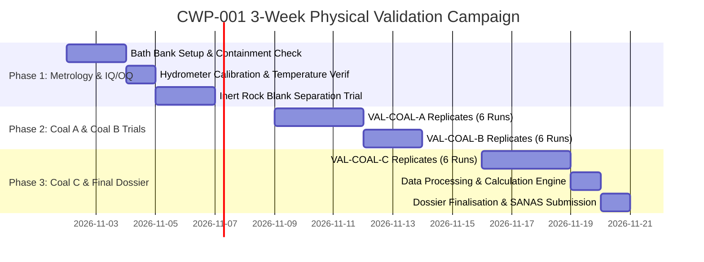

# CWP-001-VAL-PLAN-01: PHYSICAL VALIDATION CAMPAIGN PROTOCOL
## Physical Laboratory Execution Protocol, Replicate Testing Schedule, Witnessing Program, and Empirical Data Capture Plan for ISO 7936:2022 Float-and-Sink Method Validation per ISO/IEC 17025:2017 (Clause 7.2.2) and SANAS TR-26

```
Document ID:         CWP-001-VAL-PLAN-01
Project ID:          CWP-001
Document Type:       Type C (Proposed AzureSky Controlled Validation Protocol)
Parent QMS Ref:      Z:\AZURESKY SYSTEM\AZURESKY QMS\17025\CLAUSE 7\7.2. SELECTION, VERIFICATION AND VALIDATION OF METHODS\7.2.2. METHOD VALIDATION\AS001MMV- Memorandum Validation of Methods ISO 17025 7.2.2.docx
Parent Validation:   CWP-001-VAL-001 (Float-and-Sink Method Validation Dossier)
Governing Standards: ISO 7936:2022, ISO 1953:2025, ISO/IEC 17025:2017 Cl. 7.2.2, SANAS TR-26
Author:              Gift Chisali — Laboratory Supervisor
Technical Review:    S. Nyambi — Laboratory Manager
Approval:            Managing Director / Executive Management
Workspace Path:      C:\Projects\AzureSky\CWP-001\13_METHOD_VALIDATION
Effective Date:      October 2026
Revision:            01
Status:              APPROVED VALIDATION EXECUTION PLAN — READY FOR TRIAL LAUNCH
```

---

## 1. Executive Summary & Purpose

In accordance with [`CWP-001-VAL-001`](file:///c:/Projects/AzureSky/CWP-001/13_METHOD_VALIDATION/CWP-001-VAL-001_FLOAT_AND_SINK_METHOD_VALIDATION_DOSSIER.md) Section 3, all numerical performance tables and curves currently presented in the pre-accreditation validation dossier represent theoretical engineering benchmark models. To achieve formal SANAS accreditation and scope extension under **ISO/IEC 17025:2017 Clause 7.2.2** and **SANAS TR-26**, physical, witnessed, and auditable laboratory trials must be executed.

This protocol, **`CWP-001-VAL-PLAN-01`**, establishes the definitive, 3-week physical laboratory execution plan, raw data capture forms, QA/QC verification gates, and supervisory witnessing program required to generate empirical validation data across representative South African coals.

---

## 2. Validation Campaign Structure & 3-Week Schedule

The campaign spans fifteen (15) working days divided into three structured operational phases:



### 2.1 Week 1: Equipment IQ/OQ, Density Metrology & Blank Trials
- **Day 1–2: Installation & Operational Qualification (IQ/OQ)**:
  - Verify mechanical integrity of HDPE bath bank ([`AS-FS-BATH-01`](file:///c:/Projects/AzureSky/CWP-001/15_EQUIPMENT_AND_METROLOGY/CWP-002_EQUIPMENT_PERFORMANCE_AND_GAP_SPECIFICATION.md)) and secondary containment bund.
  - Verify extraction canopy face velocity ($\ge 0.50\text{ m/s}$ at operator breathing zone).
  - Verify emergency deluge shower and eyewash flow rate ($\ge 75.7\text{ L/min}$ and $\ge 1.5\text{ L/min}$ for 15 minutes).
- **Day 3: Density Metrology & Vertical Stratification Audit**:
  - Calibrate ISO 649-1 Class M50 hydrometer set against certified pycnometers.
  - Measure temperature gradient and vertical stratification (top 10%, mid 50%, bottom 10%) across 8 baths ($1.300\text{ to }2.000\text{ RD}$).
- **Day 4–5: Blank Separation Trial (Inert Quartz / Dense Dolerite)**:
  - Subject $10.0\text{ kg}$ of pure washed inert quartz / dolerite aggregate ($+0.5\text{ mm to }+25.0\text{ mm}$, true $\text{RD} \approx 2.65\text{ g/cm}^3$) to the full separation cycle.
  - **Acceptance Criterion**: $0.00\%$ floats in all baths from $1.300\text{ to }2.000\text{ RD}$; $100.00\%$ sinks recovered at $> 2.000\text{ RD}$. Mass recovery $\ge 99.8\%$.

### 2.2 Week 2: Physical Replicate Trials on Coal A and Coal B
- **Day 6–8: Sample VAL-COAL-A (Witbank Seam 4 Bituminous Steam Coal)**:
  - Execute six (6) independent, witnessed replicate runs ($10.0\text{ kg}$ each) using calibrated rotary splits.
  - Complete full 8-stage separation ($1.300\text{ to }2.000\text{ RD}$), quantitative rinsing, $40^\circ\text{C}$ drying, weighing, and proximate analysis.
- **Day 9–10: Sample VAL-COAL-B (Highveld Seam 2 Heavy Blend)**:
  - Execute six (6) independent replicate runs ($10.0\text{ kg}$ each) on medium-ash coal with high near-density material ($\sim 25\%\text{ NDM}$).

### 2.3 Week 3: Physical Replicate Trials on Coal C & Final Ingestion
- **Day 11–13: Sample VAL-COAL-C (Waterberg Upper Ecca High-Ash Dull Coal)**:
  - Execute six (6) independent replicate runs ($10.0\text{ kg}$ each) on difficult washability coal ($\text{Raw Ash} \approx 42\%$).
- **Day 14: Data Consolidation & Uncertainty Verification**:
  - Run all raw trial benchsheets through calculation engine [`AS_CALC_WASH_01.py`](file:///c:/Projects/AzureSky/CWP-001/11_CALCULATIONS/AS_CALC_WASH_01.py).
  - Compute empirical repeatability standard deviation ($s_r$), mass loss distribution, and reconstituted ash reconciliation.
- **Day 15: Dossier Authorisation & Formal Filing**:
  - Replace theoretical benchmark tables in [`CWP-001-VAL-001`](file:///c:/Projects/AzureSky/CWP-001/13_METHOD_VALIDATION/CWP-001-VAL-001_FLOAT_AND_SINK_METHOD_VALIDATION_DOSSIER.md) with empirical laboratory results.
  - Review by Gift Chisali (Supervisor) and formal sign-off by S. Nyambi (Laboratory Manager).

---

## 3. Sample Sourcing, Homogenization & Division Protocol

```
┌────────────────────────────────────────────────────────────────────────────────────────┐
│                        VALIDATION COAL MATRIX SPECIFICATION                            │
├─────────────┬──────────────────────────┬──────────────┬──────────────┬─────────────────┤
│ Sample ID   │ Source / Seam            │ Raw Ash (%)  │ Gross CV (MJ)│ Washability     │
├─────────────┼──────────────────────────┼──────────────┼──────────────┼─────────────────┤
│ VAL-COAL-A  │ Witbank Coalfield Seam 4 │ 20.0 – 23.0% │ 24.5 – 26.0  │ Free-washing    │
│ VAL-COAL-B  │ Highveld Seam 2          │ 26.0 – 30.0% │ 21.5 – 23.5  │ Moderate / NDM  │
│ VAL-COAL-C  │ Waterberg Upper Ecca     │ 39.0 – 44.0% │ 16.0 – 18.5  │ Difficult / High│
└─────────────┴──────────────────────────┴──────────────┴──────────────┴─────────────────┤
│ Minimum Bulk Sourced: 120 kg per coal type (Total Campaign Bulk: 360 kg + 30 kg Quartz)│
└────────────────────────────────────────────────────────────────────────────────────────┘
```

### 3.1 Sample Preparation Workflow (ISO 13909 / ISO 1953:2025)
1. Air-dry bulk coal ($120\text{ kg}$) at ambient temperature until surface moisture is eliminated.
2. Crush to $-25.0\text{ mm}$ top-size using jaw crusher [`AS8284-CR`](file:///Z:/AZURESKY%20SYSTEM/AZURESKY%20QMS/17025/CLAUSE%206/EQUIPMENT/6.3%20EQUIPMENT%20REGISTER.xlsx).
3. Sieve over certified $0.50\text{ mm}$ screen using mechanical shaker [`AS-FS-SHK-01`](file:///c:/Projects/AzureSky/CWP-001/15_EQUIPMENT_AND_METROLOGY/CWP-002_EQUIPMENT_PERFORMANCE_AND_GAP_SPECIFICATION.md):
   - Retain $-0.50\text{ mm}$ fines for direct raw proximate analysis.
   - Screened $+0.50\text{ mm}$ coarse coal is weighed on platform scale [`AS025PA`](file:///Z:/AZURESKY%20SYSTEM/AZURESKY%20QMS/17025/CLAUSE%206/EQUIPMENT/6.3%20EQUIPMENT%20REGISTER.xlsx).
4. Homogenize and divide $+0.50\text{ mm}$ material into twelve (12) identical $10.0\text{ kg}$ replicate charges using an automated rotary sample divider:
   - Charges 1 to 6: Physical validation separation replicates.
   - Charges 7 to 8: Direct head sample duplicates (crushed to $-0.212\text{ mm}$ for independent head Proximate & CV analysis per ISO 1171 and ISO 1928).
   - Charges 9 to 12: Sealed quality reference retains.

---

## 4. Witnessing Program & Supervisory Responsibilities

To satisfy **SANAS TR-26 Section 4** (*Evidence of Method Competence and Direct Supervision*):
1. **Lead Testing Operator**:
   - Qualified under [`AZCA-007`](file:///c:/Projects/AzureSky/CWP-001/16_COMPETENCY/AZCA-007_FLOAT_AND_SINK_COMPETENCY_ASSESSMENT_PROTOCOL.md) protocol.
   - Executes physical charging, skimming, draining, rinsing, and tray loading.
2. **Witnessing Supervisor (Gift Chisali — Laboratory Supervisor)**:
   - Witness and co-sign 100% of bath density checks ([`ASMF 02`](file:///Z:/AZURESKY%20SYSTEM/AZURESKY%20QMS/17025/CLAUSE%207/7.2.%20SELECTION,%20VERIFICATION%20AND%20VALIDATION%20OF%20METHODS/7.2.1.%20SELECTION%20AND%20VERIFICATION%20OF%20METHODS/PROCEDURES/ASMF%2002-%20FLOAT%20AND%20SINK%20VALIDATION%20FORM.docx)).
   - Directly inspect and verify Electrical Conductivity run-off measurements ($\text{EC} < 100\text{ }\mu\text{S/cm}$) and $\text{AgNO}_3$ tests.
   - Verify balance tare and mass-balance loss calculations on [`AS030TF`](file:///c:/Projects/AzureSky/CWP-001/17_SOPS_AND_FORMS/AS030TF_FLOAT_AND_SINK_BENCHSHEET_AND_CALCULATION_TEMPLATE.md).
3. **Approving Authority (Sifiso Nyambi — Laboratory Manager)**:
   - Audit calibration records and witnessed benchsheets weekly.
   - Sign off final validation performance characteristics and fitness-for-purpose statement.

---

## 5. Statistical Acceptance Gates (SANAS TR-26 Mapping)

Every physical validation run must satisfy the mandatory statistical acceptance gates detailed below:

| Validation Parameter | Test Method / Measurand | Acceptance Criteria | Governing Standard |
| :--- | :--- | :--- | :--- |
| **Gravimetric Mass Loss** | Feed vs. Total Recovered | $\Delta M_{\text{loss}} \le 1.0\%$ (Target), $\le 2.0\%$ (Hard Max) | ISO 7936:2022 Cl. 7 |
| **Ash Reconstitution** | Composite Ash vs. Raw Head Ash | $|\text{Ash}_{\text{rec}} - \text{Ash}_{\text{head}}| \le 0.50\%$ absolute | ISO 1171 / AS003IW |
| **CV Reconstitution** | Composite CV vs. Raw Head CV | $|\text{CV}_{\text{rec}} - \text{CV}_{\text{head}}| \le 0.30\text{ MJ/kg}$ absolute | ISO 1928 / AS007IW |
| **Repeatability Precision ($s_r$)**| Fractional Yields across 6 replicates | $s_r \le 0.8\%$ absolute on major cuts | SANAS TR-26 Cl. 5.2 |
| **Cut-Point Repeatability** | Tromp Cut-Point ($\text{d}_{50}$) | Repeatability range $\le 0.005\text{ g/cm}^3$ | ISO 7936 Annex B |
| **Washing Cleanliness** | Final Run-off Water | $\text{EC} < 100\text{ }\mu\text{S/cm}$ and $\text{AgNO}_3$ Negative | CWP-001-DM-001 |
| **Thermal Drying Control** | Forced-air oven drying | Strict $40.0 \pm 2.0^\circ\text{C}$ to constant mass | AS013IW Rev 02 |

---

## 6. Authorisation & Campaign Release

```
Campaign Planned and Formulated by:
_____________________________________________               Date: October 2026
Gift Chisali — Laboratory Supervisor

Approved for Execution:
_____________________________________________               Date: ______________
Sifiso Nyambi — Laboratory Manager
```
