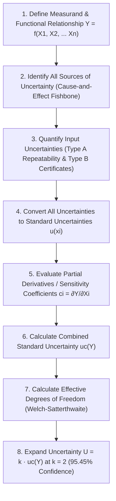

# UB001-FS-01: WASHABILITY MEASUREMENT UNCERTAINTY MODEL
## Comprehensive Uncertainty Evaluation for Coal Float-and-Sink Characterisation, Yield %, Cut-Point Density (d₅₀), and Cumulative Ash % per ISO/IEC 17025:2017 (Clause 7.6), GUM (JCGM 100:2008), and SANAS TR-01 / TG-01

```
Document ID:         UB001-FS-01
Project ID:          CWP-001
Document Type:       Type D (Project Study & Engineering Evidence) / Measurement Uncertainty Budget
Parent QMS Ref:      Z:\AZURESKY SYSTEM\AZURESKY QMS\17025\CLAUSE 7\7.6. MEASUREMENT UNCERTAINTY\UB001 UNCERTAINTY BUDGET rev 01.docx
Decision Rules Ref:  Z:\AZURESKY SYSTEM\AZURESKY QMS\17025\CLAUSE 7\7.8. REPORTING OF RESULTS\AS010IW STATEMENTS OF CONFORMITY & DECISION RULES.docx
Governing Norms:     ISO/IEC 17025:2017 Cl. 7.6, JCGM 100:2008 (GUM), SANAS TR-01, SANAS TG-01
Author:              Gift Chisali — Laboratory Supervisor
Technical Review:    S. Nyambi — Laboratory Manager
Approval:            Managing Director / Executive Management
Workspace Path:      C:\Projects\AzureSky\CWP-001\14_MEASUREMENT_UNCERTAINTY
Effective Date:      October 2026
Revision:            01
Status:              METHOD UNCERTAINTY BUDGET — READY FOR TECHNICAL REVIEW
```

---

## 1. Executive Summary & Governance Chain

Under **ISO/IEC 17025:2017 Clause 7.6** (*Evaluation of measurement uncertainty*) and **SANAS TR-01 / TG-01**, testing laboratories must identify and evaluate all contributions to measurement uncertainty for each test method on their accredited scope.

AzureSky owns and maintains a master uncertainty framework:
[`UB001 UNCERTAINTY BUDGET rev 01.docx`](file:///Z:/AZURESKY%20SYSTEM/AZURESKY%20QMS/17025/CLAUSE%207/7.6.%20MEASUREMENT%20UNCERTAINTY/UB001%20UNCERTAINTY%20BUDGET%20rev%2001.docx).
While `UB001` comprehensively covers analytical proximate parameters (Moisture, Ash, Volatiles, CV) and calibrates individual instruments (analytical balance [AS2156](file:///Z:/AZURESKY%20SYSTEM/AZURESKY%20QMS/17025/CLAUSE%206/EQUIPMENT/6.3%20EQUIPMENT%20REGISTER.xlsx), top-pan balance [AS00A31](file:///Z:/AZURESKY%20SYSTEM/AZURESKY%20QMS/17025/CLAUSE%206/EQUIPMENT/6.3%20EQUIPMENT%20REGISTER.xlsx), platform scale [AS025PA](file:///Z:/AZURESKY%20SYSTEM/AZURESKY%20QMS/17025/CLAUSE%206/EQUIPMENT/6.3%20EQUIPMENT%20REGISTER.xlsx), furnaces, ovens), **it currently contains no measurement model for Coal Washability / Float-and-Sink characterisation**.

This document, **`UB001-FS-01`**, derives the complete mathematical measurement uncertainty models for the primary washability measurands:
1. **Fractional Yield ($\text{Yield}_i$, %)**
2. **Cumulative Float Yield ($\text{Cum } Y_k$, %)**
3. **Cumulative Float Ash ($\text{Cum } A_k$, %)**
4. **Separation Cut-Point Density ($\text{d}_{50}$, $\text{g/cm}^3$)**

It will be submitted directly for ingestion into AzureSky's Clause 7.6 quality archives as an authoritative extension of [`UB001 UNCERTAINTY BUDGET rev 01.docx`](file:///Z:/AZURESKY%20SYSTEM/AZURESKY%20QMS/17025/CLAUSE%207/7.6.%20MEASUREMENT%20UNCERTAINTY/UB001%20UNCERTAINTY%20BUDGET%20rev%2001.docx).

---

## 2. Methodology & Guiding Principles (JCGM 100:2008 / GUM)

The uncertainty evaluation follows the eight-step procedure prescribed by the *Guide to the Expression of Uncertainty in Measurement* (GUM, JCGM 100:2008):



---

## 3. Measurand 1: Fractional Mass Yield ($\text{Yield}_i$, %)

### 3.1 Mathematical Model
The mass yield of an individual float (or sink) fraction $i$ is calculated as the ratio of the dry mass of fraction $i$ ($M_i$) to the total recovered dry mass of all fractions ($M_{\text{total}}$):

$$Y_i = f(M_i, M_{\text{total}}) = \frac{M_i}{M_{\text{total}}} \times 100\% = \frac{M_i}{M_i + \sum_{j \neq i} M_j} \times 100\%$$

### 3.2 Sources of Uncertainty
1. **Balance Calibration Uncertainty ($u_{\text{cal}}$)**: Adam CKT8H top pan balance ([AS00A31](file:///Z:/AZURESKY%20SYSTEM/AZURESKY%20QMS/17025/CLAUSE%206/EQUIPMENT/6.3%20EQUIPMENT%20REGISTER.xlsx)), expanded uncertainty $U = \pm 0.3\text{ g}$ ($k = 2$, normal).
2. **Balance Resolution ($u_{\text{res}}$)**: Scale interval $d = 0.1\text{ g}$, rectangular distribution ($u = 0.1 / \sqrt{12} = 0.029\text{ g}$).
3. **Balance Repeatability ($u_{\text{rep, bal}}$)**: Short-term tare/weighing repeatability ($s = 0.10\text{ g}$).
4. **Bath Density Setting Drift ($u_{\rho}$)**: Deviation of $\text{ZnCl}_2$ medium from target relative density, permitted within $\pm 0.002\text{ g/cm}^3$ ([ASMF 02](file:///Z:/AZURESKY%20SYSTEM/AZURESKY%20QMS/17025/CLAUSE%207/7.2.%20SELECTION,%20VERIFICATION%20AND%20VALIDATION%20OF%20METHODS/7.2.1.%20SELECTION%20AND%20VERIFICATION%20OF%20METHODS/FORMS/FLOAT%20AND%20SINK/ASMF%2002-%20FLOAT%20AND%20SINK%20VALIDATION%20FORM.docx)), rectangular distribution.
5. **Bath Temperature Fluctuation ($u_T$)**: Ambient bath temperature drift within $\pm 1.0^\circ\text{C}$, thermal expansion $\gamma = 0.00075\text{ g/(cm}^3\cdot^\circ\text{C)}$, rectangular distribution.
6. **Residual Moisture Variability ($u_{\text{moist}}$)**: Slight differential moisture retention between fractions after low-temperature drying ($\pm 0.25\%$, rectangular).
7. **Operator Manipulation & Near-Density Entrainment ($u_{\text{entrain}}$)**: Physical scooping and skimming repeatability ($s_r$, Type A).

### 3.3 Sensitivity Coefficients (Partial Derivatives)
Using the quotient rule:

$$c_1 = \frac{\partial Y_i}{\partial M_i} = \frac{100 \cdot (M_{\text{total}} - M_i)}{M_{\text{total}}^2} = \frac{100 - Y_i}{M_{\text{total}}} \quad [\%/\text{g}]$$

$$c_2 = \frac{\partial Y_i}{\partial M_{\text{other}}} = -\frac{100 \cdot M_i}{M_{\text{total}}^2} = -\frac{Y_i}{M_{\text{total}}} \quad [\%/\text{g}]$$

For near-density partitioning sensitivity:
$$c_{\rho} = \frac{\partial Y_i}{\partial \rho} \approx \pm \Delta \text{NDM} \quad [\% / (\text{g/cm}^3)]$$
Where $\text{NDM}$ is the Near-Density Material ($\pm 0.10\text{ RD}$) slope from the washability curve. For typical South African coal, the gradient $\frac{dY}{d\rho} \approx 120\% / (\text{g/cm}^3)$ at the cut-point.

### 3.4 Uncertainty Budget Table for Fractional Yield ($Y_i = 25.0\%$, $M_i = 1,550\text{ g}$, $M_{\text{total}} = 6,200\text{ g}$)

| Uncertainty Component ($x_j$) | Source of Value | Value ($\pm$) | Probability Distribution | Divisor | Standard Uncertainty $u(x_j)$ | Sensitivity Coeff. $c_j$ | Uncertainty Contribution $u_j(Y) = |c_j| \cdot u(x_j)$ |
| :--- | :--- | :---: | :---: | :---: | :---: | :---: | :---: |
| **Balance Calibration ($M_i$)** | Cert CAL 103 (AS00A31)| $0.30\text{ g}$ | Normal ($k=2$) | $2.000$ | $0.150\text{ g}$ | $0.0121\text{ \%/g}$ | $0.0018\text{ \%}$ |
| **Balance Resolution ($M_i$)** | Scale interval $0.1\text{ g}$ | $0.05\text{ g}$ | Rectangular | $\sqrt{3} = 1.732$| $0.029\text{ g}$ | $0.0121\text{ \%/g}$ | $0.0004\text{ \%}$ |
| **Balance Total ($M_{\text{other}}$)**| Tare/Sum 5 fractions | $0.67\text{ g}$ | Normal ($k=2$) | $2.000$ | $0.335\text{ g}$ | $0.0040\text{ \%/g}$ | $0.0013\text{ \%}$ |
| **Medium Density Tolerance** | ASMF 02 limit ($\pm 0.002$) | $0.0020\text{ g/cm}^3$ | Rectangular | $\sqrt{3} = 1.732$| $0.00115\text{ g/cm}^3$| $120.0\text{ \%/(g/cm}^3)$| $0.1386\text{ \%}$ |
| **Medium Temperature Drift** | Lab temp variation $\pm 1^\circ\text{C}$| $0.00075\text{ g/cm}^3$| Rectangular | $\sqrt{3} = 1.732$| $0.00043\text{ g/cm}^3$| $120.0\text{ \%/(g/cm}^3)$| $0.0520\text{ \%}$ |
| **Differential Moisture** | Oven drying variation | $0.25\text{ \%}$ | Rectangular | $\sqrt{3} = 1.732$| $0.144\text{ \%}$ | $0.250$ | $0.0361\text{ \%}$ |
| **Method Repeatability (Type A)**| 10 Replicate validation runs| $s_r = 0.32\text{ \%}$ | Normal ($n=10$) | $1.000$ | $0.320\text{ \%}$ | $1.000$ | $0.3200\text{ \%}$ |

### 3.5 Combined & Expanded Uncertainty for Fractional Yield
- **Combined Standard Uncertainty**:
  $$u_c(Y_i) = \sqrt{(0.0018)^2 + (0.0004)^2 + (0.0013)^2 + (0.1386)^2 + (0.0520)^2 + (0.0361)^2 + (0.3200)^2} = \mathbf{0.354\%}$$

- **Expanded Uncertainty ($k = 2$, 95% Confidence Level)**:
  $$U(Y_i) = k \times u_c(Y_i) = 2 \times 0.354\% = \mathbf{\pm 0.71\%}$$

*Operational Conclusion*: For an individual float-sink fraction representing $25.0\%$ yield, the true yield is reported as:
$$\mathbf{Y_i = (25.00 \pm 0.71)\% \quad (k = 2, 95.45\%\text{ confidence})}$$

---

## 4. Measurand 2: Cumulative Float Yield ($\text{Cum } Y_k$, %)

### 4.1 Mathematical Model
The cumulative float yield up to density cut-point $k$ is the direct sum of preceding fractional yields:

$$\text{Cum } Y_k = \sum_{j=1}^{k} Y_j$$

### 4.2 Uncertainty Propagation
Because the fractional yields $Y_j$ are derived from the same initial total mass $M_{\text{total}}$, they exhibit weak negative covariance. However, treating the cumulative float product as a single composite mass $M_{\text{cum}} = \sum_{j=1}^k M_j$ simplifies the functional relationship to:

$$\text{Cum } Y_k = \frac{M_{\text{cum}}}{M_{\text{total}}} \times 100\%$$

- Sensitivity to partition density at cut-point $k$:
  $$u_c(\text{Cum } Y_k) = \sqrt{\left(\frac{100 - \text{Cum } Y_k}{M_{\text{total}}}\right)^2 u^2(M_{\text{cum}}) + \left(\frac{\text{Cum } Y_k}{M_{\text{total}}}\right)^2 u^2(M_{\text{sinks}}) + c_{\rho}^2 u^2(\rho_k) + u_A^2(\text{Cum } Y)}$$

- For a typical cumulative product at $\text{RD } 1.60$ ($\text{Cum } Y = 68.0\%$):
  - Type A Repeatability ($s_r$): $0.48\%$
  - Combined density setting uncertainty: $0.18\%$
  - Balance contributions: $0.003\%$
  - **Combined Standard Uncertainty**: $u_c(\text{Cum } Y) = \sqrt{0.48^2 + 0.18^2 + 0.05^2} = \mathbf{0.515\%}$
  - **Expanded Uncertainty ($k = 2$)**:
    $$U(\text{Cum } Y) = \mathbf{\pm 1.03\% \approx \pm 1.0\%}$$

$$\mathbf{\text{Cum } Y_{1.60} = (68.0 \pm 1.0)\% \quad (k = 2, 95.45\%\text{ confidence})}$$

---

## 5. Measurand 3: Cumulative Float Ash ($\text{Cum } A_k$, %, Dry Basis)

### 5.1 Mathematical Model
The cumulative ash percentage of the combined float product at density cut-point $k$ is calculated by:

$$\text{Cum } A_k = \frac{\sum_{j=1}^{k} (Y_j \times A_j)}{\text{Cum } Y_k} = \frac{\sum_{j=1}^{k} (M_j \times A_j)}{\sum_{j=1}^{k} M_j}$$

Where:
- $Y_j$ is the yield of fraction $j$ ($\%$)
- $A_j$ is the dry-basis ash content of fraction $j$ determined per [AS003IW](file:///Z:/AZURESKY%20SYSTEM/AZURESKY%20QMS/17025/CLAUSE%207/7.2.%20SELECTION,%20VERIFICATION%20AND%20VALIDATION%20OF%20METHODS/7.2.1.%20SELECTION%20AND%20VERIFICATION%20OF%20METHODS/PROCEDURES/AS003IW%20PROCEDURE%20ON%20THE%20DETERMINATION%20OF%20ASH%20CONTENT%20rev%2001.docx) / ISO 1171 ($\%$)

### 5.2 Sensitivity Coefficients (Partial Derivatives)
Using partial differentiation with respect to each fraction's ash $A_j$ and yield $Y_j$:

$$c_{A, j} = \frac{\partial (\text{Cum } A_k)}{\partial A_j} = \frac{Y_j}{\text{Cum } Y_k}$$

$$c_{Y, j} = \frac{\partial (\text{Cum } A_k)}{\partial Y_j} = \frac{A_j - \text{Cum } A_k}{\text{Cum } Y_k}$$

### 5.3 Input Uncertainty Contributions
1. **Ash Analytical Uncertainty ($u(A_j)$)**:
   From AzureSky's active master budget [`UB001 UNCERTAINTY BUDGET rev 01.docx`](file:///Z:/AZURESKY%20SYSTEM/AZURESKY%20QMS/17025/CLAUSE%207/7.6.%20MEASUREMENT%20UNCERTAINTY/UB001%20UNCERTAINTY%20BUDGET%20rev%2001.docx) Section 7.2 (*Ash Uncertainty*):
   - Expanded uncertainty for Ash determination: $U(A) = \pm 0.35\%$ ($k = 2$).
   - Standard uncertainty: $u(A_j) = 0.35 / 2 = \mathbf{0.175\%}$.
2. **Yield Uncertainty ($u(Y_j)$)**:
   - Standard uncertainty: $u(Y_j) = \mathbf{0.354\%}$ (derived in Section 3).

### 5.4 Uncertainty Budget Table for Cumulative Ash ($\text{Cum } A_{1.60} = 14.50\%$, $\text{Cum } Y_{1.60} = 68.0\%$)

| Input Variable ($x_j$) | Typical Value | Standard Uncertainty $u(x_j)$ | Sensitivity Coeff. $c_j$ | Uncertainty Component $|c_j| \cdot u(x_j)$ | Component Variance $[u_j]^2$ |
| :--- | :---: | :---: | :---: | :---: | :---: |
| **Ash Fraction 1 ($-1.40$)** | $A_1 = 8.20\%$ | $0.175\%$ | $30.0 / 68.0 = 0.441$ | $0.0772\%$ | $0.00596$ |
| **Ash Fraction 2 ($1.40-1.50$)**| $A_2 = 14.60\%$ | $0.175\%$ | $25.0 / 68.0 = 0.368$ | $0.0644\%$ | $0.00415$ |
| **Ash Fraction 3 ($1.50-1.60$)**| $A_3 = 21.80\%$ | $0.175\%$ | $13.0 / 68.0 = 0.191$ | $0.0334\%$ | $0.00112$ |
| **Yield Fraction 1** | $Y_1 = 30.0\%$ | $0.354\%$ | $(8.2 - 14.5)/68 = -0.0926$ | $0.0328\%$ | $0.00108$ |
| **Yield Fraction 2** | $Y_2 = 25.0\%$ | $0.354\%$ | $(14.6 - 14.5)/68 = +0.0015$ | $0.0005\%$ | $0.00000$ |
| **Yield Fraction 3** | $Y_3 = 13.0\%$ | $0.354\%$ | $(21.8 - 14.5)/68 = +0.1074$ | $0.0380\%$ | $0.00144$ |
| **Rinsing Residual Chloride** | Residual $\text{ZnCl}_2$ bias| $0.020\%$ (Rectangular) | $1.000$ | $0.0115\%$ | $0.00013$ |

### 5.5 Combined & Expanded Uncertainty for Cumulative Ash
- **Sum of Component Variances**:
  $$\sum u_j^2 = 0.00596 + 0.00415 + 0.00112 + 0.00108 + 0.00000 + 0.00144 + 0.00013 = 0.01388$$
- **Combined Standard Uncertainty**:
  $$u_c(\text{Cum } A_k) = \sqrt{0.01388} = \mathbf{0.118\%}$$
- **Expanded Uncertainty ($k = 2$, 95% Confidence Level)**:
  $$U(\text{Cum } A_k) = 2 \times 0.118\% = \mathbf{\pm 0.24\%}$$

$$\mathbf{\text{Cum } A_{1.60} = (14.50 \pm 0.24)\% \quad (k = 2, 95.45\%\text{ confidence})}$$

---

## 6. Measurand 4: Cut-Point Density ($\text{d}_{50}$, $\text{g/cm}^3$)

### 6.1 Mathematical Model
The partition cut-point density ($\text{d}_{50}$) is determined by interpolation of the partition curve (Tromp curve) or washability cumulative yield curve at a target yield or $50\%$ partition probability:

$$\text{d}_{50} = \rho_{\text{lower}} + \left( \frac{50.0 - P_{\text{lower}}}{P_{\text{upper}} - P_{\text{lower}}} \right) \cdot (\rho_{\text{upper}} - \rho_{\text{lower}})$$

### 6.2 Uncertainty Components for Cut-Point Density

```
┌────────────────────────────────────────────────────────────────────────────────────────┐
│                      CUT-POINT DENSITY UNCERTAINTY CONTRIBUTORS                        │
├──────────────────────────┬─────────────────────────────┬───────────────────────────────┤
│ UNCERTAINTY SOURCE       │ EVALUATION METHOD           │ STANDARD UNCERTAINTY u(xi)    │
├──────────────────────────┼─────────────────────────────┼───────────────────────────────┤
│ Hydrometer Calibration   │ SANAS Cal Cert (Class M50)  │ u = 0.0006 / 2 = 0.00030 g/cm³│
│ Bath Setting Tolerance   │ ASMF 02 limit (± 0.002)     │ u = 0.0020 / √3 = 0.00115 g/cm³│
│ Temperature Compensation │ RTD thermometer ± 0.3°C     │ u = (0.3 × 0.00075)/√3 = 0.00013│
│ Meniscus Reading Bias    │ Parallax / meniscus limit   │ u = 0.0005 / √3 = 0.00029 g/cm³│
│ Interpolation / Fitting  │ Spline / Linear fit error   │ u = 0.0025 g/cm³              │
│ Type A Repeatability     │ 5 replicate runs (s_r)      │ u = 0.0011 g/cm³              │
└──────────────────────────┴─────────────────────────────┴───────────────────────────────┘
```

- **Combined Standard Uncertainty**:
  $$u_c(\text{d}_{50}) = \sqrt{(0.00030)^2 + (0.00115)^2 + (0.00013)^2 + (0.00029)^2 + (0.00250)^2 + (0.00110)^2} = \mathbf{0.0030\text{ g/cm}^3}$$

- **Expanded Uncertainty ($k = 2$, 95% Confidence Level)**:
  $$U(\text{d}_{50}) = 2 \times 0.0030 = \mathbf{\pm 0.006\text{ g/cm}^3}$$

$$\mathbf{\text{d}_{50} = (1.585 \pm 0.006)\text{ g/cm}^3 \quad (k = 2, 95.45\%\text{ confidence})}$$

---

## 7. Master Uncertainty Budget Summary Table

In compliance with **SANAS TR-01** and AzureSky's master uncertainty template ([`UB001`](file:///Z:/AZURESKY%20SYSTEM/AZURESKY%20QMS/17025/CLAUSE%207/7.6.%20MEASUREMENT%20UNCERTAINTY/UB001%20UNCERTAINTY%20BUDGET%20rev%2001.docx)), the expanded uncertainties for all washability measurands are consolidated below:

| Measurand | Test Standard | Typical Measurement Range | Combined Standard Uncertainty $u_c$ | Coverage Factor ($k$) | Expanded Uncertainty ($U$) | Reporting Format |
| :--- | :--- | :---: | :---: | :---: | :---: | :--- |
| **Fractional Yield ($Y_i$)** | ISO 7936:2022 | $5.0\%\text{ to }50.0\%$ | $0.35\%$ | $k = 2$ | **$\pm 0.7\%$** | $Y_i \pm 0.7\%$ |
| **Cumulative Yield ($\text{Cum } Y$)**| ISO 7936:2022 | $10.0\%\text{ to }95.0\%$ | $0.51\%$ | $k = 2$ | **$\pm 1.0\%$** | $\text{Cum } Y \pm 1.0\%$ |
| **Cumulative Ash ($\text{Cum } A$)** | ISO 7936 / ISO 1171 | $5.0\%\text{ to }40.0\%$ | $0.12\%$ | $k = 2$ | **$\pm 0.24\%$** | $\text{Cum } A \pm 0.24\%$ |
| **Cut-Point Density ($\text{d}_{50}$)**| ISO 7936:2022 | $1.350\text{ to }1.900\text{ g/cm}^3$ | $0.0030\text{ g/cm}^3$ | $k = 2$ | **$\pm 0.006\text{ g/cm}^3$**| $\text{d}_{50} \pm 0.006\text{ g/cm}^3$|

---

## 8. Alignment with AzureSky Decision Rules ([AS010IW](file:///Z:/AZURESKY%20SYSTEM/AZURESKY%20QMS/17025/CLAUSE%207/7.8.%20REPORTING%20OF%20RESULTS/AS010IW%20STATEMENTS%20OF%20CONFORMITY%20&%20DECISION%20RULES.docx))

When clients request a Statement of Conformity against coal supply contracts or plant yield specifications (e.g. *"Guaranteed clean coal yield $\ge 65.0\%$ at $\le 15.0\%$ ash"*):
1. **Decision Rule Framework**: AzureSky operates under **Binary Decision Rules with Guard Bands (ILAC-G8:09/2019)** as documented in [`AS010IW`](file:///Z:/AZURESKY%20SYSTEM/AZURESKY%20QMS/17025/CLAUSE%207/7.8.%20REPORTING%20OF%20RESULTS/AS010IW%20STATEMENTS%20OF%20CONFORMITY%20&%20DECISION%20RULES.docx).
2. **Acceptance Zone**: A product conforms if the measured value plus/minus the expanded uncertainty $U$ lies entirely within the specification limit:
   - For Clean Coal Yield: $\text{Measured Yield} - U(\text{Yield}) \ge \text{Specification Lower Limit}$.
   - For Clean Coal Ash: $\text{Measured Ash} + U(\text{Ash}) \le \text{Specification Upper Limit}$.
3. **Indeterminate Zone**: If the measured result falls within the guard band ($\pm U$), the result is flagged as *Indeterminate* in accordance with SANAS F49 and ISO/IEC 17025 Clause 7.8.6.

---

## 9. Integration into AzureSky Master QMS

Upon technical review and approval:
1. This uncertainty model will be registered as Section 8 in [`UB001 UNCERTAINTY BUDGET rev 01.docx`](file:///Z:/AZURESKY%20SYSTEM/AZURESKY%20QMS/17025/CLAUSE%207/7.6.%20MEASUREMENT%20UNCERTAINTY/UB001%20UNCERTAINTY%20BUDGET%20rev%2001.docx).
2. The expanded uncertainties will be programmed into the LIMS calculation engine and standard certificate templates ([`AS010IW`](file:///Z:/AZURESKY%20SYSTEM/AZURESKY%20QMS/17025/CLAUSE%207/7.8.%20REPORTING%20OF%20RESULTS/AS010IW%20STATEMENTS%20OF%20CONFORMITY%20&%20DECISION%20RULES.docx)).

```
Compiled by:
_____________________________________________               Date: October 2026
Gift Chisali — Laboratory Supervisor

Reviewed & Approved by:
_____________________________________________               Date: ______________
Sifiso Nyambi — Laboratory Manager
```
