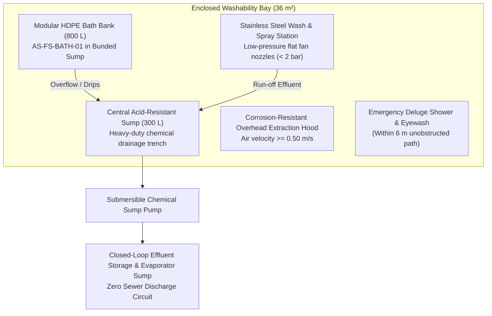
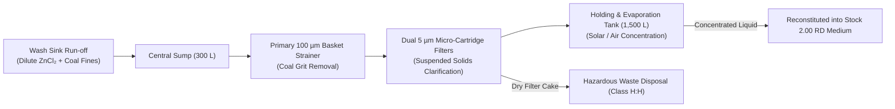

# CWP-002-COMM: PRODUCTION WASH BAY SETUP & COMMISSIONING GUIDE
## Engineering Specifications, Civil & Plumbing Layout, Bunding & Secondary Containment, Extraction & Ventilation, Effluent Closed-Loop System, and IQ/OQ/PQ Commissioning Protocol for the AzureSky Coal Washability Testing Bay per ISO 7936:2022, OHSA HCA 2021, and NEMWA

```
Document ID:         CWP-002-COMM Rev 01
Project ID:          CWP-001
Document Type:       Type D (Engineering Facility & Commissioning Specification)
Facility Location:   Unit 3, 17 Markiel Rd, Wadeville, Germiston 1401 (Dedicated Wash Bay)
Equipment Ref:       CWP-002 (Equipment Performance and Gap Specification)
Operating SOP:       AS013IW Rev 02 (Float and Sink Analysis of Hard Coal)
Safety & Regs:       OHSA Regulations for Hazardous Chemical Agents (GNR 280 / 2021), NEMWA (Act 59 of 2008)
Author:              Gift Chisali — Laboratory Supervisor
Technical Review:    S. Nyambi — Laboratory Manager
Approval:            Managing Director / Executive Management
Workspace Path:      C:\Projects\AzureSky\CWP-001\15_EQUIPMENT_AND_METROLOGY
Effective Date:      October 2026
Revision:            01
Status:              APPROVED ENGINEERING COMMISSIONING GUIDE — READY FOR PHYSICAL FIT-OUT
```

---

## 1. Executive Summary & Facility Purpose

To support accredited, production-scale coal float-and-sink testing under **ISO 7936:2022** and **ISO/IEC 17025:2017**, AzureSky must establish a dedicated, segregated, and chemically controlled **Coal Washability Bay** within its Wadeville testing facility (Unit 3, 17 Markiel Rd).

Dense medium separation utilizing aqueous Zinc Chloride ($\text{ZnCl}_2$) involves high chemical corrosivity (Skin Corr. 1B, H314), aquatic toxicity (Aquatic Chronic 1, H410), high volume liquid handling ($800\text{ L}$ active bath bank), and stringent gravimetric washing standards ($\text{EC} < 100\text{ }\mu\text{S/cm}$). Testing cannot be conducted haphazardly on open laboratory benches or in common preparation areas.

This document, **`CWP-002-COMM`**, provides the comprehensive engineering design, civil and plumbing requirements, closed-loop environmental controls, and the three-stage Installation, Operational, and Performance Qualification (IQ/OQ/PQ) commissioning protocols required to bring the wash bay into full production readiness.

---

## 2. Architectural Layout & Civil Containment

```
┌────────────────────────────────────────────────────────────────────────────────────────┐
│                        WASHABILITY BAY ARCHITECTURAL SPECIFICATION                     │
├──────────────────────────┬─────────────────────────────────────────────────────────────┤
│ Dedicated Floor Area     │ 6.0 m × 6.0 m (36.0 m² segregated enclosed bay)             │
│ Wall Construction        │ Smooth rendered masonry with acid-resistant epoxy coating   │
│ Flooring Specification   │ Heavy-duty chemical-resistant epoxy screed (4 mm thickness, │
│                          │ resistant to concentrated ZnCl₂ pH 1.0 to 6.0, non-slip)    │
│ Secondary Containment    │ Continuous 150 mm high perimeter concrete bund wall         │
│ Containment Volume       │ 5,400 L capacity (> 500% of maximum single vessel volume,   │
│                          │ exceeding NEMWA 110% statutory retention requirement)       │
│ Floor Fall / Drainage    │ 1:50 gradient falling toward central chemical sump trench   │
│ Ingress / Egress         │ Double-leaf fire door with 150 mm ramped containment lip    │
└──────────────────────────┴─────────────────────────────────────────────────────────────┘
```



---

## 3. Plumbing, Fresh Water & Extraction Engineering

### 3.1 Water Supply & Spray Manifold
1. **Fresh Water Ring Main**:
   - $25\text{ mm}$ copper or high-density polyethylene (HDPE PN16) fresh water supply line delivering minimum $3.0\text{ bar}$ static pressure.
   - Reduced Pressure Zone (RPZ) backflow prevention valve installed upstream to prevent chemical back-siphonage into municipal water supply.
2. **Low-Pressure Rinsing Manifold**:
   - Pressure-reducing valve (PRV) set strictly at **$1.8 \pm 0.2\text{ bar}$**.
   - Dual spray lances fitted with wide-angle flat-fan nozzles ($65^\circ$ spray angle) mounted above the washing sink to achieve rapid salt removal without producing airborne zinc chloride mists.
3. **Wash Sink & Drainage Trench**:
   - Grade 316 Stainless Steel washing trough ($1800\text{ mm} \times 600\text{ mm} \times 400\text{ mm}$ deep) with perforated false bottom for basket support during spray rinsing.

### 3.2 Atmospheric Extraction & Mist Abatement
Under the South African **Regulations for Hazardous Chemical Agents (GNR 280 of 2021)**, the 8-hour Occupational Exposure Limit (OEL-TWA) for Zinc Chloride mist/fume is **$1.0\text{ mg/m}^3$**.
1. **Canopy Hood**:
   - Polypropylene (PP) overhead canopy hood ($3200\text{ mm} \times 900\text{ mm}$) covering the entire bath bank.
   - Designed to maintain a capture face velocity $\ge 0.50\text{ m/s}$ at the liquid surface interface.
2. **Extraction Ducting & Fan**:
   - DN250 chemical-resistant PVC/PP ductwork discharging vertically above the roofline.
   - Corrosion-proof centrifugal extraction fan (minimum capacity $2,800\text{ m}^3\text{/h}$), IP65 rated.

---

## 4. Environmental Control & Closed-Loop Effluent Circuit (NEMWA Compliance)

Under South African environmental law (**National Environmental Management: Waste Act, Act 59 of 2008** and municipal trade effluent by-laws), **zero Zinc Chloride effluent may enter municipal sewers or storm water systems**.

The wash bay operates on a strictly closed-loop recycling circuit:



1. **Effluent Collection**: All rinse water and drainage collect in the epoxy sump trench.
2. **Solids Clarification**: Liquid is pumped through a washable $100\text{ }\mu\text{m}$ stainless basket filter followed by $5\text{ }\mu\text{m}$ polypropylene sediment cartridges.
3. **Re-Concentration**: Clean filtrate is directed to the intermediate holding tank where it is either utilized as make-up water for lower density baths ($1.30\text{ to }1.50\text{ RD}$) or fortified with technical-grade $\text{ZnCl}_2$ flakes to reconstitute $2.00\text{ RD}$ stock solution.
4. **Waste Manifesting**: Spent filter cartridges and insolubles are drummed in certified steel UN-rated drums, manifested under SANS 10234, and disposed of via a licensed hazardous waste management contractor.

---

## 5. Metrological Commissioning Protocol (IQ / OQ / PQ)

Commissioning must follow formal Three-Tier Metrological Qualification:

### 5.1 Installation Qualification (IQ)
- [ ] **Civil Containment**: Bund wall height verified at $150\text{ mm}$; bund volume confirmed $\ge 5,000\text{ L}$.
- [ ] **Chemical Resistance**: Epoxy coating curing inspection; spark testing for pinholes.
- [ ] **Asset Receipt**: Verification of all physical items against [`CWP-002`](file:///c:/Projects/AzureSky/CWP-001/15_EQUIPMENT_AND_METROLOGY/CWP-002_EQUIPMENT_PERFORMANCE_AND_GAP_SPECIFICATION.md) BOQ:
  - 8× HDPE tanks (AS-FS-BATH-01).
  - 8× 316 SS insert baskets (AS-FS-BSK-01) and skimming scoops.
  - Complete hydrometer set (AS-FS-HYD-01) with current SANAS calibration certificates.
  - Digital RTD thermometer (AS-FS-THERM-01) with SANAS certificate.
  - Electrical Conductivity meter (AS-FS-COND-01).
  - Drying trays and trolley racks.
- [ ] **Safety Shower & Eyewash**: Installed within 6 m; plumbing connected and tested.

### 5.2 Operational Qualification (OQ)
- [ ] **Extraction Performance**: Capture face velocity measured at 6 grid points under the hood using a calibrated anemometer (Pass: $\text{Mean} \ge 0.50\text{ m/s}$).
- [ ] **Spray Pressure**: Water pressure measured at nozzle inlet (Pass: $\le 2.0\text{ bar}$).
- [ ] **Drainage Integrity**: Full water fill of wash sinks; verify zero leakage at drain valves.
- [ ] **Sump Pump Automation**: High-level float switch tested; verify automated sump clearance to holding tank.
- [ ] **Emergency Shower Flow**: Flow rate measured (Pass: Shower $\ge 75.7\text{ L/min}$, Eyewash $\ge 1.5\text{ L/min}$ for 15 minutes continuous).

### 5.3 Performance Qualification (PQ)
- [ ] **Density Scale Linearity**: Prepare working baths across 8 density stages ($1.300, 1.400, 1.500, 1.600, 1.700, 1.800, 1.900, 2.000\text{ RD}$). Verify each using Class M50 hydrometer and temperature compensation formula. (Pass: All baths within $\pm 0.002\text{ g/cm}^3$).
- [ ] **Vertical Stratification Check**: Measure density at top 10%, mid 50%, and bottom 10% after 2 hours rest. (Pass: Max delta $\le 0.001\text{ g/cm}^3$).
- [ ] **Blank Washability Separation**: Execute separation of $10.0\text{ kg}$ inert quartz aggregate per [`CWP-001-VAL-PLAN-01`](file:///c:/Projects/AzureSky/CWP-001/13_METHOD_VALIDATION/CWP-001-VAL-PLAN-01_PHYSICAL_VALIDATION_CAMPAIGN_PROTOCOL.md). (Pass: $0.00\%$ floats in baths $1.30\text{ to }2.00\text{ RD}$; mass recovery $\ge 99.8\%$).
- [ ] **Rinsing Verification**: Wash quartz fraction; test final effluent EC. (Pass: $\text{EC} < 100\text{ }\mu\text{S/cm}$ and $\text{AgNO}_3$ negative).

---

## 6. Commissioning Sign-Off & Production Handover

```
Installation & Operational Commissioning:
Commissioning Engineer / Contractor: ________________________  Date: ___/___/2026

Performance Qualification & Metrology Verified:
Laboratory Supervisor / Technical Signatory:
Signature: _________________________________  Name: Gift Chisali      Date: ___/___/2026

Facility Approved for Production Testing:
Laboratory Manager:
Signature: _________________________________  Name: Sifiso Nyambi     Date: ___/___/2026
```
