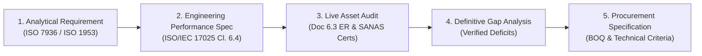
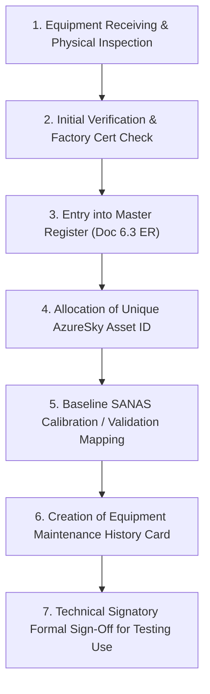

# CWP-002: EQUIPMENT PERFORMANCE & GAP SPECIFICATION
## Comprehensive Asset Audit, Engineering Performance Standards, Metrological Traceability & Procurement Gap Specification for Coal Washability Testing

```
Document ID:         CWP-002
Project ID:          CWP-001
Document Type:       Type D (Project Study & Engineering Evidence) / Pre-Procurement Technical Specification
Parent QMS:          AzureSky (Pty) Ltd — ISO/IEC 17025:2017 Accredited Quality Management System
Target AzureSky QMS: Clause 6.4 (Equipment), Clause 6.5 (Metrological Traceability), Clause 6.3 (Facilities)
Master Register Ref: Z:\AZURESKY SYSTEM\AZURESKY QMS\17025\CLAUSE 6\EQUIPMENT\6.3 EQUIPMENT REGISTER.xlsx (Doc 6.3 ER)
Author:              Gift Chisali — Laboratory Supervisor
Technical Review:    S. Nyambi — Laboratory Manager
Authoritative Base:  Z:\AZURESKY SYSTEM\AZURESKY QMS\17025
Workspace Path:      C:\Projects\AzureSky\CWP-001\15_EQUIPMENT_AND_METROLOGY
Effective Date:      October 2026
Revision:            02
Status:              PRE-PROCUREMENT SPECIFICATION — AWAITING LAB MANAGER DETERMINATION
```

---

## 1. Executive Summary & Governance Chain

Project **CWP-001** establishes the laboratory capability for coal washability testing by dense medium separation in strict compliance with **ISO 7936:2022** (*Hard coal — Determination of float and sink characteristics*) and **ISO 1953:2025** (*Size analysis*).

Under the **Architecture Freeze Protocol ([CWP-001-GOV-001](file:///c:/Projects/AzureSky/CWP-001/00_GOVERNANCE/CWP-001_ARCHITECTURE_FREEZE.md))**, CWP-001 does **not** create a parallel equipment management system. All physical testing assets in the facility belong exclusively to AzureSky's Clause 6.4 equipment inventory controlled via [`6.3 EQUIPMENT REGISTER.xlsx`](file:///Z:/AZURESKY%20SYSTEM/AZURESKY%20QMS/17025/CLAUSE%206/EQUIPMENT/6.3%20EQUIPMENT%20REGISTER.xlsx) (Doc No. `6.3 ER`), managed by the Laboratory Supervisor (Gift Chisali) and approved by the Laboratory Manager (S. Nyambi).

The purpose of **CWP-002** is to execute a rigorous, five-stage engineering audit:



> [!CRITICAL]
> **Procurement Freeze Enforcement**: In accordance with the project directives, no capital equipment, instruments, or fabrication contracts shall be awarded until this specification has been technically reviewed by the Technical Signatory and approved by the Laboratory Manager.

---

## 2. Normative Equipment & Metrological Traceability Requirements

To withstand technical assessment by SANAS under ISO/IEC 17025:2017 (Clause 6.4 and 6.5) and comply with SANAS Technical Requirements (TR 01, TR 26) and Technical Guidelines (TG 01), every piece of equipment utilized in the washability testing chain must fulfill exact normative criteria:

```
┌────────────────────────────────────────────────────────────────────────────────────────┐
│                        METROLOGICAL TRACEABILITY HIERARCHY                             │
├──────────────────────────────┬─────────────────────────────┬───────────────────────────┤
│     APPARATUS CATEGORY       │     GOVERNING STANDARD      │    CALIBRATION CADENCE    │
├──────────────────────────────┼─────────────────────────────┼───────────────────────────┤
│ Precision Hydrometers        │ ISO 649-1 / BS 718 Class M50│ 24 Months (SANAS Accred)  │
│ Digital Thermometers         │ SANS / ASTM E2877 Class A   │ 12 Months (SANAS Accred)  │
│ Test Sieves (Woven & Plate)  │ ISO 3310-1 / ISO 3310-2     │ Annual Optical Inspection │
│ Mechanical Sieve Shaker      │ ISO 1953:2025               │ Annual Validation Check   │
│ Balances (Bulk, Top-Pan, An) │ SANS 10378 / OIML R76       │ 12 Months (SANAS Accred)  │
│ Conductivity (EC) Meter      │ ISO 7888 / ASTM D1125       │ Monthly Cal / Daily Verif │
│ Drying Ovens                 │ ISO 589 / SANS 5925         │ 12 Months Multi-Point Map │
└──────────────────────────────┴─────────────────────────────┴───────────────────────────┘
```

---

## 3. Comprehensive Audit of AzureSky Live Equipment Assets

A forensic review of AzureSky's active master equipment register ([`6.3 EQUIPMENT REGISTER.xlsx`](file:///Z:/AZURESKY%20SYSTEM/AZURESKY%20QMS/17025/CLAUSE%206/EQUIPMENT/6.3%20EQUIPMENT%20REGISTER.xlsx)) was performed in October 2026. The findings confirm which equipment is available and active in the laboratory:

### 3.1 Live Physical Assets Audited in `6.3 ER`

| Equipment ID | Manufacturer | Description | Serial No | Location | Calibration Status | Washability Applicability |
| :--- | :--- | :--- | :--- | :--- | :--- | :--- |
| **`AS025PA`** | Darvan Brenco | Platform Scale (150 kg) | 120330150 | Sample Prep | Calibrated 27-02-2026 | **SUITABLE**: Bulk sample receiving & gross bulk masses ($\pm 10\text{ g}$) |
| **`AS00A31`** | Adam Equipment | Top Pan Balance (8.2 kg) | AEA90242156 | Sample Prep | Calibrated 27-02-2026 | **SUITABLE**: 6 kg batch fraction weighing ($\pm 0.1\text{ g}$) |
| **`AS2156`** | BEL Engineering | Analytical Balance (210 g) | ITA2500477 | Analysis Room | Calibrated 27-02-2026 | **SUITABLE**: Micro-fractions, moisture/ash crucibles ($\pm 0.1\text{ mg}$) |
| **`AS0096D`** | Sinometer | Hygrometer / Temp | OBS202503-01 | Analysis Room | Calibrated 19-03-2026 | **NON-APPLICABLE**: Ambient air monitor, cannot immerse in $\text{ZnCl}_2$ |
| **`AS8284`** (Probe) | Sinometer | Probe and Thermometer | OBS T2.2a | Manager's Office | Calibrated 03-2026 | **EVALUATE**: General thermometer; check acid resistance for $\text{ZnCl}_2$ |
| **`AS00110`** | Micron Mass | Reference Mass Pieces (Small)| OB WSA.1R | Analysis Room | Calibrated 17-03-2025 | **SUITABLE**: Daily balance span checks ([AS00A31](file:///Z:/AZURESKY%20SYSTEM/AZURESKY%20QMS/17025/CLAUSE%206/EQUIPMENT/6.3%20EQUIPMENT%20REGISTER.xlsx), [AS2156](file:///Z:/AZURESKY%20SYSTEM/AZURESKY%20QMS/17025/CLAUSE%206/EQUIPMENT/6.3%20EQUIPMENT%20REGISTER.xlsx)) |
| **Unnumbered**| Micron Mass | Heavy Mass Pieces | - | Sample Prep | Calibrated 17-03-2025 | **SUITABLE**: Daily span check for platform scale [AS025PA](file:///Z:/AZURESKY%20SYSTEM/AZURESKY%20QMS/17025/CLAUSE%206/EQUIPMENT/6.3%20EQUIPMENT%20REGISTER.xlsx) |
| **`AS00111`** (Oven) | Mokopoledi | B Drying Oven | LZ 007/07/10 | Sample Prep | Calibrated 11-12-2025 | **PARTIAL**: Prep drying; [COLLISION in 6.3 ER with CTS Hygrometer AS00111 -> Recommend AS00111-HY] |
| **`AS8501`** | Mokopoledi | Drying Oven | NE-002-MO | Sample Prep | Inactive / Uncalibrated | **CANDIDATE**: Available for refurbishment as dedicated washability oven |
| **`AS3800`** | Darvan Brenco | IM Drying Oven (50 L) | DOV53A/210325/40| Analysis Room | Calibrated 27-02-2026 | **DEDICATED**: Strictly reserved for Inherent Moisture ([AS004IW](file:///Z:/AZURESKY%20SYSTEM/AZURESKY%20QMS/17025/CLAUSE%207/7.2.%20SELECTION,%20VERIFICATION%20AND%20VALIDATION%20OF%20METHODS/7.2.1.%20SELECTION%20AND%20VERIFICATION%20OF%20METHODS/PROCEDURES/AS004IW%20%20PROCEDURE%20ON%20DETERMINATION%20OF%20INHERENT(ANALYSIS)%20MOISTURE%20REV%2002.docx)) |
| **`AS8284`** (Crusher)| Mega Size | Jaw Crusher (25 mm) | - | Sample Prep | Operational | **SUITABLE**: Coarse crushing to $-25\text{ mm}$; [COLLISION in 6.3 ER with Probe AS8284 -> Recommend AS8284-CR] |
| **`AS8809`** | Mega Size | Jaw Crusher (10 mm) | - | Sample Prep | Operational | **SUITABLE**: Intermediate reduction of float/sink fractions |
| **`AS5935`** | Mega Size | Roll/Jaw Crusher (3 mm) | - | Sample Prep | Operational | **SUITABLE**: Reduction of fractions to $-3\text{ mm}$ per [AS001IW](file:///Z:/AZURESKY%20SYSTEM/AZURESKY%20QMS/17025/CLAUSE%207/7.2.%20SELECTION,%20VERIFICATION%20AND%20VALIDATION%20OF%20METHODS/7.2.1.%20SELECTION%20AND%20VERIFICATION%20OF%20METHODS/PROCEDURES/AS001IW%20PROCEDURE%20ON%20SAMPLE%20PREPARATION%20OF%20HARD%20COAL%20Rev%2005.docx) |
| **`AS021PA`** | Mokopoledi | Swing Mill Pulverizer | AS021P | Sample Prep | Operational | **SUITABLE**: Milling fractions to $-212\text{ }\mu\text{m}$ for chemical analysis |
| **`AS7WET4`** | Mokopoledi | Swing Mill Pulverizer | AS7WET4 | Sample Prep | Operational | **SUITABLE**: Milling backup unit |
| **`AS03CW`** | Tork Craft | Vernier Caliper (150 mm) | SDK39250808825 | Sample Prep | Calibrated 28-04-2026 | **SUITABLE**: Verification of sieve aperture and crusher gap settings |

---

## 4. Analytical Step-by-Step Equipment Chain & Gap Analysis

Following the complete laboratory testing lifecycle (*Sample Receiving $\to$ Sizing $\to$ Density Separation $\to$ Washing $\to$ Drying $\to$ Weighing $\to$ Comminution $\to$ QA/QC Verification*), the exact equipment requirements, existing capabilities, and hardware deficits are mapped below:

```
┌────────────────────────────────────────────────────────────────────────────────────────┐
│                        ANALYTICAL LIFECYCLE GAP OVERVIEW                               │
├─────────────────────┬──────────────────────────┬───────────────────┬───────────────────┤
│ ANALYTICAL STAGE    │ NORMATIVE REQUIREMENT    │ EXISTING ASSET    │ GAP STATUS        │
├─────────────────────┼──────────────────────────┼───────────────────┼───────────────────┤
│ 1. Sizing Analysis  │ Motorized Sieve Shaker   │ None (Manual)     │ 🔴 CRITICAL GAP   │
│                     │ ISO 3310 Certified Sieves│ Informal screens  │ 🔴 CRITICAL GAP   │
├─────────────────────┼──────────────────────────┼───────────────────┼───────────────────┤
│ 2. Density Bath Stn │ Modular HDPE Bath Bank   │ Ad-hoc Buckets    │ 🔴 CRITICAL GAP   │
│                     │ 316 SS Drain Baskets     │ Uncontrolled wire │ 🔴 CRITICAL GAP   │
├─────────────────────┼──────────────────────────┼───────────────────┼───────────────────┤
│ 3. Metrology Check  │ M50 Precision Hydrometers│ None in 6.3 ER    │ 🔴 CRITICAL GAP   │
│                     │ Immersion RTD Temp Probe │ Office probes only│ 🟡 MODERATE GAP   │
├─────────────────────┼──────────────────────────┼───────────────────┼───────────────────┤
│ 4. Rinsing & Verif  │ Dual Wash Bay & Sprays   │ Basic tap hose    │ 🔴 CRITICAL GAP   │
│                     │ Calibrated EC Meter      │ None in 6.3 ER    │ 🔴 CRITICAL GAP   │
├─────────────────────┼──────────────────────────┼───────────────────┼───────────────────┤
│ 5. Thermal Drying   │ Forced Air Drying Oven   │ AS00111 / AS8501  │ 🟡 MINOR GAP      │
│                     │ Stainless Drying Trays   │ 10 trays available│ 🟡 MODERATE GAP   │
├─────────────────────┼──────────────────────────┼───────────────────┼───────────────────┤
│ 6. Mass Weighing    │ 0.1 g Top Pan Balance    │ AS00A31 (8.2 kg)  │ 🟢 ASSET ACTIVE   │
│                     │ 0.1 mg Analytical Balance│ AS2156 (210 g)    │ 🟢 ASSET ACTIVE   │
├─────────────────────┼──────────────────────────┼───────────────────┼───────────────────┤
│ 7. Comminution      │ Jaw Crushers & Pulverizer│ AS8284, AS5935,etc│ 🟢 ASSET ACTIVE   │
├─────────────────────┼──────────────────────────┼───────────────────┼───────────────────┤
│ 8. Waste Recycling  │ Closed-Loop Effluent Sump│ None              │ 🔴 STATUTORY GAP  │
└─────────────────────┴──────────────────────────┴───────────────────┴───────────────────┘
```

---

## 5. Detailed Engineering Performance Specifications (The Gaps)

To ensure procured equipment withstands both technical scrutiny during SANAS assessment and the harsh, corrosive operating environment of concentrated $\text{ZnCl}_2$, the following detailed engineering specifications are established:

### 5.1 Item CWP-EQ-01: Modular Heavy-Duty Dense Medium Bath Bank
- **Function**: Quiescent gravitational separation of coal fractions in stable aqueous $\text{ZnCl}_2$ solutions spanning $\text{RD } 1.30\text{ to }2.00\text{ g/cm}^3$.
- **Quantity Required**: 1 Complete Bank comprising 8 to 10 Individual Bath Stations.
- **Vessel Material**: Virgin High-Density Polyethylene (HDPE) or Polypropylene (PP), minimum wall thickness $8\text{ mm}$, chemically inert to concentrated acidic $\text{ZnCl}_2$ ($\text{pH } 1.0\text{ to }4.0$, density up to $2.00\text{ g/cm}^3$).
- **Dimensions & Capacity**:
  - Capacity: $80\text{ L to }100\text{ L}$ working volume per vessel.
  - Internal Dimensions: Diameter / Width $\ge 450\text{ mm}$, Depth $\ge 500\text{ mm}$ (guaranteeing minimum liquid settling depth of $350\text{ mm}$ above sunken basket).
- **Drainage & Plumbing**:
  - Bottom cone or dished bottom with a full-bore $1.5\text{ inch}$ (DN40) polypropylene ball valve for complete drainage and sludge flushing.
  - Quick-connect camlock fittings for hose connection to recovery pump.
- **Support Framework & Secondary Containment**:
  - Structural support frame constructed from 304 or 316 Stainless Steel box section, or heavy-duty powder-coated structural steel with acid-resistant epoxy lining.
  - Integrated secondary containment bund (sump) beneath the entire bank capable of containing at least $110\%$ of the single largest vessel volume ($110\text{ L}$) in compliance with SANS 10263-0.
  - Removable splash lids equipped with counterbalanced hinges to minimize splash during basket immersion.

### 5.2 Item CWP-EQ-02: 316 Stainless Steel Perforated Basket Inserts & Skimming Scoops
- **Function**: Complete, rapid extraction of sunken and floated coal particles without loss of particles $> 0.5\text{ mm}$ or liquid splashing.
- **Quantity Required**: 10 Insert Baskets (one per bath plus two spares) and 4 Skimming Scoops.
- **Material**: Heavy-duty Grade 316 Stainless Steel (chemical/corrosion resistant to $\text{ZnCl}_2$).
- **Insert Basket Specification**:
  - Sized to nest inside the HDPE bath vessels with $25\text{ mm}$ radial clearance.
  - Base and lower walls fabricated from precision perforated 316 SS sheet: aperture $0.50\text{ mm}$ (round or slotted), minimum $30\%$ open area for instantaneous fluid drainage upon hoisting.
  - Reinforced top rim with heavy-duty lifting bail / twin handles, compatible with an overhead manual chain hoist or counterweighted balance arm.
  - Integrated bottom feet ($30\text{ mm}$ clearance) to keep perforated base elevated above any fine sediment in the vessel bottom.
- **Skimming Scoop Specification**:
  - Deep-dish perforated scoop, 316 SS, dimensions $200\text{ mm} \times 150\text{ mm} \times 80\text{ mm}$ depth.
  - Perforated mesh aperture $0.425\text{ mm}$ (35 mesh), reinforced rim, ergonomic tubular stainless steel handle ($400\text{ mm}$ length).

### 5.3 Item CWP-EQ-03: Precision Density Metrology Set (ISO 649-1 Class M50)
- **Function**: Verification and calibration of bath relative density to within $\pm 0.002\text{ g/cm}^3$ per [ASMF 02](file:///Z:/AZURESKY%20SYSTEM/AZURESKY%20QMS/17025/CLAUSE%207/7.2.%20SELECTION,%20VERIFICATION%20AND%20VALIDATION%20OF%20METHODS/7.2.1.%20SELECTION%20AND%20VERIFICATION%20OF%20METHODS/FORMS/FLOAT%20AND%20SINK/ASMF%2002-%20FLOAT%20AND%20SINK%20VALIDATION%20FORM.docx).
- **Quantity Required**: 2 Complete Matched Sets (1 Working Set, 1 Reference Master Set).
- **Standards Conformance**: **ISO 649-1 / BS 718 Class M50**, Reference Temperature $20.0^\circ\text{C}$, calibrated for surface tension category *High Surface Tension* (aqueous solutions, $\approx 75\text{ mN/m}$).
- **Range & Span Coverage**:
  - Span per hydrometer: $0.050\text{ g/cm}^3$ (or $0.100\text{ g/cm}^3$).
  - Range coverage: Complete spectrum from $1.250\text{ to }2.050\text{ g/cm}^3$ across 8 instruments:
    * Hydrometer 1: $1.250 - 1.300\text{ g/cm}^3$
    * Hydrometer 2: $1.300 - 1.350\text{ g/cm}^3$
    * Hydrometer 3: $1.350 - 1.400\text{ g/cm}^3$
    * Hydrometer 4: $1.400 - 1.500\text{ g/cm}^3$
    * Hydrometer 5: $1.500 - 1.600\text{ g/cm}^3$
    * Hydrometer 6: $1.600 - 1.700\text{ g/cm}^3$
    * Hydrometer 7: $1.700 - 1.850\text{ g/cm}^3$
    * Hydrometer 8: $1.850 - 2.050\text{ g/cm}^3$
  - Scale Subdivision: $0.001\text{ g/cm}^3$ (Maximum Permissible Error $\le \pm 0.0006\text{ g/cm}^3$).
- **Traceability Certificate**: Every instrument must be supplied with an individual **SANAS-accredited or ISO/IEC 17025-accredited calibration certificate** detailing scale corrections across at least 3 calibration points.
- **Associated Apparatus**:
  - Borosilicate Glass Hydrometer Cylinders: 4 units, capacity $500\text{ mL}$, internal diameter $\ge 50\text{ mm}$, height $350\text{ mm}$, heavy circular base.
  - Digital RTD Immersion Thermometer: Pt100 sensor, range $-10^\circ\text{C to }+60^\circ\text{C}$, resolution $0.05^\circ\text{C}$, accuracy $\pm 0.1^\circ\text{C}$, with SANAS calibration certificate.

### 5.4 Item CWP-EQ-04: Particle Size Analysis System (ISO 1953:2025 / ISO 3310)
- **Function**: Fractionation of raw coal into standard size fractions prior to float-sink separation per ISO 1953:2025.
- **Motorized Mechanical Sieve Shaker**:
  - Type: High-capacity electromagnetic 3D-motion sieve shaker accommodating $300\text{ mm}$ (12 inch) and $450\text{ mm}$ (18 inch) diameter test sieves (e.g., Haver & Boecker / Endecotts Octagon / Gilson equivalent).
  - Capacity: Sieve stack mass up to $30\text{ kg}$.
  - Features: Digital amplitude control ($0\text{ to }3.0\text{ mm}$), digital timer ($0\text{ to }99\text{ min}$), continuous and intermittent vibration modes.
- **Certified Test Sieve Set (ISO 3310-1 / ISO 3310-2 Conforming)**:
  - Frame Diameter: $300\text{ mm}$ or $450\text{ mm}$, Grade 304 Stainless Steel seamless frame.
  - Perforated Plate Sieves (ISO 3310-2, Square Apertures):
    * $50.0\text{ mm}$, $31.5\text{ mm}$, $25.0\text{ mm}$, $16.0\text{ mm}$, $13.2\text{ mm}$, $6.30\text{ mm}$, $4.75\text{ mm}$.
  - Woven Wire Mesh Sieves (ISO 3310-1, Stainless Steel Mesh):
    * $2.00\text{ mm}$, $1.00\text{ mm}$, $0.500\text{ mm}$ ($500\text{ }\mu\text{m}$).
  - Full Depth Collecting Pan and Lid.
  - Metrological Status: Supplied with manufacturer **ISO/IEC 17025 / ISO 3310 Calibration Certificates of Inspection** stating aperture tolerances and standard deviations.

### 5.5 Item CWP-EQ-05: Rinsing Verification & Effluent Monitoring Station
- **Function**: Verification of washing completeness ($\text{EC} < 100\text{ }\mu\text{S/cm}$) and environmental effluent control.
- **Precision Electrical Conductivity (EC) Meter**:
  - Model: Benchtop/Portable Dual EC/TDS/Salinity/Temperature Meter with Automatic Temperature Compensation (ATC at $25^\circ\text{C}$ or $20^\circ\text{C}$).
  - Range: $0.00\text{ }\mu\text{S/cm to }200.0\text{ mS/cm}$.
  - Resolution: $0.01\text{ }\mu\text{S/cm}$ in low range ($0 - 200\text{ }\mu\text{S/cm}$).
  - Accuracy: $\pm 0.5\%$ of reading.
  - Sensor: 4-ring glass or titanium probe with epoxy body, chemical-resistant.
  - Traceability: Traceable calibration certificate with CRM conductivity standards ($84\text{ }\mu\text{S/cm}$, $1413\text{ }\mu\text{S/cm}$).

### 5.6 Item CWP-EQ-06: High-Capacity Washability Drying System
- **Function**: Controlled low-temperature drying ($\le 40^\circ\text{C}$) of washed float and sink fractions to achieve stable air-dry mass balance without coal oxidation.
- **Refurbishment / Procurement Plan**:
  - **Option A (Preferred Asset Refurbishment)**: Refurbish existing oven **`AS8501`** (Mokopoledi Prep Oven) by installing a precision PID digital temperature controller, high-velocity cross-flow circulation fan, and performing a 9-point thermal mapping calibration to SANAS standards.
  - **Option B (New Procurement)**: Procure a dedicated $250\text{ L}$ forced-convection laboratory drying oven, temperature range ambient $+5^\circ\text{C to }150^\circ\text{C}$, uniformity $\pm 1.5^\circ\text{C}$ at $40^\circ\text{C}$.
- **Drying Trays & Racks**:
  - 30 units Grade 304 Stainless Steel heavy-gauge drying trays, dimensions $400\text{ mm} \times 300\text{ mm} \times 50\text{ mm}$, seamless press-formed with smooth corners to prevent particle loss.
  - Mobile stainless steel 15-tier tray rack on anti-static castor wheels.

### 5.7 Item CWP-EQ-07: Closed-Loop Effluent Recycling & Lime Treatment Unit
- **Function**: Zero-discharge collection, 50 $\mu\text{m}$ filtration, and precipitation of spent $\text{ZnCl}_2$ effluent per NEMWA.
- **Components**:
  - Heavy-duty Polyethylene Wash Bay Sump ($200\text{ L}$).
  - Air-operated double diaphragm (AODD) pump, polypropylene body with PTFE diaphragms (explosion-proof, run-dry capable, self-priming).
  - Duplex 316 SS inline bag filter housing with $50\text{ }\mu\text{m}$ polypropylene filter bags for removing fine coal silt.
  - $500\text{ L}$ conical-bottom neutralization and lime dosing tank fitted with a mechanical paddle stirrer ($0.37\text{ kW}$) and manual lime feed hopper.
  - Heavy-duty transfer hoses with PP camlock couplings.

---

## 6. Bill of Quantities (BOQ) & Capital Procurement Matrix

The comprehensive procurement bill of quantities (BOQ) is structured below, categorised by procurement priority:

| BOQ Item Code | Item Description | Technical Specification Reference | Target Qty | Est. Unit Cost (ZAR) | Est. Total Cost (ZAR) | Priority Tier |
| :--- | :--- | :--- | :---: | :---: | :---: | :---: |
| **CWP-BOQ-01** | Modular HDPE Bath Bank & Frame | CWP-EQ-01 (10 Stations, Bunded) | 1 Set | R 45,000 | R 45,000 | **Tier 1 (Critical)** |
| **CWP-BOQ-02** | 316 SS Perforated Baskets & Scoops| CWP-EQ-02 (0.5 mm aperture) | 10 Baskets<br/>4 Scoops | R 28,000 | R 28,000 | **Tier 1 (Critical)** |
| **CWP-BOQ-03** | Precision M50 Hydrometers (Working) | CWP-EQ-03 (1.250 - 2.050, Cert) | 1 Set (8 pcs) | R 16,000 | R 16,000 | **Tier 1 (Critical)** |
| **CWP-BOQ-04** | Precision M50 Hydrometers (Reference)| CWP-EQ-03 (1.250 - 2.050, Cert) | 1 Set (8 pcs) | R 16,000 | R 16,000 | **Tier 2 (QC Master)** |
| **CWP-BOQ-05** | SANAS Calibrated RTD Temp Probe | CWP-EQ-03 (Pt100, 0.05°C Res) | 2 Units | R 6,500 | R 13,000 | **Tier 1 (Critical)** |
| **CWP-BOQ-06** | 500 mL Borosilicate Hydrometer Jars| CWP-EQ-03 (Heavy base) | 6 Units | R 850 | R 5,100 | **Tier 1 (Critical)** |
| **CWP-BOQ-07** | Motorized 3D Sieve Shaker (300/450mm)| CWP-EQ-04 (Digital timer/amp) | 1 Unit | R 78,000 | R 78,000 | **Tier 1 (Critical)** |
| **CWP-BOQ-08** | Certified ISO 3310 Test Sieve Set | CWP-EQ-04 (50 mm to 0.5 mm, Cert)| 1 Set (10 pcs) | R 32,000 | R 32,000 | **Tier 1 (Critical)** |
| **CWP-BOQ-09** | Dual EC/TDS Conductivity Meter | CWP-EQ-05 (ATC, 0.01 µS/cm, Cert) | 1 Unit | R 12,500 | R 12,500 | **Tier 1 (Critical)** |
| **CWP-BOQ-10** | Refurbishment of Prep Oven AS8501 | CWP-EQ-06 (PID, Fan, Mapping) | 1 Job | R 18,000 | R 18,000 | **Tier 1 (Cost-Saver)** |
| **CWP-BOQ-11** | Grade 304 SS Drying Trays & Mobile Rack| CWP-EQ-06 (30 Trays, 15-tier Rack)| 1 Set | R 22,000 | R 22,000 | **Tier 1 (Critical)** |
| **CWP-BOQ-12** | Closed-Loop Effluent AODD & Sump Unit | CWP-EQ-07 (PP AODD, Sump, Filter) | 1 Set | R 38,000 | R 38,000 | **Tier 1 (Statutory)** |
| **CWP-BOQ-13** | Chemical Reagents: ZnCl₂ Flakes (98%)| CWP-001-DM-001 (Commercial Bulk) | 1,000 kg | R 55 / kg | R 55,000 | **Tier 1 (Consumable)** |
| **CWP-BOQ-14** | Personal Protective Equipment (HCA) | EN 374 Gauntlets, Visors, Aprons | 4 Sets | R 2,500 | R 10,000 | **Tier 1 (OHSA)** |
| **SUBTOTAL** | **Estimated Capital & Initial Stock**| — | — | — | **R 388,600** | — |
| **CONTINGENCY**| 10% Engineering Contingency | — | — | — | **R 38,860** | — |
| **TOTAL** | **Estimated Project Procurement Total**| — | — | — | **R 427,460** | — |

---

## 7. Integration Protocol into AzureSky Clause 6.4 Equipment System

When procurement is formally authorized by the Laboratory Manager (S. Nyambi), newly delivered equipment will be integrated into AzureSky's existing QMS following [`AS001EQ / CLAUSE 6.4 EQUIPMENT MANAGEMENT`](file:///Z:/AZURESKY%20SYSTEM/AZURESKY%20QMS/17025/CLAUSE%206/EQUIPMENT/):



### 7.1 Asset ID Allocation Scheme for Washability Equipment
New assets will be registered in [`6.3 EQUIPMENT REGISTER.xlsx`](file:///Z:/AZURESKY%20SYSTEM/AZURESKY%20QMS/17025/CLAUSE%206/EQUIPMENT/6.3%20EQUIPMENT%20REGISTER.xlsx) under the following standardized AzureSky nomenclature:
- **`AS-FS-BATH-01`**: Modular HDPE Dense Medium Bath Bank (10 Stations)
- **`AS-FS-HYD-01` to `08`**: Set 1 Working M50 Precision Hydrometers
- **`AS-FS-HYD-REF-01` to `08`**: Set 2 Reference Master M50 Hydrometers
- **`AS-FS-THERM-01`**: Digital Precision Immersion RTD Thermometer
- **`AS-FS-SHK-01`**: Motorized 3D Mechanical Sieve Shaker
- **`AS-FS-SVE-01` to `10`**: Set of Certified ISO 3310 Test Sieves
- **`AS-FS-COND-01`**: Dual Range Electrical Conductivity Meter
- **`AS8501`**: Refurbished High-Capacity Washability Drying Oven (Re-commissioned)
- **`AS-FS-REC-01`**: Closed-Loop Wash Water AODD & Filtration Sump Unit

---

## 8. Verification & Next Project Milestones

1. **Document Register Update**: Register `CWP-002` in [CWP-001_DOCUMENT_LINK_AND_EVIDENCE_REGISTER.md](file:///c:/Projects/AzureSky/CWP-001/CWP-001_DOCUMENT_LINK_AND_EVIDENCE_REGISTER.md) as completed Type D engineering specification.
2. **Technical Submission**: Present `CWP-002` alongside `CWP-001-DM-001` to the Technical Signatory (T. Maponya) and Laboratory Manager (S. Nyambi) for gate review prior to vendor quotation requests.
3. **Subsequent Milestones**:
   - Proceed to **Milestone 3**: Formulate Method Validation Dossier ([`CWP-001-VAL-001`](file:///c:/Projects/AzureSky/CWP-001/13_METHOD_VALIDATION/)) per SANAS TR-26.
   - Proceed to **Milestone 4**: Extend Measurement Uncertainty Model ([`UB001-FS-01`](file:///c:/Projects/AzureSky/CWP-001/14_MEASUREMENT_UNCERTAINTY/)) for washability measurands.
   - Proceed to **Milestone 5**: Draft Upgraded SOP Proposal ([`AS013IW Rev 02`](file:///c:/Projects/AzureSky/CWP-001/17_SOPS_AND_FORMS/)).
