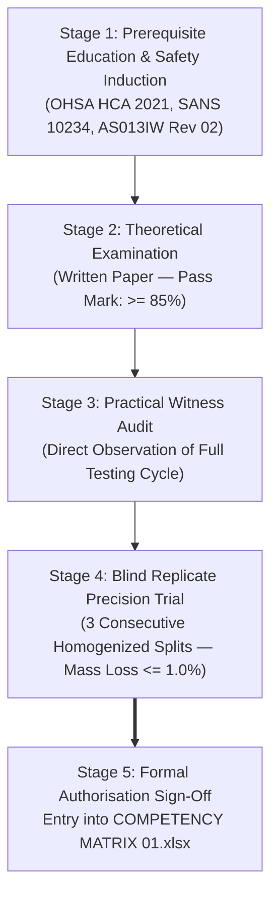

# AZCA-007: FLOAT-AND-SINK TECHNICAL COMPETENCY ASSESSMENT PROTOCOL
## Qualification, Practical Examination, Blind Testing, and Authorisation Framework for Float-and-Sink Washability Operators per ISO/IEC 17025:2017 (Clause 6.2) and ISO 7936:2022

```
Document ID:         AZCA-007 Rev 01
Project ID:          CWP-001
Document Type:       Type C (Proposed AzureSky Controlled Competency Standard)
Parent QMS Target:   Z:\AZURESKY SYSTEM\AZURESKY QMS\17025\CLAUSE 6\PERSONNEL COMPETENCY\6.2 COMPETENCY MATRIX\COMPETENCY MATRIX 01.xlsx
Parent SOP:          AS013IW Rev 02 (Procedure on Float and Sink Analysis of Hard Coal)
Governing Standard:  ISO/IEC 17025:2017 Clause 6.2 & ISO 7936:2022
Evaluator:           Gift Chisali — Laboratory Supervisor / Technical Signatory
Approval Authority:  S. Nyambi — Laboratory Manager
Workspace Path:      C:\Projects\AzureSky\CWP-001\16_COMPETENCY
Effective Date:      October 2026
Revision:            01
Status:              CONTROLLED COMPETENCY STANDARD — READY FOR ADOPTION
```

---

## 1. Executive Summary & Governance Chain

Under **ISO/IEC 17025:2017 Clause 6.2** (*Personnel*), the laboratory must ensure that all personnel who operate specific equipment, perform tests, evaluate results, and sign test reports are competent and work in accordance with the laboratory's quality management system.

AzureSky controls technical qualifications through:
[`COMPETENCY MATRIX 01.xlsx`](file:///Z:/AZURESKY%20SYSTEM/AZURESKY%20QMS/17025/CLAUSE%206/PERSONNEL%20COMPETENCY/6.2%20COMPETENCY%20MATRIX/COMPETENCY%20MATRIX%2001.xlsx).
Existing personnel competency records currently authorize staff for Sample Preparation, Inherent Moisture, Ash, Volatiles, and Gross CV. **No competency module currently exists for Float-and-Sink Washability Testing**.

This protocol, **`AZCA-007`**, establishes the formal, multi-stage qualification and authorization framework required to certify an analyst or preparation technician as a **Competent Float-and-Sink Operator**.

---

## 2. Competency Architecture & Assessment Pathway

An analyst must successfully complete all four stages of the assessment pathway before being granted formal testing authorization:



---

## 3. Stage 1: Prerequisites & Mandatory Safety Induction
Before undertaking competency evaluation, the candidate must demonstrate:
1. Formal appointment as a Laboratory Technician or Analyst in AzureSky.
2. Verified competency in Hard Coal Sample Preparation ([`AS001IW Rev 05`](file:///Z:/AZURESKY%20SYSTEM/AZURESKY%20QMS/17025/CLAUSE%207/7.2.%20SELECTION,%20VERIFICATION%20AND%20VALIDATION%20OF%20METHODS/7.2.1.%20SELECTION%20AND%20VERIFICATION%20OF%20METHODS/PROCEDURES/AS001IW%20PROCEDURE%20ON%20SAMPLE%20PREPARATION%20OF%20HARD%20COAL%20Rev%2005.docx)) and Balance Calibration Verification.
3. Training on the Material Safety Data Sheet (MSDS) for Zinc Chloride ($\text{ZnCl}_2$) and emergency deluge shower operation.
4. Documented study of [`AS013IW Rev 02`](file:///c:/Projects/AzureSky/CWP-001/17_SOPS_AND_FORMS/AS013IW_Rev_02_PROCEDURE_ON_FLOAT_AND_SINK_ANALYSIS.md) and [`CWP-001-DM-001`](file:///c:/Projects/AzureSky/CWP-001/07_DENSITY_MEDIA/CWP-001-DM-001_DENSITY_MEDIUM_SELECTION_AND_ENVIRONMENTAL_STUDY.md).

---

## 4. Stage 2: Theoretical Knowledge Examination
The candidate must complete a closed-book written examination (minimum pass mark: **$85\%$**) covering:

| Examination Section | Weight | Core Topics Evaluated |
| :--- | :---: | :--- |
| **Section A: Principles & Standard** | $25\%$ | ISO 7936:2022 principles; Stokes' law settling kinetics; why $-0.5\text{ mm}$ fines are screened out; ascending density progression. |
| **Section B: Metrology & Calibration** | $25\%$ | Reading ISO 649-1 hydrometers at eye level; applying the thermal correction equation $\text{RD}_{20} = \text{RD}_{\text{meas}} + 0.00075 \times (T - 20.0)$; tolerance $\pm 0.002\text{ g/cm}^3$ on [ASMF 02](file:///Z:/AZURESKY%20SYSTEM/AZURESKY%20QMS/17025/CLAUSE%207/7.2.%20SELECTION,%20VERIFICATION%20AND%20VALIDATION%20OF%20METHODS/7.2.1.%20SELECTION%20AND%20VERIFICATION%20OF%20METHODS/FORMS/FLOAT%20AND%20SINK/ASMF%2002-%20FLOAT%20AND%20SINK%20VALIDATION%20FORM.docx). |
| **Section C: OHS & Environmental** | $20\%$ | GHS classification of $\text{ZnCl}_2$ (H314, H410); OEL-TWA $1.0\text{ mg/m}^3$; mandatory PPE; emergency response to splashes; zero sewer discharge rule under NEMWA. |
| **Section D: QA/QC & Calculations** | $30\%$ | Mass balance calculation ($\Delta M_{\text{loss}} \le 1.0\%$ target, $\le 2.0\%$ max); reconstituted ash vs head ash; two-tier washing criteria ($\text{EC} < 100\text{ }\mu\text{S/cm}$ & $\text{AgNO}_3$ test); $40^\circ\text{C}$ drying rule. |

---

## 5. Stage 3: Practical Witness Audit Evaluation
The Technical Signatory (T. Maponya) directly observes and grades the candidate executing a complete $6.0\text{ kg}$ coarse coal washability test across 6 density baths ($1.30\text{ to }1.80\text{ RD}$):

```
┌────────────────────────────────────────────────────────────────────────────────────────┐
│                        PRACTICAL AUDIT COMPETENCY CHECKLIST                            │
├────┬───────────────────────────────────────────────────────────┬─────────┬───────────┤
│ NO │ OPERATIONAL SKILL / PERFORMANCE CRITERION                 │ PASS/FAIL│ EVALUATOR │
├────┼───────────────────────────────────────────────────────────┼─────────┼───────────┤
│ 01 │ Donning complete PPE (Gauntlets, Visor, Goggles, Apron)   │ [ ] P [ ]F│ _________ │
│ 02 │ Daily balance span verification on AS00A31 using weights  │ [ ] P [ ]F│ _________ │
│ 03 │ Homogenisation and accurate sizing at 0.50 mm screen     │ [ ] P [ ]F│ _________ │
│ 04 │ Accurate recording of feed mass (M_feed) on AS030TF       │ [ ] P [ ]F│ _________ │
│ 05 │ Execution of 2 min pre-soaking and 5 min draining         │ [ ] P [ ]F│ _________ │
│ 06 │ Bath agitation and temp measurement with RTD probe        │ [ ] P [ ]F│ _________ │
│ 07 │ Accurate hydrometer meniscus reading & temp compensation  │ [ ] P [ ]F│ _________ │
│ 08 │ Logging pre-test densities on ASMF 02 within ± 0.002      │ [ ] P [ ]F│ _________ │
│ 09 │ Controlled sample immersion to prevent splashing          │ [ ] P [ ]F│ _________ │
│ 10 │ Gentle stirring, liberation of entrapped sinks, settling  │ [ ] P [ ]F│ _________ │
│ 11 │ Thorough skimming of floats without particle loss         │ [ ] P [ ]F│ _________ │
│ 12 │ 60-second gravity draining of medium back into bath       │ [ ] P [ ]F│ _________ │
│ 13 │ Multi-stage rinsing to achieve run-off EC < 100 µS/cm     │ [ ] P [ ]F│ _________ │
│ 14 │ Performance of negative AgNO₃ spot test verification      │ [ ] P [ ]F│ _________ │
│ 15 │ Loading trays into oven strictly controlled at 40.0 ± 2°C │ [ ] P [ ]F│ _________ │
│ 16 │ Precision weighing of cooled dry fractions to 0.1 g       │ [ ] P [ ]F│ _________ │
│ 17 │ Mathematical calculation of mass recovery balance         │ [ ] P [ ]F│ _________ │
│ 18 │ Housekeeping, splash cleanup, and waste containment       │ [ ] P [ ]F│ _________ │
└────┴───────────────────────────────────────────────────────────┴─────────┴───────────┘
```
*Requirement*: All 18 criteria must be assessed as **PASS**. A single critical failure (e.g. failure to wear visor, exceeding $40^\circ\text{C}$ oven temp, or discharging $\text{ZnCl}_2$ down a sink) results in immediate failure.

---

## 6. Stage 4: Blind Replicate Precision Trial
To prove that the candidate achieves repeatable, unbiased analytical results:
1. The candidate is provided with three (3) blind, randomized split charges ($6.0\text{ kg}$ each) of a characterized reference coal sample.
2. The candidate performs full float-and-sink testing across $1.35, 1.40, 1.50, 1.60, 1.70, 1.80\text{ RD}$.
3. **Acceptance Criteria for Authorization**:
   - Total Mass Recovery Loss: $\Delta M_{\text{loss}} \le 1.0\%$ on **all three runs**.
   - Cumulative Yield at $1.60\text{ RD}$: Relative Standard Deviation ($\text{RSD}$) across the 3 runs $\le 1.5\%$.
   - Reconstituted Ash Reconciliation: $|\text{Ash}_{\text{head}} - \text{Ash}_{\text{rec}}| \le 0.35\%$ on all three runs.
   - Washing Verification: Final run-off $\text{EC} < 100\text{ }\mu\text{S/cm}$ across all fractions.

---

## 7. Competency Record & Authorisation Certificate

```
┌────────────────────────────────────────────────────────────────────────────────────────┐
│                        AZURESKY (PTY) LTD — CERTIFICATE OF COMPETENCY                  │
│                     ISO/IEC 17025:2017 CLAUSE 6.2 TECHNICAL AUTHORISATION              │
├────────────────────────────────────────────────────────────────────────────────────────┤
│ Employee Name:    ____________________________________________________________________  │
│ Employee ID:      ___________________________  Job Title: ____________________________  │
│ Competency Code:  AZCA-007 — Float-and-Sink Washability Testing Operator                │
│ Test Standard:    ISO 7936:2022 / AS013IW Rev 02 (Hard Coal Dense Medium Separation)   │
├────────────────────────────────────────────────────────────────────────────────────────┤
│ ASSESSMENT RESULTS:                                                                    │
│ 1. Theoretical Examination Score:  _______ % (Pass Mark: >= 85%)      [ ] PASS  [ ] FAIL│
│ 2. Practical Witness Audit:        18 / 18 Checklist Items Approved   [ ] PASS  [ ] FAIL│
│ 3. Blind Precision Trial (3 Runs): Mass Loss <= 1.0%, RSD <= 1.5%     [ ] PASS  [ ] FAIL│
├────────────────────────────────────────────────────────────────────────────────────────┤
│ STATEMENT OF AUTHORISATION:                                                            │
│ I hereby certify that the above employee has demonstrated technical competence,       │
│ adherence to quality management controls, and rigorous safety practices. The employee │
│ is fully authorised to perform float-and-sink washability testing and calibrate       │
│ density media independently.                                                           │
│                                                                                        │
│ Assessed by (Laboratory Supervisor / Technical Signatory):                             │
│ Signature: ________________________________  Name: Gift Chisali      Date: ___/___/2026│
│                                                                                        │
│ Approved by (Laboratory Manager):                                                      │
│ Signature: ________________________________  Name: Sifiso Nyambi     Date: ___/___/2026│
│                                                                                        │
│ Re-Assessment Due Date: October 2027 (Annual Frequency)                                │
└────────────────────────────────────────────────────────────────────────────────────────┘
```

---

## 8. Integration into AzureSky Master Competency Matrix
Upon signature:
1. The employee's record is updated in [`COMPETENCY MATRIX 01.xlsx`](file:///Z:/AZURESKY%20SYSTEM/AZURESKY%20QMS/17025/CLAUSE%206/PERSONNEL%20COMPETENCY/6.2%20COMPETENCY%20MATRIX/COMPETENCY%20MATRIX%2001.xlsx) with designation **`AZCA-007: AUTHORISED`**.
2. The signed certificate and raw test benchsheets are filed in the employee's personal training file in `Z:\AZURESKY SYSTEM\AZURESKY QMS\17025\CLAUSE 6\PERSONNEL COMPETENCY\`.
