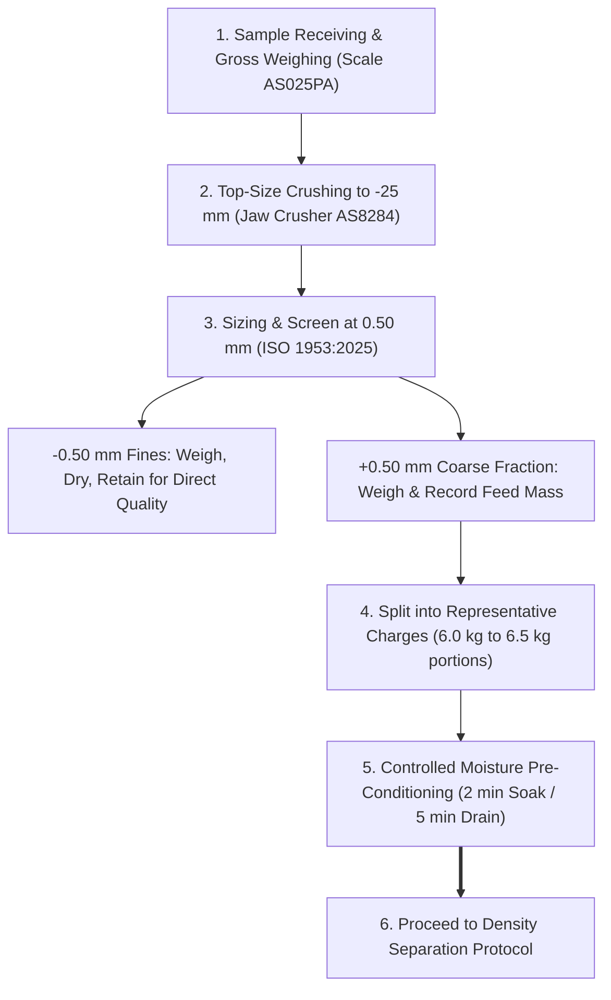
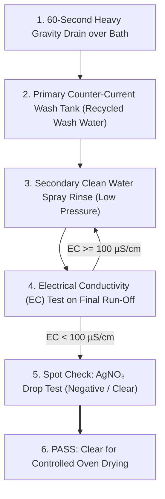

# AS013IW: PROCEDURE ON FLOAT AND SINK ANALYSIS OF HARD COAL
## Standard Operating Procedure for Determination of Float-and-Sink Washability Characteristics by Dense Medium Separation (ISO 7936:2022)

```
Document ID:         AS013IW Rev 02
Replaces:            AS013IW Rev 01 (Draft SOP)
Document Type:       Type C (Proposed AzureSky Controlled Standard Operating Procedure)
Target QMS Path:     Z:\AZURESKY SYSTEM\AZURESKY QMS\17025\CLAUSE 7\7.2. SELECTION, VERIFICATION AND VALIDATION OF METHODS\7.2.1. SELECTION AND VERIFICATION OF METHODS\PROCEDURES
Governing Standard:  ISO 7936:2022 (Float & Sink Characteristics), ISO 1953:2025 (Size Analysis)
Supporting SOPs:     AS001IW Rev 05 (Sample Prep), AS003IW Rev 01 (Ash), AS004IW Rev 02 (Moisture)
Associated Form:     AS030TF (Float & Sink Benchsheet & Calculation Log), ASMF 02 (Density Validation Form)
Author:              Gift Chisali — Laboratory Supervisor
Approval:            S. Nyambi — Laboratory Manager
Effective Date:      October 2026
Revision:            02
Status:              CONTROLLED SOP PROPOSAL — SUBMITTED FOR FORMAL QMS APPROVAL
```

---

## 1. PURPOSE
The purpose of this procedure is to describe the definitive method for conducting float-and-sink washability analysis on coarse hard coal using density-controlled aqueous zinc chloride ($\text{ZnCl}_2$) solutions. 

The test partitions coal particles on the basis of their relative density (buoyant density), determining the mass and quality distribution across density fractions. The generated data is used to:
1. Determine coal density distribution and liberation characteristics.
2. Calculate theoretical clean coal yields and ash reduction potential at specified cut densities.
3. Establish combustible recovery, near-density material ($\text{NDM} \pm 0.10\text{ RD}$), and separation difficulty.
4. Construct standard washability curves (Primary, Cumulative Floats, Cumulative Sinks, and Characteristic Ash Curves) per ISO 7936:2022.
5. Provide technical baselines for coal preparation plant design, washery performance auditing, and coal sales contract compliance.

---

## 2. SCOPE AND APPLICABILITY
1. **Applicable Materials**:
   - Run-of-Mine (ROM) coal.
   - Borehole core samples.
   - Washed products, middlings, and discards from beneficiation plants.
2. **Particle Size Scope**:
   - This procedure is strictly validated and accredited for **Coarse Coal Fractions from $+0.50\text{ mm}$ up to $+50.0\text{ mm}$**.
   - Fine fractions ($-0.50\text{ mm}$) cannot be separated accurately by static gravity baths due to viscous drag; they are screened out, weighed, dried, analyzed directly for raw quality, and accounted for in the composite balance.
3. **Validated Density Spectrum**:
   - Working relative densities: $1.300\text{ to }2.000\text{ g/cm}^3$ at standard intervals of $0.050\text{ or }0.100\text{ RD}$.

---

## 3. NORMATIVE REFERENCES
- **ISO 7936:2022**: *Hard coal — Determination of float and sink characteristics*.
- **ISO 1953:2025**: *Hard coal — Size analysis by sieving*.
- **ISO 13909:2025 Series / ISO 18283:2022**: *Hard coal and coke — Mechanical / Manual sampling*.
- **ISO 1171 / AS003IW**: *Determination of ash content of hard coal*.
- **ISO 589 / AS004IW**: *Determination of moisture content of hard coal*.
- **ISO 1928 / AS007IW**: *Determination of gross calorific value*.
- **ISO/IEC 17025:2017**: *General requirements for the competence of testing and calibration laboratories*.
- **CWP-001-VAL-001**: *Float-and-Sink Method Validation Dossier (AzureSky QMS Clause 7.2.2)*.
- **UB001-FS-01**: *Washability Measurement Uncertainty Model (AzureSky QMS Clause 7.6)*.
- **AS001V**: *Ensuring Validity of Results Procedure (AzureSky QMS Clause 7.7)*.
- **AS010IW**: *Statements of Conformity and Decision Rules (AzureSky QMS Clause 7.8)*.

---

## 4. RESPONSIBILITIES AND AUTHORISATIONS
1. **Receiving Clerk / Sampler**:
   - Inspect sample condition, log receiving mass on [AS025PA](file:///Z:/AZURESKY%20SYSTEM/AZURESKY%20QMS/17025/CLAUSE%206/EQUIPMENT/6.3%20EQUIPMENT%20REGISTER.xlsx), record client details in Sample Receiving Book, and allocate unique AzureSky Lab Sample ID.
2. **Washability Analyst / Preparation Technician**:
   - Hold documented competency authorisation AZCA-007 (*Float-and-Sink Operator*).
   - Perform sizing, pre-soaking, density separation, quantitative rinsing, oven drying, and fraction weighing.
   - Accurately record all primary data on [AS030TF](file:///c:/Projects/AzureSky/CWP-001/17_SOPS_AND_FORMS/AS030TF_FLOAT_AND_SINK_BENCHSHEET_AND_CALCULATION_TEMPLATE.md) and [ASMF 02](file:///Z:/AZURESKY%20SYSTEM/AZURESKY%20QMS/17025/CLAUSE%207/7.2.%20SELECTION,%20VERIFICATION%20AND%20VALIDATION%20OF%20METHODS/7.2.1.%20SELECTION%20AND%20VERIFICATION%20OF%20METHODS/PROCEDURES/ASMF%2002-%20FLOAT%20AND%20SINK%20VALIDATION%20FORM.docx).
3. **Laboratory Supervisor (Gift Chisali) / Technical Signatory**:
   - Verify daily density calibrations, review temperature corrections, verify mass balance ($\le 2.0\%$), and perform quality reconciliation before releasing samples for comminution.
4. **Laboratory Manager (S. Nyambi)**:
   - Authorise test reports, ensure environmental compliance (NEMWA), and manage equipment calibration schedules.

---

## 5. OCCUPATIONAL HEALTH, SAFETY & ENVIRONMENTAL CONTROLS

```
┌────────────────────────────────────────────────────────────────────────────────────────┐
│                          MANDATORY SAFETY & OHS REQUIREMENTS                           │
├──────────────────────────┬─────────────────────────────────────────────────────────────┤
│ Chemical Classification  │ Zinc Chloride (ZnCl₂): Corrosive (H314), Aquatic Tox (H410) │
│ Occupational Exposure    │ OEL-TWA: 1.0 mg/m³ (Respirable mist/dust per GNR 280)       │
│ Mandatory PPE            │ • Heavy-duty Gauntlet PVC Gloves (EN 374, 40 cm cuff)      │
│                          │ • Full Face Visor (EN 166) over Safety Splash Goggles       │
│                          │ • Heavy-duty Acid-Resistant PVC Apron                       │
│                          │ • Steel-Toe Waterproof Safety Boots (S5 rated)              │
│ Engineering Controls     │ • Dedicated washability bay with bunded epoxy floor         │
│                          │ • Low-pressure spray wash nozzles (< 2 bar) to avoid mist   │
│ Emergency Equipment      │ Deluge safety shower & eyewash within 6 m travel distance   │
│ Environmental Rule       │ ZERO SEWER DISCHARGE: All effluent recycled or treated      │
└──────────────────────────┴─────────────────────────────────────────────────────────────┘
```

> [!CAUTION]
> **Corrosive Hazard**: Concentrated $\text{ZnCl}_2$ causes immediate chemical burns to eyes and skin. In case of accidental skin contact, immediately flush with copious running water for at least 15 minutes. For eye splash, irrigate eyes continuously at the eyewash station and seek urgent medical evaluation.

---

## 6. APPARATUS AND MATERIALS
1. **Modular Dense Medium Bath Bank ([AS-FS-BATH-01](file:///c:/Projects/AzureSky/CWP-001/15_EQUIPMENT_AND_METROLOGY/CWP-002_EQUIPMENT_PERFORMANCE_AND_GAP_SPECIFICATION.md))**:
   - 8 to 10 chemical-resistant HDPE tanks ($80\text{ L to }100\text{ L}$ capacity), minimum liquid depth $350\text{ mm}$, bottom drain valves DN40, mounted in bunded secondary containment.
2. **Perforated Insert Baskets & Skimming Scoops ([AS-FS-BSK-01](file:///c:/Projects/AzureSky/CWP-001/15_EQUIPMENT_AND_METROLOGY/CWP-002_EQUIPMENT_PERFORMANCE_AND_GAP_SPECIFICATION.md))**:
   - Grade 316 Stainless Steel, perforated base and walls ($0.50\text{ mm}$ aperture), lifting handles.
   - Grade 316 Stainless Steel perforated skimming scoops ($0.425\text{ mm}$ mesh).
3. **Precision Metrology Set**:
   - ISO 649-1 Class M50 precision glass hydrometers covering $1.250\text{ to }2.050\text{ g/cm}^3$ (divisions $0.001\text{ g/cm}^3$) with current SANAS calibration certificates.
   - Calibrated digital RTD immersion thermometer ($0.05^\circ\text{C}$ resolution, $\pm 0.1^\circ\text{C}$ accuracy).
   - $500\text{ mL}$ borosilicate glass hydrometer cylinders.
4. **Washing Verification Equipment**:
   - Calibrated benchtop/portable Electrical Conductivity (EC) meter with ATC ($0.01\text{ }\mu\text{S/cm}$ resolution).
   - $0.1\text{ M Silver Nitrate } (\text{AgNO}_3)$ dropper bottle.
5. **Drying & Weighing Equipment**:
   - Calibrated forced-convection drying oven ([AS8501](file:///Z:/AZURESKY%20SYSTEM/AZURESKY%20QMS/17025/CLAUSE%206/EQUIPMENT/6.3%20EQUIPMENT%20REGISTER.xlsx) / [AS00111](file:///Z:/AZURESKY%20SYSTEM/AZURESKY%20QMS/17025/CLAUSE%206/EQUIPMENT/6.3%20EQUIPMENT%20REGISTER.xlsx)) operating at $40.0 \pm 2.0^\circ\text{C}$.
   - Grade 304 Stainless Steel drying trays ($400\text{ mm} \times 300\text{ mm} \times 50\text{ mm}$).
   - Calibrated top pan balance ([AS00A31](file:///Z:/AZURESKY%20SYSTEM/AZURESKY%20QMS/17025/CLAUSE%206/EQUIPMENT/6.3%20EQUIPMENT%20REGISTER.xlsx), $8.2\text{ kg}$, resolution $0.1\text{ g}$).
   - Calibrated platform scale ([AS025PA](file:///Z:/AZURESKY%20SYSTEM/AZURESKY%20QMS/17025/CLAUSE%206/EQUIPMENT/6.3%20EQUIPMENT%20REGISTER.xlsx), $150\text{ kg}$, resolution $10\text{ g}$).
6. **Size Analysis Apparatus**:
   - Motorized 3D mechanical sieve shaker ([AS-FS-SHK-01](file:///c:/Projects/AzureSky/CWP-001/15_EQUIPMENT_AND_METROLOGY/CWP-002_EQUIPMENT_PERFORMANCE_AND_GAP_SPECIFICATION.md)).
   - Certified ISO 3310-1 / ISO 3310-2 test sieves ($50.0\text{ mm}$, $31.5\text{ mm}$, $25.0\text{ mm}$, $13.2\text{ mm}$, $4.75\text{ mm}$, $2.00\text{ mm}$, $1.00\text{ mm}$, $0.500\text{ mm}$).
7. **Chemical Reagents**:
   - Technical grade Zinc Chloride flakes ($\text{ZnCl}_2$, purity $\ge 98\%$).
   - Clean potable water supply.

---

## 7. SAMPLE RECEIVING AND PREPARATION PROTOCOL



### 7.1 Sample Receiving
1. Receive bulk coal sample and record client details, sample ID, date, and initial gross mass ($M_{\text{gross}}$) using platform scale [AS025PA](file:///Z:/AZURESKY%20SYSTEM/AZURESKY%20QMS/17025/CLAUSE%206/EQUIPMENT/6.3%20EQUIPMENT%20REGISTER.xlsx).
2. Inspect sample for visible surface moisture. If excessively wet, air-dry at ambient temperature or $< 40^\circ\text{C}$ until free-flowing.

### 7.2 Crushing and Sizing
Depending on client testing objectives, sample sizing follows one of two operational branches:
- **Branch A — Natural Run-of-Mine / Core Sizing (Lump Preservation)**:
  Where the test objective is evaluating coal washability by natural market size fractions (e.g., Large Lump $+50.0\text{ mm}$, Cobbles $-50.0 +31.5\text{ mm}$, Nuts $-31.5 +13.2\text{ mm}$, Peas $-13.2 +4.75\text{ mm}$, Duffs $-4.75 +0.50\text{ mm}$), **do NOT crush the raw sample**. Sieve the bulk sample directly over the specified screen series in accordance with ISO 1953:2025. Wash each size fraction independently.
- **Branch B — Standard Top-Size Crushed Washability (Liberation Analysis)**:
  Where total composite washability or liberation potential is required at a defined top size (typically $-25.0\text{ mm}$ or $-50.0\text{ mm}$), crush oversize lumps using calibrated jaw crusher [AS8284-CR](file:///Z:/AZURESKY%20SYSTEM/AZURESKY%20QMS/17025/CLAUSE%206/EQUIPMENT/6.3%20EQUIPMENT%20REGISTER.xlsx) (distinguished from temperature probe AS8284).

In both branches:
1. Screen sample over the certified $0.50\text{ mm}$ screen:
   - **$-0.50\text{ mm}$ Fines**: Weigh accurately on [AS00A31](file:///Z:/AZURESKY%20SYSTEM/AZURESKY%20QMS/17025/CLAUSE%206/EQUIPMENT/6.3%20EQUIPMENT%20REGISTER.xlsx), dry at $105^\circ\text{C}$, record mass $M_{\text{fines}}$, and retain for raw Proximate/CV analysis.
   - **$+0.50\text{ mm}$ Coarse Fraction**: Weigh accurately on [AS00A31](file:///Z:/AZURESKY%20SYSTEM/AZURESKY%20QMS/17025/CLAUSE%206/EQUIPMENT/6.3%20EQUIPMENT%20REGISTER.xlsx) and record as **Total Float-Sink Feed Mass ($M_{\text{feed}}$)** on [AS030TF](file:///c:/Projects/AzureSky/CWP-001/17_SOPS_AND_FORMS/AS030TF_FLOAT_AND_SINK_BENCHSHEET_AND_CALCULATION_TEMPLATE.md).
2. Divide $+0.50\text{ mm}$ material into manageable testing charges of **$6.0\text{ kg to }6.5\text{ kg}$** using a calibrated rotary sample divider or riffle splitter.

### 7.3 Mandatory Moisture Pre-Soaking
*Purpose: Prevent dry porous coal from capillary-absorbing dense $\text{ZnCl}_2$ solution.*
1. Submerge the $6.0\text{ kg}$ coarse coal charge in potable water for **2 minutes**.
2. Transfer charge onto a $0.5\text{ mm}$ draining screen and allow free-draining surface water to drain for **5 minutes**.
3. The sample is now surface-moist with pores water-saturated, ready for density immersion.

---

## 8. DENSITY MEDIUM PREPARATION & CALIBRATION GATE

### 8.1 Medium Preparation
1. Prepare working baths of $\text{ZnCl}_2$ at required densities ($1.30, 1.40, 1.50, 1.60, 1.70, 1.80, 1.90, 2.00\text{ g/cm}^3$) by diluting stock $2.00\text{ RD}$ solution with water in accordance with [`CWP-001-DM-001`](file:///c:/Projects/AzureSky/CWP-001/07_DENSITY_MEDIA/CWP-001-DM-001_DENSITY_MEDIUM_SELECTION_AND_ENVIRONMENTAL_STUDY.md).

### 8.2 Pre-Test Metrological Calibration Verification
*Mandatory Rule: Before any coal sample is introduced, every bath density must be verified and logged on form [ASMF 02](file:///Z:/AZURESKY%20SYSTEM/AZURESKY%20QMS/17025/CLAUSE%207/7.2.%20SELECTION,%20VERIFICATION%20AND%20VALIDATION%20OF%20METHODS/7.2.1.%20SELECTION%20AND%20VERIFICATION%20OF%20METHODS/FORMS/FLOAT%20AND%20SINK/ASMF%2002-%20FLOAT%20AND%20SINK%20VALIDATION%20FORM.docx).*

1. Agitate bath thoroughly using a perforated plunger rod to eliminate vertical stratification.
2. Carefully fill a clean $500\text{ mL}$ hydrometer jar from mid-depth of the tank.
3. Measure temperature ($T_{\text{meas}}$) using the calibrated RTD immersion thermometer to $0.1^\circ\text{C}$.
4. Insert the appropriate calibrated Class M50 hydrometer, release gently, and read the bottom of the meniscus at eye level ($\text{RD}_{\text{meas}}$).
5. Apply the standard temperature correction formula:
   $$\text{RD}_{20^\circ\text{C}} = \text{RD}_{\text{meas}} + 0.00075 \times (T_{\text{meas}} - 20.0)$$
6. **Acceptance Criterion**: True density must fall within **$\pm 0.002\text{ g/cm}^3$** of nominal.
   - If $|\text{RD}_{20} - \text{RD}_{\text{target}}| > 0.002\text{ g/cm}^3$, adjust with stock solution or water, re-mix, and re-test.
7. Record actual reading, temperature, and corrected density on [ASMF 02](file:///Z:/AZURESKY%20SYSTEM/AZURESKY%20QMS/17025/CLAUSE%207/7.2.%20SELECTION,%20VERIFICATION%20AND%20VALIDATION%20OF%20METHODS/7.2.1.%20SELECTION%20AND%20VERIFICATION%20OF%20METHODS/FORMS/FLOAT%20AND%20SINK/ASMF%2002-%20FLOAT%20AND%20SINK%20VALIDATION%20FORM.docx).

---

## 9. FLOAT-AND-SINK SEPARATION PROCEDURE

Float-and-sink testing shall proceed sequentially from the **lowest relative density to the highest relative density** (Standard Ascending Density Sequence):

```
RD 1.30 ──► RD 1.40 ──► RD 1.50 ──► RD 1.60 ──► RD 1.70 ──► RD 1.80 ──► RD 1.90 / 2.00
  │            │            │            │            │            │             │
Floats       Floats       Floats       Floats       Floats       Floats       Final Sinks
```

### 9.1 Separation Step Execution
For each density stage:
1. **Charging the Bath**:
   - Ensure the 316 SS perforated insert basket is seated at the bottom of the tank.
   - Slowly charge the coal sample portion into the bath to prevent splashing.
   - Limit portion size to maximum $6.5\text{ kg}$ per batch in an $80\text{ L}$ tank.
2. **Stratification & Agitation**:
   - Gently stir the liquid using a stirring paddle to liberate any mechanically trapped sink particles from the float layer.
   - Allow the bath to stand undisturbed for **settling time** based on particle size:
     * Lump coal ($+13.2\text{ mm}$): Allow $2\text{ minutes}$ quiescent settling.
     * Medium/Grit coal ($-13.2 +0.5\text{ mm}$): Allow **$5\text{ minutes}$** quiescent settling.
3. **Collecting Floats**:
   - Skim off all buoyant floating particles using the 316 SS perforated skimming scoop.
   - Transfer floats directly onto the perforated drainage tray positioned over the bath.
   - Repeat skimming until no float particles remain on the liquid surface.
   - Allow free medium to drain back into the bath for **60 seconds**.
   - Transfer drained floats into the primary wash container labeled with Sample ID and Density Fraction (e.g., `SAMPLE-01 / Float 1.40`).
4. **Collecting Sinks / Advancing to Next Density**:
   - If advancing to the next higher density: Hoist the insert basket containing the sinks, allow medium to drain for 60 seconds back into the tank, and immediately submerge the basket into the next higher density bath.
   - At the final density step (e.g., $1.80\text{ or }2.00\text{ RD}$): Hoist the basket, drain for 60 seconds, and transfer the sinks into the final container labeled `SAMPLE-01 / Sink [Final RD]`.

---

## 10. QUANTITATIVE RINSING & WASHING VERIFICATION PROTOCOL



### 10.1 Multi-Stage Rinsing Execution
1. **Primary Rinse**: Immerse drained coal basket into the primary counter-current rinse tank to remove gross surface $\text{ZnCl}_2$. Agitate for 1 minute.
2. **Secondary Spray Rinse**: Spray coal with low-pressure potable water ($< 2\text{ bar}$) while oscillating the basket until effluent appears clean.

### 10.2 Mandatory Quantitative Rinsing Gates
*Under ISO/IEC 17025:2017, visual cleanliness is invalid. Rinsing MUST pass quantitative testing:*
1. **Gate 1: Electrical Conductivity ($\text{EC}$)**:
   - Collect $100\text{ mL}$ of run-off water dripping from the bottom of the coal basket.
   - Measure $\text{EC}$ using calibrated conductivity meter [AS-FS-COND-01](file:///c:/Projects/AzureSky/CWP-001/15_EQUIPMENT_AND_METROLOGY/CWP-002_EQUIPMENT_PERFORMANCE_AND_GAP_SPECIFICATION.md).
   - **PASS CRITERION**: $\mathbf{\text{EC} < 100\text{ }\mu\text{S/cm}}$ (or $\le \text{Feed Water EC} + 30\text{ }\mu\text{S/cm}$).
   - If $\text{EC} \ge 100\text{ }\mu\text{S/cm}$, continue spraying and re-measure.
2. **Gate 2: Silver Nitrate ($\text{AgNO}_3$) Spot Test (Daily QC Spot Check)**:
   - Transfer $10\text{ mL}$ of final run-off into a test tube.
   - Add 3 drops of $0.1\text{ M AgNO}_3$ solution.
   - **PASS CRITERION**: Solution remains completely clear (no white $\text{AgCl}$ turbidity).
3. Record final verified $\text{EC}$ value on [AS030TF](file:///c:/Projects/AzureSky/CWP-001/17_SOPS_AND_FORMS/).

---

## 11. DRYING, WEIGHING AND COMMINUTION

### 11.1 Controlled Thermal Drying
1. Spread washed coal fractions evenly onto clean, pre-weighed Grade 304 Stainless Steel drying trays to a depth not exceeding $30\text{ mm}$.
2. Place trays in calibrated forced-convection oven ([AS8501](file:///Z:/AZURESKY%20SYSTEM/AZURESKY%20QMS/17025/CLAUSE%206/EQUIPMENT/6.3%20EQUIPMENT%20REGISTER.xlsx) / [AS00111](file:///Z:/AZURESKY%20SYSTEM/AZURESKY%20QMS/17025/CLAUSE%206/EQUIPMENT/6.3%20EQUIPMENT%20REGISTER.xlsx)) controlled strictly at **$\mathbf{40.0 \pm 2.0^\circ\text{C}}$**.
   > [!WARNING]
   > Do not exceed $40^\circ\text{C}$ for air-dry washability fractions. Temperatures $> 40^\circ\text{C}$ induce low-temperature coal oxidation, lowering calorific value and distorting volatile matter.
3. Dry until constant mass is attained (change in mass $< 0.1\%$ between successive hourly weighings).
4. Allow trays to cool in the balance room for 30 minutes to equilibrate with ambient atmosphere.

### 11.2 Precision Gravimetric Weighing
1. Tare top pan balance [AS00A31](file:///Z:/AZURESKY%20SYSTEM/AZURESKY%20QMS/17025/CLAUSE%206/EQUIPMENT/6.3%20EQUIPMENT%20REGISTER.xlsx) (resolution $0.1\text{ g}$).
2. Weigh each air-dry fraction ($M_i$) to the nearest $0.1\text{ g}$.
3. Record each mass directly onto [AS030TF](file:///c:/Projects/AzureSky/CWP-001/17_SOPS_AND_FORMS/).

### 11.3 Sample Comminution for Chemical Analysis
1. After the Technical Signatory verifies and approves the mass balance:
   - Crush each float and sink fraction to $-3.0\text{ mm}$ using roll/jaw crusher [AS5935](file:///Z:/AZURESKY%20SYSTEM/AZURESKY%20QMS/17025/CLAUSE%206/EQUIPMENT/6.3%20EQUIPMENT%20REGISTER.xlsx).
   - Divide to $250\text{ g}$ using a rotary micro-splitter.
   - Pulverize to $-212\text{ }\mu\text{m}$ using swing mill [AS021PA](file:///Z:/AZURESKY%20SYSTEM/AZURESKY%20QMS/17025/CLAUSE%206/EQUIPMENT/6.3%20EQUIPMENT%20REGISTER.xlsx) per [AS001IW Rev 05](file:///Z:/AZURESKY%20SYSTEM/AZURESKY%20QMS/17025/CLAUSE%207/7.2.%20SELECTION,%20VERIFICATION%20AND%20VALIDATION%20OF%20METHODS/7.2.1.%20SELECTION%20AND%20VERIFICATION%20OF%20METHODS/PROCEDURES/AS001IW%20PROCEDURE%20ON%20SAMPLE%20PREPARATION%20OF%20HARD%20COAL%20Rev%2005.docx).
2. Submit analytical samples for:
   - Inherent Moisture per [AS004IW](file:///Z:/AZURESKY%20SYSTEM/AZURESKY%20QMS/17025/CLAUSE%207/7.2.%20SELECTION,%20VERIFICATION%20AND%20VALIDATION%20OF%20METHODS/7.2.1.%20SELECTION%20AND%20VERIFICATION%20OF%20METHODS/PROCEDURES/AS004IW%20PROCEDURE%20ON%20THE%20DETERMINATION%20OF%20MOISTURE%20rev%2002.docx).
   - Ash Content (dry basis) per [AS003IW](file:///Z:/AZURESKY%20SYSTEM/AZURESKY%20QMS/17025/CLAUSE%207/7.2.%20SELECTION,%20VERIFICATION%20AND%20VALIDATION%20OF%20METHODS/7.2.1.%20SELECTION%20AND%20VERIFICATION%20OF%20METHODS/PROCEDURES/AS003IW%20PROCEDURE%20ON%20THE%20DETERMINATION%20OF%20ASH%20CONTENT%20rev%2001.docx).
   - Gross CV per [AS007IW](file:///Z:/AZURESKY%20SYSTEM/AZURESKY%20QMS/17025/CLAUSE%207/7.2.%20SELECTION,%20VERIFICATION%20AND%20VALIDATION%20OF%20METHODS/7.2.1.%20SELECTION%20AND%20VERIFICATION%20OF%20METHODS/PROCEDURES/AS007IW%20PROCEDURE%20ON%20THE%20DETERMINATION%20OF%20CALORIFIC%20VALUE.docx) (if requested).

---

## 12. CALCULATIONS & DATA PROCESSING

### 12.1 Total Gravimetric Mass Balance Reconciliation (Gate 1)
Calculate the percentage mass recovery loss ($\Delta M_{\text{loss}}$):

$$\Delta M_{\text{loss}} = \frac{M_{\text{feed}} - \left( \sum_{i=1}^{n} M_{\text{floats}, i} + M_{\text{sinks}} \right)}{M_{\text{feed}}} \times 100\%$$

- **Target Acceptance Limit**: $\Delta M_{\text{loss}} \le 1.0\%$.
- **Hard Maximum Limit (ISO 7936:2022)**: $\Delta M_{\text{loss}} \le 2.0\%$.
- **Non-Conformance Trigger**: If $\Delta M_{\text{loss}} > 2.0\%$, the test is **INVALID**. Quarantine fractions, issue Non-Conformance Report under [`7.17 Rev 05`](file:///Z:/AZURESKY%20SYSTEM/AZURESKY%20QMS/17025/CLAUSE%207/7.10%20NONCONFORMING%20WORK/7.17%20MANAGEMENT%20OF%20NON-CONFORMING%20WORK%20Rev%2005.docx), and repeat test using reserve split sample.

### 12.2 Normalized Fractional Mass Yield ($Y_i$, %)

$$Y_i = \frac{M_i}{\sum_{j=1}^{n} M_j} \times 100\%$$

### 12.3 Cumulative Floats Yield & Cumulative Floats Ash
For each cut density $k$:

$$\text{Cum } Y_k = \sum_{j=1}^{k} Y_j \quad [\%]$$

$$\text{Cum } A_k = \frac{\sum_{j=1}^{k} (Y_j \times A_j)}{\text{Cum } Y_k} \quad [\%]$$

### 12.4 Cumulative Sinks Yield & Cumulative Sinks Ash

$$\text{Cum Sinks } Y_k = 100.0 - \text{Cum } Y_k \quad [\%]$$

$$\text{Cum Sinks } A_k = \frac{\sum_{j=k+1}^{n} (Y_j \times A_j)}{\text{Cum Sinks } Y_k} \quad [\%]$$

### 12.5 Quality Reconciliation against Raw Head Ash (Gate 2)
Calculate reconstituted composite ash and verify against the independently analyzed head sample ash:

$$\text{Ash}_{\text{reconstituted}} = \sum_{i=1}^{n} \left( \frac{Y_i \times A_i}{100} \right)$$

$$\Delta \text{Ash} = |\text{Ash}_{\text{head}} - \text{Ash}_{\text{reconstituted}}|$$

- **Acceptance Criterion**: $\mathbf{\Delta \text{Ash} \le 0.50\%}$ absolute.

---

## 13. QUALITY CONTROL & ENSURING VALIDITY OF RESULTS ([AS001V](file:///Z:/AZURESKY%20SYSTEM/AZURESKY%20QMS/17025/CLAUSE%207/7.7%20ENSURING%20VALIDATION%20OF%20RESULTS/AS001V%20ENSURING%20VALIDITY%20OF%20RESULTS%20PROCEDURE.docx))

```
┌────────────────────────────────────────────────────────────────────────────────────────┐
│                          SUMMARY OF MANDATORY QC GATES                                 │
├─────────────────────────┬───────────────────────────┬──────────────────────────────────┤
│ QC CHECK                │ FREQUENCY                 │ ACCEPTANCE CRITERION             │
├─────────────────────────┼───────────────────────────┼──────────────────────────────────┤
│ 1. Balance Span Check   │ Daily before weighing     │ ± 0.2 g using Micron Mass Pieces │
│ 2. Bath Density Cal     │ Before every sample run   │ Nominal RD ± 0.002 g/cm³         │
│ 3. Temperature Drift    │ With every density check  │ Formula applied if T ≠ 20.0°C    │
│ 4. Quantitative Rinsing │ Every fraction basket     │ EC < 100 µS/cm (or Blank + 30)   │
│ 5. AgNO₃ Drop Test      │ 1 spot check per batch    │ Completely negative (clear)      │
│ 6. Mass Balance Loss    │ Every washability run     │ ≤ 1.0% Target (≤ 2.0% Hard Limit)│
│ 7. Ash Reconstitution   │ Every washability run     │ |Ash_rec - Ash_head| ≤ 0.50%     │
│ 8. Duplicate Run        │ 1 in every 20 samples     │ Yield diff ≤ 1.5% across cuts    │
└─────────────────────────┴───────────────────────────┴──────────────────────────────────┘
```

---

## 14. REPORTING REQUIREMENTS & TEST CERTIFICATES ([AS010IW](file:///Z:/AZURESKY%20SYSTEM/AZURESKY%20QMS/17025/CLAUSE%207/7.8.%20REPORTING%20OF%20RESULTS/AS010IW%20STATEMENTS%20OF%20CONFORMITY%20&%20DECISION%20RULES.docx))

The final Test Certificate (issued under unaccredited status until formal SANAS scope extension is granted, per ASMF 5.3 REV 02) shall include:
1. Full client details, sample description, borehole/seam identification, and sampling date.
2. Particle size range tested (e.g. $+0.5\text{ mm to }+25.0\text{ mm}$) and percentage of excluded $-0.5\text{ mm}$ fines.
3. Complete tabular washability data:
   - Density fractions ($\text{RD}$).
   - Fractional Yield ($\%$), Inherent Moisture ($\%$), Dry Ash ($\%$), and Gross CV ($\text{MJ/kg}$).
   - Cumulative Floats Yield ($\%$) and Cumulative Floats Ash ($\%$).
   - Cumulative Sinks Yield ($\%$) and Cumulative Sinks Ash ($\%$).
4. Measurement uncertainty statement quoting expanded uncertainties from [`UB001-FS-01`](file:///c:/Projects/AzureSky/CWP-001/14_MEASUREMENT_UNCERTAINTY/UB001-FS-01_WASHABILITY_MEASUREMENT_UNCERTAINTY_MODEL.md):
   - Yield: $\pm 0.7\%$; Cumulative Yield: $\pm 1.0\%$; Cumulative Ash: $\pm 0.24\%$ ($k = 2, 95\%$).
5. Graphical washability curves plotted in accordance with ISO 7936:2022.
6. Formal signature of Laboratory Supervisor (Gift Chisali) / Technical Signatory and Laboratory Manager (Sifiso Nyambi).

---

## 15. TECHNICAL RECORDS & RETENTION
All primary records shall be archived for a minimum of five (5) years:
- Sample Receiving Book.
- Density Validation Form ([ASMF 02](file:///Z:/AZURESKY%20SYSTEM/AZURESKY%20QMS/17025/CLAUSE%207/7.2.%20SELECTION,%20VERIFICATION%20AND%20VALIDATION%20OF%20METHODS/7.2.1.%20SELECTION%20AND%20VERIFICATION%20OF%20METHODS/PROCEDURES/ASMF%2002-%20FLOAT%20AND%20SINK%20VALIDATION%20FORM.docx)).
- Float and Sink Benchsheet ([AS030TF](file:///c:/Projects/AzureSky/CWP-001/17_SOPS_AND_FORMS/AS030TF_FLOAT_AND_SINK_BENCHSHEET_AND_CALCULATION_TEMPLATE.md)).
- Balance printouts and calibration check sheets.
- Final signed washability test certificates.
