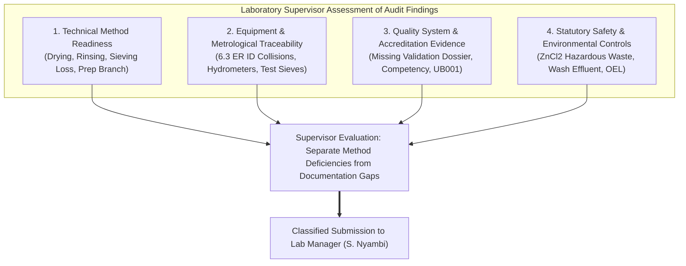
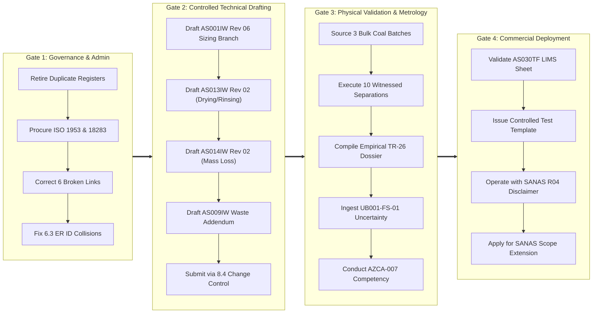

# CWP-001: LAB MANAGER REVIEW AND DECISION PACK
## Formal Technical Review, Decision Classification & Gated Approval Submission for Project CWP-001

```
Document ID:         CWP-001-REV-003
Project ID:          CWP-001 (Coal Washability Testing & Characterisation Capability Extension)
Originator:          Gift Chisali — Laboratory Supervisor
Reviewer / Gate 1:   S. Nyambi — Laboratory Manager
Approval / Gate 2:   Managing Director / Executive Management
Effective Date:      13 October 2026
Source Reference:    MISSION_002_AUDIT_REPORT.md | MISSION_002_DECISION_LOG.md
Parent QMS System:   AzureSky (Pty) Ltd — ISO/IEC 17025:2017 Accredited Quality Management System
Target QMS Path:     Z:\AZURESKY SYSTEM\AZURESKY QMS\17025
Review Pack Path:    C:\Projects\AzureSky\CWP-001\MISSION_003_REVIEW_PACK\
Document Status:     FORMAL TECHNICAL SUBMISSION — AWAITING LAB MANAGER DETERMINATION
```

---

## 1. Executive Transmittal Memorandum

**TO**: Sifiso Nyambi (Laboratory Manager)  
**FROM**: Gift Chisali (Laboratory Supervisor)  
**DATE**: 13 October 2026  
**SUBJECT**: Technical Review, Gated Decision Pack & Remediation Strategy for Project CWP-001 (Coal Washability Testing Capability)

### 1.1 Purpose of this Submission
Following the completion of the read-only forensic audits under **Mission 001** and **Mission 002**, this review pack formally submits the verified technical and quality-system findings for executive evaluation. 

The primary objective is to transition Project CWP-001 from preliminary archaeological discovery into a **defensible, traceable, and controlled quality-system capability extension**, strictly adhering to AzureSky’s governance boundary:
> **We extend the existing AzureSky ISO/IEC 17025:2017 quality management system; we do not build a parallel QMS.**

### 1.2 Fundamental Governance & Ethical Disclosure
As Laboratory Supervisor, I place the following non-negotiable boundaries on record for management review:
1. **Validation Data Transparency**: Document [`CWP-001-VAL-001`](file:///c:/Projects/AzureSky/CWP-001/13_METHOD_VALIDATION/CWP-001-VAL-001_FLOAT_AND_SINK_METHOD_VALIDATION_DOSSIER.md) drafted in the project workspace contains **modeled engineering benchmark calculations** ($0.49\%$ mean mass loss, $0.19\%$ ash delta). **These figures are NOT physical, witnessed laboratory test results.** They must never be represented to clients, auditors, or SANAS as physical validation evidence. Controlled physical validation must be formally executed in the laboratory.
2. **Current Accreditation Boundary**: [`ASMF 5.3 Statement of Conformity REV 02`](file:///Z:/AZURESKY%20SYSTEM/AZURESKY%20QMS/17025/CLAUSE%205/ASMF%205.3%20Statement%20of%20Conformity%20(Defining%20scope%20of%20work)%20REV%2002.docx#L44-L62) confirms that while AzureSky is fully accredited for Sample Preparation, Proximate (Ash, Moisture, Volatiles), and Calorific Value, **Float & Sink and Particle Size Distribution are officially UNACCREDITED**. No washability work may be issued with a SANAS endorsement until formal extension of scope is granted.
3. **Approval Gating**: No draft procedure (`AS013IW Rev 02`), form (`AS030TF`), or uncertainty model (`UB001-FS-01`) is legally binding or authorized for operational use until formally approved through AzureSky’s [`8.4 DOCUMENT CONTROL`](file:///Z:/AZURESKY%20SYSTEM/AZURESKY%20QMS/17025/CLAUSE%208/8.4%20DOCUMENT%20CONTROL%20Rev%2001.docx) procedure.
4. **Personnel Transition & Controlled Organogram Discrepancy**: Following organizational restructuring effective October 2026, Gift Chisali succeeded Tsepo Maponya as Laboratory Supervisor. Inspection of controlled organogram [`5.1 Structural Requirements (Clause 5 Organogram) rev 02.docx`](file:///Z:/AZURESKY%20SYSTEM/AZURESKY%20QMS/17025/CLAUSE%205/5.1%20Structural%20Requirements%20(Clause%205%20Organogram)%20rev%2002.docx) confirms that the supervisor's name was removed in Revision 02 under the note *"Remove name of laboratory supervisor, and 'outsourced' laboratory analysts. Reason for change: Structure of the organisation has changed"* and has not yet been re-issued to formally incorporate Gift Chisali. Furthermore, while historical QMS records reflect technical signatory status for previous personnel, Gift Chisali is designated strictly as Laboratory Supervisor pending formal technical signatory evaluation and SANAS R03 approval. An administrative review and formal organogram update by the Laboratory Manager / Managing Director is required under ISO/IEC 17025:2017 Clause 5.1.

---

## 2. Review & Technical Challenge of Audit Evidence

The findings detailed in [`MISSION_002_AUDIT_REPORT.md`](file:///c:/Projects/AzureSky/CWP-001/MISSION_002_AUDIT/MISSION_002_AUDIT_REPORT.md) have been subjected to rigorous technical scrutiny against AzureSky's physical operating environment:



### 2.1 Technical Method Readiness
* **Product Drying ([`AS013IW Rev 01 Section 8.3.2`](file:///Z:/AZURESKY%20SYSTEM/AZURESKY%20QMS/17025/CLAUSE%207/7.2.%20SELECTION,%20VERIFICATION%20AND%20VALIDATION%20OF%20METHODS/7.2.1.%20SELECTION%20AND%20VERIFICATION%20OF%20METHODS/PROCEDURES/AS013IW%20FLOAT%20AND%20SINK%20WASHABILITY%20STANDARD%20OPERATING%20PROCEDURE.docx#L89))**: The instruction to air-dry floats *"until visibly dry"* is an unacceptable technical deficiency. Retained surface moisture skews fraction masses, distorts fractional yield percentages, and corrupts cumulative washability curves. ISO 7936:2022 Clause 8.5 mandates drying to constant mass at controlled temperature ($\le 40^\circ\text{C}$ to avoid oxidation, or $105^\circ\text{C}$).
* **Product Rinsing ([`AS013IW Rev 01 Section 8.3.2`](file:///Z:/AZURESKY%20SYSTEM/AZURESKY%20QMS/17025/CLAUSE%207/7.2.%20SELECTION,%20VERIFICATION%20AND%20VALIDATION%20OF%20METHODS/7.2.1.%20SELECTION%20AND%20VERIFICATION%20OF%20METHODS/PROCEDURES/AS013IW%20FLOAT%20AND%20SINK%20WASHABILITY%20STANDARD%20OPERATING%20PROCEDURE.docx#L84-L86))**: Instructing analysts to rinse *"until most if not all medium is off"* is subjective. Residual zinc chloride salts bind to coal pores, inflating recovered yield and artificially increasing subsequent ashing residues. A quantitative verification gate (electrical conductivity $< 100\text{ }\mu\text{S/cm}$ or $\text{AgNO}_3$ drop test) is essential.
* **Particle Size Mass Loss ([`AS014IW Rev 01 Section 5.2`](file:///Z:/AZURESKY%20SYSTEM/AZURESKY%20QMS/17025/CLAUSE%207/7.2.%20SELECTION,%20VERIFICATION%20AND%20VALIDATION%20OF%20METHODS/7.2.1.%20SELECTION%20AND%20VERIFICATION%20OF%20METHODS/PROCEDURES/AS014IW%20DETERMINATION%20OF%20PARTICLE%20SIZE%20DISTRIBUTION.docx#L45-L55))**: The existing rule that forces all sieving mass loss into receiver fines introduces systematic positive error into fines yield. ISO 1953:2025 mandates proportional distribution or explicit reporting of unassigned loss if $\le 1.0\%$.
* **Sample Comminution Conflict ([`AS001IW Rev 05 Section 4`](file:///Z:/AZURESKY%20SYSTEM/AZURESKY%20QMS/17025/CLAUSE%207/7.2.%20SELECTION,%20VERIFICATION%20AND%20VALIDATION%20OF%20METHODS/7.2.1.%20SELECTION%20AND%20VERIFICATION%20OF%20METHODS/PROCEDURES/AS001IW%20PROCEDURE%20ON%20SAMPLE%20PREPARATION%20OF%20HARD%20COAL%20Rev%2005.docx#L15-L25))**: While `AS001IW` is accredited for CRM/PT bulk reduction (crushing everything to 3 mm), commercial washability requires $+50\text{ mm}$ and $+25\text{ mm}$ lump coal to be preserved. Crushing bulk coal prematurely destroys natural liberation and density characteristics.

### 2.2 Quality-System Readiness
* **Method Validation Gap (ISO/IEC 17025 Clause 7.2.2)**: A missing validation file on `Z:\` is a formal evidence gap under SANAS TR-26. However, it does not mean the physics of dense medium separation are invalid. It means AzureSky has not yet documented empirical performance characteristics (accuracy, repeatability, mass recovery gates) on representative coal types.
* **Competency Gap (Clause 6.2)**: [`COMPETENCY MATRIX 01.xlsx`](file:///Z:/AZURESKY%20SYSTEM/AZURESKY%20QMS/17025/CLAUSE%206/PERSONNEL%20COMPETENCY/6.2%20COMPETENCY%20MATRIX/COMPETENCY%20MATRIX%2001.xlsx) lists zero authorized analysts for Float-and-Sink. Staff cannot execute client testing without witnessed assessment records.
* **Measurement Uncertainty Gap (Clause 7.6)**: [`UB001`](file:///Z:/AZURESKY%20SYSTEM/AZURESKY%20QMS/17025/CLAUSE%207/7.6.%20MEASUREMENT%20UNCERTAINTY/UB001%20UNCERTAINTY%20BUDGET%20rev%2001.docx) covers proximate parameters only. A validated measurement model for Yield % and Cut-point density ($\text{d}_{50}$) must be ingested into the QMS.
* **LIMS Calculation Integrity (Clause 7.11)**: [`AS002LV.xlsx`](file:///Z:/AZURESKY%20SYSTEM/AZURESKY%20QMS/17025/CLAUSE%207/7.11.%20MANAGEMENT%20OF%20RECORDS/AS002LV-%20LIMS%20VALIDATION%20FOR%20FUNCTIONALITY.xlsx) validates proximate parameters only. Washability reduction formulas (Yield, Dry Ash balance, M-curves, Tromp partition curves) must be validated under [`ASMF 7.11 Data Integrity Procedure`](file:///Z:/AZURESKY%20SYSTEM/AZURESKY%20QMS/17025/CLAUSE%207/7.11.%20MANAGEMENT%20OF%20RECORDS/ASMF%207.11%20Data%20Integrity%20Risk%20Management%20Procedure.docx).

---

## 3. Classification of the Ten Required Decisions

To enable structured executive determination, the ten decisions logged in [`MISSION_002_DECISION_LOG.md`](file:///c:/Projects/AzureSky/CWP-001/MISSION_002_AUDIT/MISSION_002_DECISION_LOG.md) are classified into five functional categories with assigned decision authorities:

```
┌────────────────────────────────────────────────────────────────────────────────────────┐
│                              DECISION CLASSIFICATION MATRIX                            │
├──────────────┬──────────────────────────────────────────┬──────────────────────────────┤
│ Category     │ Decision Item Reference                  │ Designated Authority         │
├──────────────┼──────────────────────────────────────────┼──────────────────────────────┤
│ Category I   │ DEC-01: Master Duplicate Disposition     │ Lab Manager / Project Owner  │
│ Admin & Doc  │ DEC-02: Standards Library Ingestion      │ Laboratory Manager           │
├──────────────┼──────────────────────────────────────────┼──────────────────────────────┤
│ Category II  │ DEC-04: Sample Prep Comminution Flowsheet│ Technical Signatory / Lab Mgr│
│ Technical    │ DEC-05: Product Drying Protocol & Temp   │ Technical Signatory          │
│ Methods      │ DEC-06: PSD Mass Loss Bias Correction    │ Technical Signatory / Lab Mgr│
├──────────────┼──────────────────────────────────────────┼──────────────────────────────┤
│ Category III │ DEC-09: Equipment ID Collisions & Assets │ Lab Supervisor / Lab Manager │
│ Resources    │ Competency Matrix Authorization Protocol │ Laboratory Manager           │
├──────────────┼──────────────────────────────────────────┼──────────────────────────────┤
│ Category IV  │ DEC-07: Phase 1 Density Medium Selection │ Lab Manager / Project Owner  │
│ Safety/Waste │ DEC-10: Hazardous Chemical Waste & Wash  │ Operations Mgr / Lab Manager │
├──────────────┼──────────────────────────────────────────┼──────────────────────────────┤
│ Category V   │ DEC-03: Scope Boundary (As-Received)     │ Lab Manager / Director       │
│ Validation   │ DEC-08: Physical Validation Scheduling   │ Lab Manager / Tech Signatory │
└──────────────┴──────────────────────────────────────────┴──────────────────────────────┘
```

---

## 4. Laboratory Supervisor Recommendations & Detailed Justifications

### Recommendation 1 (Category I — Admin): Authorize Master Duplicate Retirement (DEC-01)
* **Verified Finding**: Four identical duplicate files exist across root and subfolders, while `CWP-001_DOCUMENT_LINK_AND_EVIDENCE_REGISTER.md` has two divergent copies.
* **Objective Evidence**: Cryptographic hash analysis in [`MISSION_002_AUDIT_REPORT.md Section 2.1`](file:///c:/Projects/AzureSky/CWP-001/MISSION_002_AUDIT/MISSION_002_AUDIT_REPORT.md#21-inventory--hash-audit-of-duplicate-master-documents).
* **Quality Risk**: Maintaining conflicting registers violates ISO/IEC 17025 Clause 8.4 (Document Control) and creates confusion regarding document status.
* **Supervisor Recommendation**: Declare the files at the **root of `C:\Projects\AzureSky\CWP-001\` as the sole authoritative master artifacts** per [CWP-001_ARCHITECTURE_FREEZE.md Section 8](file:///c:/Projects/AzureSky/CWP-001/CWP-001_ARCHITECTURE_FREEZE.md#L167-L175). Move the divergent subfolder copy `01_EXISTING_AZURESKY_SYSTEM\CWP-001_DOCUMENT_LINK_AND_EVIDENCE_REGISTER.md` to `00_ARCHIVE_HISTORICAL/`.
* **Governing QMS Reference**: [`8.4 DOCUMENT CONTROL Rev 01`](file:///Z:/AZURESKY%20SYSTEM/AZURESKY%20QMS/17025/CLAUSE%208/8.4%20DOCUMENT%20CONTROL%20Rev%2001.docx).

### Recommendation 2 (Category I — Admin): Procure Missing Standards PDFs (DEC-02)
* **Verified Finding**: Controlled PDFs of `ISO 1953:2025` and `ISO 18283:2022` are missing from `Z:\...\ISO STANDARDS\`. Procedure `AS008IW` cites withdrawn `ISO 18283:2006`.
* **Objective Evidence**: Direct file listing of `Z:\...\ISO STANDARDS\` in [`MISSION_002_EVIDENCE_INDEX.md Section 3`](file:///c:/Projects/AzureSky/CWP-001/MISSION_002_AUDIT/MISSION_002_EVIDENCE_INDEX.md#3-normative-standards-library-files-on-record-drive-z).
* **Quality Risk**: Citing external standards not maintained in the controlled library constitutes a non-conformance under ISO/IEC 17025 Clause 7.2.1.2.
* **Supervisor Recommendation**: Formally procure licensed PDF copies of `ISO 1953:2025` and `ISO 18283:2022` and ingest them into the QMS standards repository. Issue routine editorial amendments to `AS008IW` and `AS006IW` updating standard publication dates.
* **Governing QMS Reference**: [`8.4 DOCUMENT CONTROL Rev 01`](file:///Z:/AZURESKY%20SYSTEM/AZURESKY%20QMS/17025/CLAUSE%208/8.4%20DOCUMENT%20CONTROL%20Rev%2001.docx).

### Recommendation 3 (Category V — Scope): Define Scope as Laboratory Testing on As-Received Samples (DEC-03)
* **Verified Finding**: [`ASMF 5.3 REV 02 Section 5`](file:///Z:/AZURESKY%20SYSTEM/AZURESKY%20QMS/17025/CLAUSE%205/ASMF%205.3%20Statement%20of%20Conformity%20(Defining%20scope%20of%20work)%20REV%2002.docx#L30-L36) explicitly excludes sampling from AzureSky’s claimed scope of conformity and future accreditation.
* **Objective Evidence**: Inspection of `ASMF 5.3` lines 30–36.
* **Operational Risk**: Offering accredited sampling requires vehicle/equipment capex, on-site sampling bias audits per ISO 13909-8, and sampler certification.
* **Supervisor Recommendation**: Reaffirm that CWP-001 washability testing will be offered strictly as an **in-house laboratory testing service on as-received customer samples**. All test certificates will carry the standard disclaimer that AzureSky is not responsible for sampling representation and results apply only to the sample received.
* **Governing QMS Reference**: [`ASMF 5.3 Statement of Conformity`](file:///Z:/AZURESKY%20SYSTEM/AZURESKY%20QMS/17025/CLAUSE%205/ASMF%205.3%20Statement%20of%20Conformity%20(Defining%20scope%20of%20work)%20REV%2002.docx) & [`7.8. REPORTING OF RESULTS Section 4.3`](file:///Z:/AZURESKY%20SYSTEM/AZURESKY%20QMS/17025/CLAUSE%207/7.8%20REPORTING/7.8.%20REPORTING%20OF%20RESULTS.docx).

### Recommendation 4 (Category II — Methods): Create Non-Destructive Sizing Branch in Sample Prep (DEC-04)
* **Verified Finding**: [`AS001IW Rev 05 Section 4`](file:///Z:/AZURESKY%20SYSTEM/AZURESKY%20QMS/17025/CLAUSE%207/7.2.%20SELECTION,%20VERIFICATION%20AND%20VALIDATION%20OF%20METHODS/7.2.1.%20SELECTION%20AND%20VERIFICATION%20OF%20METHODS/PROCEDURES/AS001IW%20PROCEDURE%20ON%20SAMPLE%20PREPARATION%20OF%20HARD%20COAL%20Rev%2005.docx) enforces crushing all received bulk coal through 25 mm $\to$ 10 mm $\to$ 3 mm crushers.
* **Objective Evidence**: Inspection of `AS001IW Rev 05` Section 4.2.
* **Technical Risk**: Crushing bulk coal destined for washability destroys natural liberation, particle size distributions, and coarse lump density profiles.
* **Supervisor Recommendation**: Prepare an amendment to `AS001IW` (Rev 06) incorporating a dedicated "Washability Preparation Branch". Bulk samples designated for washability/size analysis shall be screened and split at $+50\text{ mm}$, $25\text{ mm}$, $13.2\text{ mm}$ prior to any destructive comminution.
* **Governing QMS Reference**: [`AS001IW PROCEDURE ON SAMPLE PREPARATION OF HARD COAL`](file:///Z:/AZURESKY%20SYSTEM/AZURESKY%20QMS/17025/CLAUSE%207/7.2.%20SELECTION,%20VERIFICATION%20AND%20VALIDATION%20OF%20METHODS/7.2.1.%20SELECTION%20AND%20VERIFICATION%20OF%20METHODS/PROCEDURES/AS001IW%20PROCEDURE%20ON%20SAMPLE%20PREPARATION%20OF%20HARD%20COAL%20Rev%2005.docx) & ISO 13909-4:2025 Clause 6.1.

### Recommendation 5 (Category II — Methods): Standardize Forced-Air Product Drying at $\le 40^\circ\text{C}$ (DEC-05)
* **Verified Finding**: [`AS013IW Rev 01 Section 8.3.2`](file:///Z:/AZURESKY%20SYSTEM/AZURESKY%20QMS/17025/CLAUSE%207/7.2.%20SELECTION,%20VERIFICATION%20AND%20VALIDATION%20OF%20METHODS/7.2.1.%20SELECTION%20AND%20VERIFICATION%20OF%20METHODS/PROCEDURES/AS013IW%20FLOAT%20AND%20SINK%20WASHABILITY%20STANDARD%20OPERATING%20PROCEDURE.docx#L89) instructs analysts to air-dry floats "until visibly dry".
* **Objective Evidence**: Inspection of `AS013IW` Section 8.3.2 text.
* **Technical Risk**: Retained moisture introduces gravimetric errors directly corrupting fraction yield percentages and cumulative curves.
* **Supervisor Recommendation**: Amend `AS013IW` to mandate controlled forced-air drying at $\le 40^\circ\text{C}$ until constant mass ($\Delta M < 0.1\%$ between successive weighings 1 hour apart). Allocate Mokopoledi drying oven `AS00111` for washability tray drying.
* **Governing QMS Reference**: ISO 7936:2022 Clause 8.5 & [`AS004IW Inherent Moisture`](file:///Z:/AZURESKY%20SYSTEM/AZURESKY%20QMS/17025/CLAUSE%207/7.2.%20SELECTION,%20VERIFICATION%20AND%20VALIDATION%20OF%20METHODS/7.2.1.%20SELECTION%20AND%20VERIFICATION%20OF%20METHODS/PROCEDURES/AS004IW%20%20PROCEDURE%20ON%20DETERMINATION%20OF%20INHERENT(ANALYSIS)%20MOISTURE%20REV%2002.docx).

### Recommendation 6 (Category II — Methods): Amend Particle Size Mass Loss Allocation Rule (DEC-06)
* **Verified Finding**: [`AS014IW Rev 01 Section 5.2`](file:///Z:/AZURESKY%20SYSTEM/AZURESKY%20QMS/17025/CLAUSE%207/7.2.%20SELECTION,%20VERIFICATION%20AND%20VALIDATION%20OF%20METHODS/7.2.1.%20SELECTION%20AND%20VERIFICATION%20OF%20METHODS/PROCEDURES/AS014IW%20DETERMINATION%20OF%20PARTICLE%20SIZE%20DISTRIBUTION.docx#L45-L55) forcibly adds all sieving mass loss into receiver fines.
* **Objective Evidence**: Inspection of `AS014IW` Section 5.2 formula.
* **Technical Risk**: Artificially inflates fines yield, generating systematic positive bias contrary to ISO 1953:2025.
* **Supervisor Recommendation**: Amend `AS014IW` Section 5.2 to distribute allowable sieving loss proportionally across all recovered size fractions if total loss is $\le 1.0\%$; invalidate the test if loss exceeds $1.0\%$.
* **Governing QMS Reference**: ISO 1953:2025 Clause 9.2.

### Recommendation 7 (Category IV — Safety): Reaffirm Aqueous $\text{ZnCl}_2$ with Mandatory Effluent Loop (DEC-07)
* **Verified Finding**: [`AS013IW`](file:///Z:/AZURESKY%20SYSTEM/AZURESKY%20QMS/17025/CLAUSE%207/7.2.%20SELECTION,%20VERIFICATION%20AND%20VALIDATION%20OF%20METHODS/7.2.1.%20SELECTION%20AND%20VERIFICATION%20OF%20METHODS/PROCEDURES/AS013IW%20FLOAT%20AND%20SINK%20WASHABILITY%20STANDARD%20OPERATING%20PROCEDURE.docx#L64) utilizes aqueous $\text{ZnCl}_2$ (RD 1.30–1.90).
* **Objective Evidence**: Current practice and `ASMF 02` logsheet.
* **Statutory Risk**: Zinc solutions are corrosive and aquatic-toxic. Uncontrolled sewer discharge violates NEMWA GN R. 634.
* **Supervisor Recommendation**: Reaffirm aqueous $\text{ZnCl}_2$ as the authorized medium for Phase 1 coarse washability due to existing stock and operational infrastructure. Mandate a closed-circuit rinse water settling/evaporation loop and contract a licensed hazardous waste collector.
* **Governing QMS Reference**: OHSA HCA Regulations 2021 & NEMWA Act 59 of 2008.

### Recommendation 8 (Category V — Validation): Schedule Physical Method Validation Campaign (DEC-08)
* **Verified Finding**: Zero method validation records exist on `Z:\` under Clause 7.2.2. Data in `CWP-001-VAL-001` are modeled figures.
* **Objective Evidence**: Inspection of `Z:\...\7.2.2. METHOD VALIDATION\` folder.
* **Accreditation Risk**: Issuing test certificates without empirical validation data violates ISO/IEC 17025 Clause 7.2.2 and SANAS TR-26.
* **Supervisor Recommendation**: Authorize an official 3-week physical laboratory validation campaign: source three 100 kg bulk coal samples (low, medium, high ash); execute 10 witnessed replicate separations under the Laboratory Supervisor (Gift Chisali) and authorized Technical Signatory (S. Nyambi); generate empirical mass loss and ash balance datasets to replace modeled figures in `CWP-001-VAL-001`.
* **Governing QMS Reference**: [`AS001MMV- Memorandum Validation of Methods ISO 17025 7.2.2`](file:///Z:/AZURESKY%20SYSTEM/AZURESKY%20QMS/17025/CLAUSE%207/7.2.%20SELECTION,%20VERIFICATION%20AND%20VALIDATION%20OF%20METHODS/7.2.2.%20METHOD%20VALIDATION/AS001MMV-%20Memorandum%20Validation%20of%20Methods%20ISO%2017025%207.2.2.docx) & SANAS TR-26.

### Recommendation 9 (Category III — Resources): Resolve Equipment ID Collisions & Asset Ingestion (DEC-09)
* **Verified Finding**: Asset ID `AS8284` is assigned to both a thermometer probe and a 25 mm crusher; `AS00111` is assigned to both a drying oven and a hygrometer. Hydrometers and sieves are unlisted.
* **Objective Evidence**: Inspection of [`6.3 EQUIPMENT REGISTER.xlsx`](file:///Z:/AZURESKY%20SYSTEM/AZURESKY%20QMS/17025/CLAUSE%206/EQUIPMENT/6.3%20EQUIPMENT%20REGISTER.xlsx) rows 14, 18, 23, 29.
* **Metrological Risk**: Duplicate asset numbers compromise measurement traceability under ISO/IEC 17025 Clause 6.4.
* **Supervisor Recommendation**: Reassign unique asset IDs in `6.3 ER` (e.g. `AS8284-CR` for 25 mm crusher; `AS00111-HY` for CTS hygrometer). Ingest calibrated hydrometers (RD 1.30–1.90), test sieves, and separation vessels into `6.3 ER` with defined calibration intervals.
* **Governing QMS Reference**: [`6.3 EQUIPMENT REGISTER`](file:///Z:/AZURESKY%20SYSTEM/AZURESKY%20QMS/17025/CLAUSE%206/EQUIPMENT/6.3%20EQUIPMENT%20REGISTER.xlsx) & [`6.5. METROLOGICAL TRACEABILITY MEMORANDUM`](file:///Z:/AZURESKY%20SYSTEM/AZURESKY%20QMS/17025/CLAUSE%206/EQUIPMENT/6.5.%20AZURESKY%20METROLOGICAL%20TRACEABILITY%20MEMORANDUM.docx).

### Recommendation 10 (Category IV — Safety): Issue Liquid Chemical Waste Addendum to `AS009IW` (DEC-10)
* **Verified Finding**: [`AS009IW`](file:///Z:/AZURESKY%20SYSTEM/AZURESKY%20QMS/PROCEDURES/AS009IW%20WASTE%20MANAGEMENT%20PROCEDURE.docx) covers solid waste only; liquid chemical waste is unaddressed.
* **Objective Evidence**: Inspection of `AS009IW` text.
* **Statutory Liability**: Operating hazardous chemical baths without documented waste disposal routes is illegal under NEMWA GN R. 634.
* **Supervisor Recommendation**: Issue a controlled Liquid Hazardous Waste Addendum to `AS009IW`; establish dedicated chemical waste IBC containers; approve a service agreement with a registered hazardous waste disposal contractor.
* **Governing QMS Reference**: [`AS009IW WASTE MANAGEMENT PROCEDURE`](file:///Z:/AZURESKY%20SYSTEM/AZURESKY%20QMS/PROCEDURES/AS009IW%20WASTE%20MANAGEMENT%20PROCEDURE.docx) & SANS 10234.

---

## 5. Formal Approval Hierarchy & Sign-off Gate

In accordance with AzureSky's organizational governance:

```
┌────────────────────────────────────────────────────────────────────────────────────────┐
│                                FORMAL GOVERNANCE GATING                                │
├────────────────────────────────────────────────────────────────────────────────────────┤
│ Level 1: LABORATORY SUPERVISOR SUBMISSION (Gift Chisali)                               │
│ - Audits evidence, formulates technical justifications, drafts proposed amendments.     │
│ Status: SUBMITTED (13 October 2026)                                                    │
├────────────────────────────────────────────────────────────────────────────────────────┤
│ Level 2: LABORATORY MANAGER REVIEW & APPROVAL (S. Nyambi)                              │
│ - Approves QMS procedure amendments, authorises competency, approves validation plans. │
│ Status: PENDING DETERMINATION                                                          │
├────────────────────────────────────────────────────────────────────────────────────────┤
│ Level 3: MANAGING DIRECTOR / EXECUTIVE APPROVAL                                        │
│ - Approves capital expenditure, hazardous waste contracts, and SANAS scope extension.  │
│ Status: PENDING DETERMINATION                                                          │
└────────────────────────────────────────────────────────────────────────────────────────┘
```

---

## 6. Actionable Gated Implementation Roadmap (Post-Approval)

To ensure zero disruption to live operations, remediation must proceed in four sequential, gated phases:



1. **Gate 1 — Administrative Reconciliation (Week 1)**:
   * Formally retire divergent subfolder register.
   * Procure missing standard PDFs for QMS library.
   * Correct 6 broken Markdown paths in project files.
   * Clean asset ID collisions in `6.3 ER`.
2. **Gate 2 — Controlled Document Drafting & Review (Week 2)**:
   * Submit proposed revisions (`AS001IW Rev 06`, `AS013IW Rev 02`, `AS014IW Rev 02`, `AS009IW Addendum`) through formal Clause 8.4 review gates.
   * Review and approve benchsheet template `AS030TF`.
3. **Gate 3 — Physical Validation & Competency Execution (Weeks 3–5)**:
   * Procure 3 representative bulk coal samples.
   * Execute witnessed physical separation trials; compile empirical validation data per SANAS TR-26.
   * Ingest uncertainty model `UB001-FS-01` with empirical input variances.
   * Execute `AZCA-007` competency assessments and authorize analysts on `COMPETENCY MATRIX 01.xlsx`.
4. **Gate 4 — Commercial Readiness & Accreditation Extension (Week 6 onwards)**:
   * Validate calculation spreadsheet `AS030TF` under `ASMF 7.11`.
   * Deploy commercial testing under `7.8 Reporting` with mandatory SANAS R04 unaccredited disclaimers.
   * Prepare formal application dossier for SANAS scope extension.

---

## 7. Submission Sign-off Gate

| Role | Name | Title | Signature | Date |
| :--- | :--- | :--- | :--- | :--- |
| **Submitted By** | Gift Chisali | Laboratory Supervisor | *Electronic Submission (G. Chisali)* | 13 October 2026 |
| **Reviewed By** | Sifiso Nyambi | Laboratory Manager / Quality Authority | *Pending Review* | — |
| **Approved By** | Executive Management | Managing Director / Director | *Pending Review* | — |

---
*End of Document CWP-001-REV-003 — Lab Manager Review and Decision Pack.*
