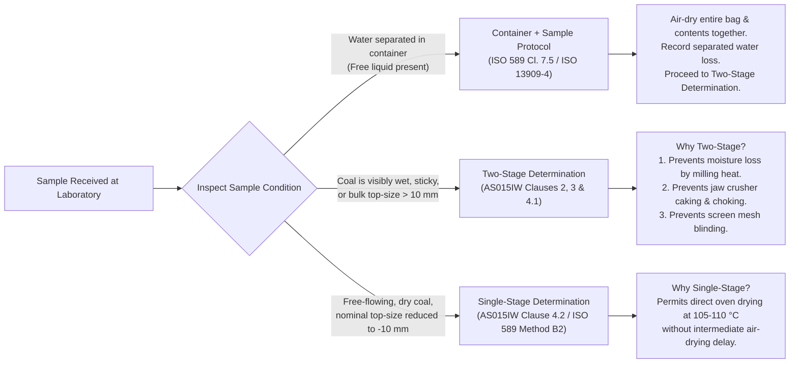
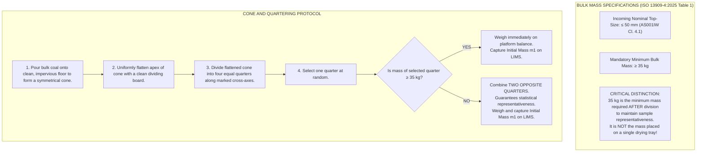
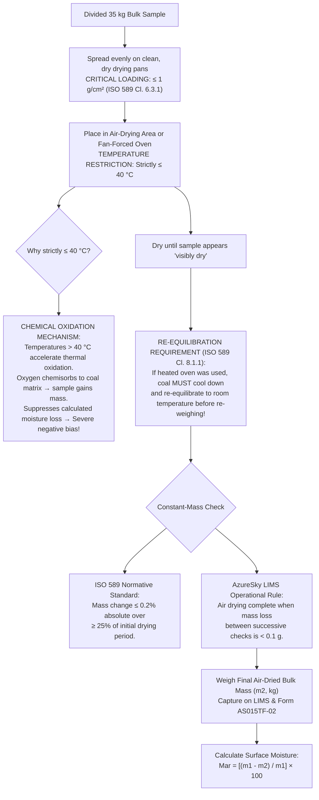
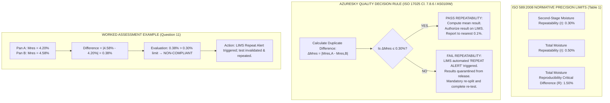
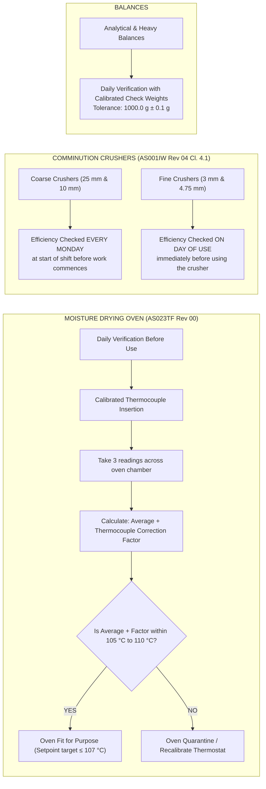
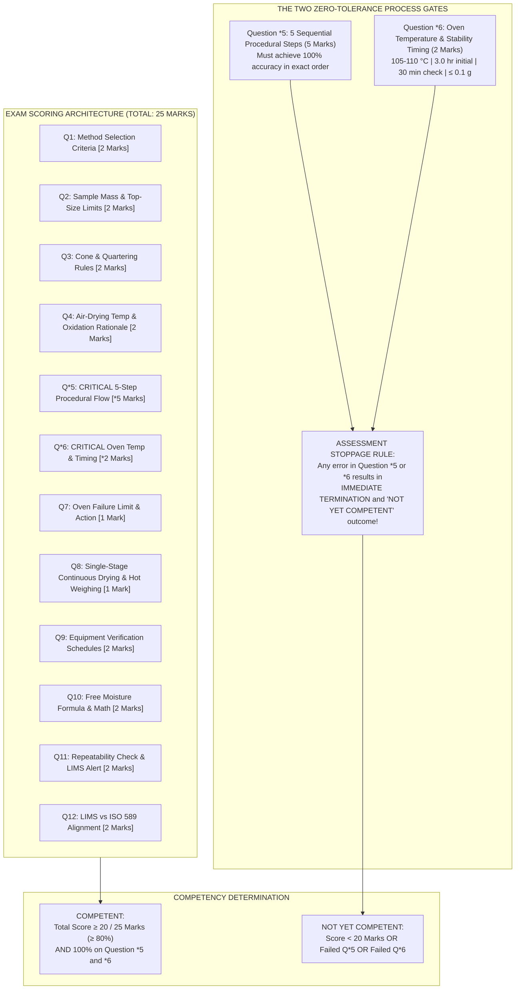

# AZURESKY COAL LABORATORY: TOTAL MOISTURE DETERMINATION
## Comprehensive Technical Manual, Process Architecture & Visual Workflow Reference
### Operating under ISO/IEC 17025:2017 | ISO 589:2008 | ISO 13909-4:2025

```
========================================================================================
Document Code:        AS-REF-015
Governing SOP:        AS015IW Rev 01 (Procedure on the Determination of Total Moisture)
Supporting Standards: ISO 589:2008 (Methods A2 and B2 in air)
                      ISO 13909-4:2025 (Mechanical Sampling — Preparation of Test Samples)
                      ISO 18283:2006 (Manual Sampling of Hard Coal)
Associated Quality:   AS001IW Rev 04 (Hard Coal Sample Preparation Procedure)
                      AS015TF-01 (Single-Stage Total Moisture Benchsheet)
                      AS015TF-02 (Two-Stage Total Moisture Benchsheet)
                      AS023TF (Drying Oven Daily Metrological Verification)
                      AS010IW (Statements of Conformity & Decision Rules per Cl. 7.8.6)
Competency Standard:  AZCA-015 Rev 01 (Technical Competency Assessment — 25 Marks)
Target Audience:      Coal Preparation Analysts, Laboratory Technicians, Quality Managers
Effective Date:       October 2026
Revision Status:      01
========================================================================================
```

---

## 1. Executive Summary & Core Principle

In coal characterization, **Total Moisture (TM)** is a critical commercial and technical parameter that directly dictates:
1. **As-Received Calorific Value ($CV_{ar}$)**: Moisture absorbs latent heat during combustion, reducing usable thermal yield.
2. **Commercial Pricing and Invoicing**: Moisture contributes non-combustible mass, directly impacting freight costs and contract specifications.
3. **Materials Handling**: Excessive surface moisture causes handling difficulties, bin hang-ups, transfer chute plugging, and screen blinding.

### Core Thermodynamic Principle
Total moisture is determined gravimetrically by measuring the **loss in mass** of coal when heated in air under strictly controlled conditions at **$105\ ^\circ\text{C}$ to $110\ ^\circ\text{C}$** until constant mass is attained.

$$\text{Total Moisture (TM)} = \text{Surface (Free) Moisture } (M_{ar}) + \text{Residual Moisture } (M_{res})$$

* **Surface (Free) Moisture ($M_{ar}$)**: Water residing on the external surfaces of coal particles and within coarse macro-pores. Measured during **Stage 1** by low-temperature air drying ($\le 40\ ^\circ\text{C}$).
* **Residual Moisture ($M_{res}$)**: Water retained inside internal capillaries and micro-pores of the coal matrix after air drying. Measured during **Stage 2** by thermal drying at $105\ ^\circ\text{C} - 110\ ^\circ\text{C}$.

---

## 2. Master End-to-End Visual Architecture

```mermaid
flowchart TD
    subgraph S1["PHASE 1: SAMPLE RECEPTION & METHOD SELECTION"]
        A["Bulk Coal Consignment Received<br/>(Traceability Log on LIMS)"] --> B{"Check Nominal Top-Size<br/>(AS001IW Cl. 4.1)"}
        B -->|Top-Size > 50 mm| B1["NON-CONFORMANCE:<br/>Reject / Refer to Supervisor"]
        B -->|Top-Size ≤ 50 mm| C{"Physical State Inspection<br/>(ISO 589 Cl. 7.5)"}
        C -->|Separated Free Water in Bag| C1["Air-dry Sample + Container Together<br/>Record Water Mass Loss"]
        C -->|Visibly Wet / Dripping / Moist| D["MANDATORY PATHWAY:<br/>Two-Stage Determination (Method A2)"]
        C -->|Free-Flowing / Drier Coal (-10 mm)| E["DIRECT PATHWAY:<br/>Single-Stage Determination (Method B2)"]
    end

    subgraph S2["PHASE 2: PRIMARY SPLITTING & STAGE 1 DRYING"]
        D --> F["Cone and Quartering Split<br/>(Check Mass vs ISO 13909-4 Tab. 1)"]
        F --> G{"Is single quarter ≥ 35 kg?"}
        G -->|No| G1["Combine TWO Opposite Quarters<br/>to ensure representativeness"]
        G -->|Yes| G2["Use Single Selected Quarter"]
        G1 --> H["Weigh Initial Mass m1 on LIMS<br/>('As Received' Mass)"]
        G2 --> H
        H --> I["Spread sample thinly (≤ 1 g/cm²)<br/>Air dry at ambient or oven ≤ 40 °C"]
        I --> J["Re-equilibrate to room temp if heated<br/>Check stability on LIMS (< 0.1 g loss)"]
        J --> K["Weigh Final Air-Dried Mass m2<br/>Calculate Surface Moisture Mar"]
    end

    subgraph S3["PHASE 3: COMMINUTION & CRITICAL DIVISION (CRITICAL GATE 1)"]
        K --> L["Step 1: Primary Crush to 25 mm"]
        L --> M["Step 2: Intermediate Riffle Split"]
        M --> N["Step 3: Secondary Crush to -3 mm<br/>(AzureSky Validated Macro Method)"]
        N --> O["Step 4: Riffle Split to 1 kg / side"]
        O --> P["Step 5: Tare duplicate pans on balance<br/>Transfer ~1 kg into Pan A and Pan B<br/>Log initial net charge m3 on LIMS"]
    end

    subgraph S4["PHASE 4: STAGE 2 OVEN DRYING (CRITICAL GATE 2)"]
        P --> Q["Place Pan A & B in Oven at 105 °C - 110 °C<br/>(Oven Verified per AS023TF ≤ 107 °C)"]
        Q --> R["Continuous Initial Dry for 3.0 Hours"]
        R --> S["First Intermediate Weighing on LIMS"]
        S --> T["Return to Oven for 30 Minutes"]
        T --> U["Re-weigh on LIMS:<br/>Calculate 30-min mass loss Δm"]
        U --> V{"Is Δm ≤ 0.1 g?"}
        V -->|Yes| W["SAMPLE STABLE:<br/>Capture final mass m4 on LIMS<br/>Calculate Mres,A and Mres,B"]
        V -->|No| X{"Total Oven Time ≥ 5.0 Hours?"}
        X -->|No| T
        X -->|Yes| Y["TEST FAILED:<br/>Mark Failed on LIMS<br/>Invalidate & Repeat from Backup Split"]
    end

    subgraph S5["PHASE 5: QA/QC, PRECISION & AUTHORIZATION"]
        W --> Z{"Check Repeatability:<br/>|Mres,A - Mres,B| ≤ 0.30%?"}
        Z -->|Difference > 0.30%| AA["LIMS REPEAT ALERT (AS010IW):<br/>Quarantine Data & Repeat Test"]
        Z -->|Difference ≤ 0.30%| AB["PASS REPEATABILITY:<br/>Calculate TM = Mar + (100-Mar)Mres/100<br/>Report Mean to nearest 0.1%"]
        E --> AC["Single-Stage Oven Cycle:<br/>Dry 1 kg duplicate pans 5.0 hrs continuous<br/>Weigh hot within 5 minutes<br/>TM = (m2 - m3)/(m2 - m1) * 100"]
        AC --> AD{"Check Repeatability:<br/>|TMA - TMB| ≤ 0.50%?"}
        AD -->|Difference > 0.50%| AA
        AD -->|Difference ≤ 0.50%| AB
    end
```

---

## 3. Method Selection Architecture & Decision Framework

The analyst must evaluate the physical state and top-size of the sample upon arrival:



---

## 4. Primary Reception & Bulk Sample Division



---

## 5. Stage 1: Air Drying (Free / Surface Moisture)



---

## 6. The Critical 5-Step Procedural Sequence (Assessment Question \*5)

> [!CAUTION]
> **ZERO-TOLERANCE CRITICAL GATE 1**: All candidates taking **AZCA-015** must state these 5 sequential steps with 100% precision. Missing or re-ordering any step results in an **immediate assessment stoppage and disqualification**.

```mermaid
sequenceDiagram
    autonumber
    actor Tech as Preparation Analyst
    participant Crusher as Comminution Circuit
    participant Splitter as Riffle Splitter
    participant Balance as LIMS-Connected Balance
    participant Pan as Duplicate Test Pans

    Note over Tech,Pan: Step 1: Stage 1 Air Drying
    Tech->>Pan: Spread 35 kg sample thinly (loading ≤ 1 g/cm²) until "visibly dry" (≤ 40 °C)

    Note over Tech,Balance: Step 2: Stage 1 Stability Check
    Tech->>Balance: Weigh back pans; confirm air drying complete when mass loss is < 0.1 g (m2 captured)

    Note over Tech,Splitter: Step 3: Primary Comminution & Intermediate Split
    Tech->>Crusher: Pass air-dried sample through 25 mm jaw crusher
    Crusher->>Splitter: Reduce bulk mass using clean, level Riffle Splitter

    Note over Tech,Crusher: Step 4: Secondary Comminution
    Tech->>Crusher: Crush material: to -10 mm for Single-Stage, or to -3 mm for Two-Stage

    Note over Tech,Pan: Step 5: Final Division & Duplicate Charge
    Tech->>Splitter: Riffle split to obtain representative portions of 1 kg per riffled side
    Tech->>Balance: Tare two clean, dry moisture pans on LIMS-connected balance
    Tech->>Pan: Transfer ~1 kg into Pan A and ~1 kg into Pan B
    Balance-->>Tech: Capture initial net sample mass m3 on LIMS for both pans
```

---

## 7. Stage 2: Oven Drying Protocols Compared

```mermaid
flowchart TD
    subgraph TWO["TWO-STAGE RESIDUAL MOISTURE (-3 mm)"]
        T1["Duplicate 1 kg portions (-3 mm) in Pan A & B"] --> T2["Preheated Oven: 105 °C to 110 °C<br/>(Ventilation: ≥ 5 atmosphere changes/hr)"]
        T2 --> T3["Initial Interval: Dry continuously for 3.0 Hours"]
        T3 --> T4["First Weighing: Capture intermediate mass on LIMS"]
        T4 --> T5["Return pans to oven for 30 minutes"]
        T5 --> T6["Re-weigh on LIMS: Calculate 30-min loss Δm"]
        T6 --> T7{"Is Δm ≤ 0.1 g?"}
        T7 -->|YES| T8["SAMPLE STABLE:<br/>Log final net mass m4 on LIMS<br/>Calculate Mres = [(m3 - m4)/m3] * 100"]
        T7 -->|NO| T9{"Total Oven Time ≥ 5.0 Hours?"}
        T9 -->|NO| T5
        T9 -->|YES| T10["FAILURE THRESHOLD REACHED:<br/>Mark 'Failed' on LIMS<br/>Invalidate test & repeat from backup split"]
    end

    subgraph SINGLE["SINGLE-STAGE TOTAL MOISTURE (-10 mm — ISO 589 Method B2)"]
        S1["Duplicate portions (≥ 600 g, routine ~1000 g)<br/>Crushed to -10 mm; loading ≤ 1 g/cm²"] --> S2["Preheated Oven: 105 °C to 110 °C"]
        S2 --> S3["Continuous Drying for full 5.0 Hours<br/>(No 3-hour intermediate check)"]
        S3 --> S4["HOT WEIGHING PROTOCOL (ISO 589 Cl. 8.2.1):<br/>Remove trays from oven and weigh while hot<br/>AS SOON AS POSSIBLE (WITHIN 5 MINUTES)"]
        S4 --> S5["Prevents moisture re-adsorption from cooling room air!"]
        S5 --> S6["Record tare m1, initial gross m2, dried gross m3<br/>Calculate TM = [(m2 - m3)/(m2 - m1)] * 100"]
    end
```



---

## 8. Mathematical Formulation & Variable Matrix

To prevent variable naming conflicts across laboratory raw data sheets and LIMS, the variable notations are segregated:

```
┌────────────────────────────────────────────────────────────────────────────────────────┐
│                        STANDARDIZED VARIABLE DEFINITION MATRIX                         │
├─────────────────┬──────────┬──────┬────────────────────────────────────────────────────┤
│ Pathway         │ Variable │ Unit │ Physical Definition & Measurement Source           │
├─────────────────┼──────────┼──────┼────────────────────────────────────────────────────┤
│ TWO-STAGE       │ m1       │ kg   │ Initial "As Received" bulk coal mass (AS015TF-02)  │
│ (Stage 1 Bulk)  │ m2       │ kg   │ Final air-dried bulk coal mass (AS015TF-02)        │
│                 │ Mar      │ %    │ Free / Surface Moisture percentage                │
├─────────────────┼──────────┼──────┼────────────────────────────────────────────────────┤
│ TWO-STAGE       │ m3       │ g    │ Initial net sample mass before oven drying (~1000g)│
│ (Stage 2 Pans)  │ m4       │ g    │ Final net stabilized sample mass after oven drying │
│                 │ Mres     │ %    │ Residual Moisture percentage of Pan A / Pan B      │
│                 │ TM       │ %    │ Combined Total Moisture percentage                 │
├─────────────────┼──────────┼──────┼────────────────────────────────────────────────────┤
│ SINGLE-STAGE    │ m1       │ g    │ Empty, clean, dry drying tray tare mass (AS015TF-01│
│ (ISO 589 B2)    │ m2       │ g    │ Gross mass of tray + test sample before oven drying│
│                 │ m3       │ g    │ Gross mass of tray + test sample after oven drying │
│                 │ TM       │ %    │ Direct Total Moisture percentage                   │
└─────────────────┴──────────┴──────┴────────────────────────────────────────────────────┘
```

### Mathematical Equations

#### 1. Surface (Free) Moisture ($M_{ar}$)
$$M_{ar} = \left(\frac{m_1 - m_2}{m_1}\right) \times 100$$

*Worked Example (Assessment Q10)*:
$$m_1 = 35.00\text{ kg (as received)}, \quad m_2 = 32.55\text{ kg (air dried)}$$
$$M_{ar} = \left(\frac{35.00 - 32.55}{35.00}\right) \times 100 = \left(\frac{2.45}{35.00}\right) \times 100 = \mathbf{7.00\%}$$

#### 2. Residual Moisture ($M_{res}$)
$$M_{res} = \left(\frac{m_3 - m_4}{m_3}\right) \times 100$$

#### 3. Combined Total Moisture ($TM$) for Two-Stage
$$TM = M_{ar} + \frac{(100 - M_{ar}) \times M_{res}}{100}$$

```
┌────────────────────────────────────────────────────────────────────────────────────────┐
│                   LIMS VS. ISO 589 CALCULATION ALIGNMENT (QUESTION 12)                 │
├────────────────────────────────────────────────────────────────────────────────────────┤
│ ISO 589 Standard Approach:                                                             │
│ Calculates TM for Pan A and Pan B individually, then computes the mean:                │
│   TMA = Mar + [(100 - Mar) × Mres,A] / 100                                             │
│   TMB = Mar + [(100 - Mar) × Mres,B] / 100                                             │
│   TM_report = (TMA + TMB) / 2                                                          │
│                                                                                        │
│ AzureSky LIMS Automated Approach:                                                      │
│ Averages duplicate residual moistures first, then inserts into the master equation:    │
│   Mres,avg = (Mres,A + Mres,B) / 2                                                     │
│   TM_LIMS = Mar + [(100 - Mar) × Mres,avg] / 100                                       │
│                                                                                        │
│ Mathematical Equivalence:                                                              │
│ Because the equation is linear with respect to Mres, both methods yield IDENTICAL      │
│ numerical results: (TMA + TMB)/2 ≡ TM_LIMS. Both are approved under AzureSky QMS.     │
└────────────────────────────────────────────────────────────────────────────────────────┘
```

#### 4. Single-Stage Total Moisture (ISO 589:2008 Clause 8.2.3 Equation 5)
$$TM = \left(\frac{m_2 - m_3}{m_2 - m_1}\right) \times 100$$
* Moisture mass loss = $(m_2 - m_3)$
* Initial sample net mass = $(m_2 - m_1)$

---

## 9. Quality Assurance, ISO Precision & LIMS Decision Rules



---

## 10. Equipment Verification & Metrological Traceability

Under ISO/IEC 17025:2017 Clause 6.4, all critical equipment must undergo scheduled verification against calibrated standards:



---

## 11. Technician Competency Framework (AZCA-015 Roadmap)



---

## 12. Quick Reference Summary for Bench Technicians

```
┌────────────────────────────────────────────────────────────────────────────────────────┐
│                           BENCH TECHNICIAN POCKET SUMMARY                              │
├───────────────────────────────────┬────────────────────────────────────────────────────┤
│ Incoming Bulk Top-Size Limit      │ Maximum ≤ 50 mm (Reject if > 50 mm)                │
│ Minimum Divided Bulk Sample Mass  │ Minimum ≥ 35 kg (for 50 mm top-size)               │
│ Cone & Quartering Rule            │ If 1 quarter < 35 kg, combine TWO OPPOSITE quarters│
│ Stage 1 Air-Drying Temperature    │ Ambient or fan oven STRICTLY ≤ 40 °C (No oxidation)│
│ Heated Air-Drying Re-equilibration│ MUST cool to room temperature before re-weighing   │
│ Stage 1 Stability Criterion       │ Mass loss < 0.1 g between checks                   │
│ Comminution Top-Sizes             │ Primary: 25 mm | Single: -10 mm | Two-Stage: -3 mm │
│ Stage 2 Subsample Charge          │ Duplicate 1 kg portions (Pan A & Pan B)            │
│ Moisture Oven Temperature         │ 105 °C to 110 °C (Setpoint target ≤ 107 °C)       │
│ Two-Stage Oven Cycle              │ Dry 3.0 hrs → weigh → dry 30 min → weigh           │
│ Two-Stage Oven Stability          │ Mass loss ≤ 0.1 g between 30-min checks            │
│ Oven Failure Threshold            │ If not stable within 5.0 hours → Mark FAILED       │
│ Single-Stage Oven Cycle           │ Dry full 5.0 hours continuous (no 3h check)        │
│ Single-Stage Hot Weighing         │ Weigh while hot WITHIN 5 MINUTES of removal        │
│ Second-Stage Repeatability Limit  │ |Mres,A - Mres,B| must be ≤ 0.30%                  │
│ Total Moisture Repeatability Limit│ |TMA - TMB| must be ≤ 0.50%                        │
│ Repeat Alert Trigger              │ Lock job on LIMS, quarantine, re-split from backup │
│ Oven Daily Verification           │ 3-reading average + thermocouple correction factor │
│ Crusher Sieve Checks              │ 25mm/10mm: Monday shift start | 3mm: Day of use    │
└───────────────────────────────────┴────────────────────────────────────────────────────┘
```
